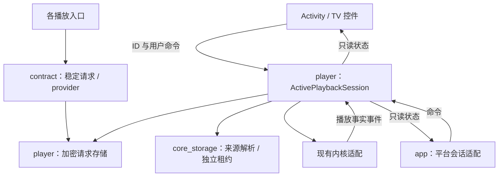

# 播放启动交接与活动会话深化设计

> 日期：2026-07-18  
> 状态核对：2026-10-28
>
> 状态：任务 1–13 与任务 14 的两项自动验证已完成，合计 62/65；余下三项综合验收由用户负责。旧路径已删除，不再处于任务 12 暂停状态。
>
> 范围：播放请求提交、来源恢复、播放器路由、前台切换、进程恢复与敏感临时数据  
> 不包含：全部内核切换算法重写、完整后台 MediaSession 服务、Bilibili 账号会话重构、存储浏览页面重构  
> 前置依赖：`2026-07-19-playback-transport-leases-design.md`

> 文档职责：保留选定的设计约束、职责边界及其形成原因。实施进度、测试证据和未完成验收以[播放交接与活动会话实施计划](../plans/2026-10-27-playback-handoff-session.md)为准；示例类型与迁移步骤不作为再次实施旧路径的指令。

> 修订依据：[播放重构方案与参考项目源码复核](../../../document/architecture/2026-10-27-playback-refactor-reference-review.md)。本版将请求/恢复策略归入 player，明确唯一状态写入者及旧职责迁移表，统一释放树，取消自动下一集候选的磁盘持久化。用户已确认的主动切换失败策略保持不变。

## 1. 重构前背景

本节描述重构前的缺陷与旧调用链；`VideoSourceManager`、`Media3LaunchParams` 和二段拦截路由已在实施中删除，不能用本节判断当前源码状态。当时所有播放入口通过 `VideoSourceManager` 交接一个进程内 `BaseVideoSource`。部分入口还会单独写入 `Media3LaunchParams`：

```text
feature ViewModel
  -> 构建 BaseVideoSource
  -> setSource(source)
  -> attachMedia3LaunchParams(params)
  -> 发送无内容导航事件
  -> PlayerInterceptorActivity
  -> PlayerActivity
  -> getSource()
  -> consumeMedia3LaunchParams()
```

该 Interface 暴露了调用顺序、全局状态和 Activity 生命周期等实现细节。调用方必须记住：

- 播放源和 Media3 参数必须属于同一次用户操作；
- 所有校验必须在导航前完成；
- 失败时必须清理已经写入的全局状态；
- PlayerActivity 必须在另一个入口覆盖状态前完成读取；
- 进程死亡后 `BaseVideoSource` 无法恢复；
- 投屏、外部 URL 和磁链各自还携带不同的临时信息。

当时的代码存在可复现的状态串线窗口：

1. `StorageFileViewModel` 创建播放源并写入 Media3 参数；
2. 磁链离线校验随后阻止播放；
3. 待消费参数没有清理；
4. `PlayHistoryViewModel` 只覆盖播放源；
5. `PlayerActivity` 将上一笔失败请求的 Media3 参数应用到新播放源。

本设计不以增加一次 `clear()` 为目标，而是重新建立播放请求和活动播放会话的所有权。

2026-07-19 的源码级复核确认：当时 HTTP、SMB、FTP、Thunder 和 Bilibili 播放 Session 使用共享可变资源，在准备候选来源时可能破坏旧播放。因此本设计拆为两个独立子项目：先完成传输资源租约，再实施播放请求与活动会话。本文只描述后者，且要求所有 `PreparedPlayback` 已获得独立、可释放的 `PlaybackTransportLease`。

2026-10-27 用户确认内部切源采用“统一会话与资源归属、保留底层切换流程”，并确认主动切换激活前持久化失败必须阻止切换；随后授权 agent 自行决策，并要求参考成熟项目调整方案。本版以降低维护成本为目标：新增会话必须替换旧状态写入口，新增资源对象必须明确替换谁的释放责任。

## 2. 设计目标

### 2.1 功能目标

1. 一次播放请求必须原子包含来源身份、启动选项和敏感临时数据。
2. feature 不再构建或持有可跨页面传递的 `BaseVideoSource`。
3. 待消费请求采用 latest-wins；新请求替换旧请求并清理旧临时资源。
4. 播放器消费请求后，运行时所有权转移到活动播放会话。
5. PlayerActivity 被系统恢复时，可以按稳定描述重建来源并续播。
6. 用户正常冷启动应用时仍进入首页，不自动恢复陈旧播放会话。
7. 播放器前台收到新请求时复用当前 PlayerActivity，不增加播放器返回栈。
8. 主动切换时，新来源解析、校验或激活前持久化失败保留旧播放；原生自动切换按第 12.2 节在真实事件后保存。
9. URL Header、Cookie、投屏 Header 等敏感数据不以明文进入 Intent、SavedState、MMKV 或日志。
10. 删除透明的 `PlayerInterceptorActivity` 和旧 `VideoSourceManager`。
11. 所有跨身份内部切源必须更新活动描述、租约和会话快照。
12. 同身份画质或 URL 恢复必须替换自己的传输/Bilibili token，不能覆盖全局当前资源。

### 2.2 架构目标

- 在 `player_component` 内集中请求、恢复和会话业务；不新增 Gradle 模块。
- `ActivePlaybackSession` 是当前来源、代次、候选与队列位置的唯一业务写入者；页面、顺序播放和平台会话使用命令/事件与只读状态。
- `core_storage_component` 提供来源解析与租约；协议适配有真实差异，但不承担请求调度和播放恢复策略。
- 调用方与测试经过同一生产装配入口；每条迁移同时删除原写入口或将其改为只读适配。
- 保持现有 Gradle Module 依赖方向，不增加 feature 之间的直接依赖。

## 3. 非目标

本次不同时解决以下问题：

- 不立即实现完整后台 MediaSession 服务或远端网关；当前本地播放状态和能力的写入权必须在本次收敛；
- 不重写 `PlayerActivity.applyPlaySource()` 的全部 source transition 生命周期；
- 不拆分 `PlayerInitializer`；
- 不拆分 `MediaLibraryEntity` 数据库结构；
- 不实现“桌面冷启动自动继续播放”；
- 不实现多笔播放请求排队；
- 不把完整 `BaseVideoSource`、`StorageFile` 或 `MediaLibraryEntity` 序列化；
- 不新增跨 feature 的 Gradle 依赖；
- 不改变 TV DPAD focus 架构和播放器控制条交互。
- 不保证旧画面持续到新来源首帧；切换边界是 `PreparedPlayback` 与传输租约全部就绪。

## 4. 备选方案与决策

### 4.1 方案 A：修补现有全局单例

做法：增加 `clear()`，调整 `StorageFileViewModel` 的校验顺序，并在每个入口覆盖 Media3 参数。

优点：改动最小。

缺点：

- 仍然依赖进程内 `BaseVideoSource`；
- 仍然不能恢复进程死亡；
- 所有入口仍需了解清理和写入顺序；
- 后续新增播放参数会再次扩大串线风险；
- `PlayerInterceptorActivity` 和无内容导航事件仍然存在。

结论：拒绝。它保留了每个入口分别维护状态与清理顺序的负担。

### 4.2 方案 B：原子进程内请求对象

做法：把 `BaseVideoSource` 和 `Media3LaunchParams` 合并成一个进程内请求对象，一次提交、一次消费。

优点：

- 能消除参数分离导致的串线；
- 改动范围低于完整恢复设计。

缺点：

- 请求仍不能跨进程恢复；
- feature 仍负责构建运行时来源；
- 投屏、外部 URL 和媒体库恢复仍需旁路；
- 后续要支持恢复时仍需第二次迁移。

结论：拒绝。可作为临时过渡，但不符合已确认的根治目标。

### 4.3 方案 C：稳定播放描述 + 待消费请求 + 活动播放会话

做法：feature 通过 contract 提交稳定播放描述；player 内部的请求存储加密持久化；Activity 只转交 ID，由活动会话编排来源解析、恢复和替换。

优点：

- 原子解决播放源、Media3 参数和敏感数据的归属；
- 支持进程恢复；
- feature 不再了解来源构建顺序；
- 可以通过请求 ID 和会话 ID建立明确状态机；
- 为投屏、Bilibili、磁链和外部 URL 提供统一入口。

缺点：

- 需要为不同来源建立稳定引用和解析 Adapter；
- 需要迁移全部播放入口；
- 需要新增加密临时存储与恢复测试。

结论：采用。将入口交接、队列变化与恢复规则集中在 player，并以删除旧写入口作为完成条件，不改变 Gradle 模块边界。

### 4.4 参考架构的选择与本地适配

| 参考源码 | 采用的职责划分 | 本项目适配 |
| --- | --- | --- |
| [Next Player PlayerService](https://github.com/anilbeesetti/nextplayer/blob/main/feature/player/src/main/java/dev/anilbeesetti/nextplayer/feature/player/service/PlayerService.kt) | 播放运行时拥有状态，页面展示并发出命令 | 先抽离现有 Activity 中的业务所有权，保留多内核；不为模仿 service 结构立即迁移所有内核生命周期 |
| [VLC PlaylistManager](https://github.com/videolan/vlc-android/blob/master/application/vlc-android/src/org/videolan/vlc/media/PlaylistManager.kt) | 队列变化和位置保存围绕同一播放运行时 | 将已有顺序播放算法变为会话的内部协作者，不另设全局队列管理器 |
| [Jellyfin TV PlaybackManager](https://github.com/jellyfin/jellyfin-androidtv/blob/master/app/src/main/java/org/jellyfin/androidtv/ui/playback/PlaybackManager.kt) | 媒体身份/选项解析为可播放结果 | 保留独立准备结果，但不照搬其先停止旧转码的顺序，满足准备失败旧播放继续 |
| [Media3 恢复示例](https://github.com/androidx/media/blob/release/demos/session_service/src/main/java/androidx/media3/demo/session/DemoMediaLibrarySessionCallback.kt) | 按媒体身份、索引和位置重建播放 | 增加本项目必需的加密、租约和多协议解析；平台 API 不承担业务状态存储 |

源码核对日期为 2026-10-27，详细适用限制见复核报告。参考 `E:/Project/PiliPlus/lib/plugin/pl_player/playback_source.dart` 的纯来源选择，以及 `lib/pages/video/controller.dart` 的播放器调用关系；协议选择映射到 `bilibili_component`，来源/租约映射到 core_storage，会话归 player。保留 TV 和多内核约束，不复制 Flutter/GetX UI 或单例。

不采用“旧 manager 不动、外面再包一层会话”的方案，也不采用一次性重写所有内核/全量迁入 service 的方案。前者增加同步点，后者扩大验证面；本版先收回状态写入权，再沿现有内核适配执行。

## 5. 领域术语

### 5.1 播放描述（Playback Descriptor）

描述“用户要播放什么”的稳定、可持久化数据。它不包含 `BaseVideoSource`、`Storage`、`StorageFile`、Activity 或 Repository 实例。

### 5.2 播放请求（Playback Request）

一次尚未被播放器激活的用户操作。包含请求 ID、播放描述、Media3 启动选项、来源入口、创建时间和过期时间。

### 5.3 待消费请求（Pending Request）

当前最新的一笔播放请求。系统只保存一笔；新请求原子替换旧请求。

### 5.4 已准备播放（Prepared Playback）

播放描述成功解析后的运行时结果。包含 `BaseVideoSource`、Media3 启动参数、稳定描述、释放动作和可用于恢复的初始进度。

### 5.5 活动播放会话（Active Playback Session）

播放器已接受的一次播放会话。由 player 模块拥有运行时状态，由加密会话快照提供进程恢复数据。主动切换以恢复记录成功保存为逻辑激活点，随后应用到内核；逻辑激活不代表首帧成功。

### 5.6 播放会话快照（Playback Session Snapshot）

活动播放会话最后成功提交的可恢复目标。包含会话 ID、来源代次、稳定播放描述、Media3 启动选项、最近播放位置、更新时间和过期时间，不包含播放器内核、Surface 或 Controller 对象。主动切换提交后、内核尚未完成应用时，快照已指向新目标。

### 5.7 播放传输租约（Playback Transport Lease）

已准备播放对本地代理、SMB/FTP 播放服务器、迅雷任务、Bilibili 播放会话等传输资源的独占引用。候选来源必须持有自己的租约；释放旧候选不能删除新候选资源，准备新来源也不能改写旧来源正在使用的传输状态。

## 6. Module 与职责

以下是现有模块内的职责分配，名称为待实施的逻辑契约，不代表再增加一套通用框架。

### 6.1 `core_contract_component`：稳定数据和入口契约

- 定义 `PlaybackDescriptor`、`PlaybackRequestInput`、`PlaybackLaunchOptions`、请求提交结果和必要的只读会话视图；不暴露 Storage、内核或 Activity。
- 定义 `PlaybackRequestService : IProvider`，提供 `submit(input)` 与验证结果提交；不向 feature 暴露 store 的读写方法。
- `PlaybackLaunchOptions` 从当前 `Media3LaunchParams` 移入 contract，保留 `mediaId`、`sourceType`、`requestedCapabilities`、`autoplay` 字段语义。仅依赖已有 data 类型；迁完调用方后删除旧定义，避免 contract 反向依赖 core_storage。
- 沿用 ARouter provider/路由装配方式，provider 实现在 player，app 组合；feature 只依赖 contract，不新增 feature→player 编译依赖。

### 6.2 `core_storage_component`：引用生成、来源解析和租约

- 引用生成器从借用的文件/媒体库输入同步提取稳定身份与队列描述，不缓存浏览 Storage；协议引用只由对应适配器解释。
- 按稳定描述查询媒体库、历史、凭据和协议状态，解析独立播放文件，调用租约 factory，并准备字幕/弹幕所需元数据。
- 返回可释放来源及解析后的身份/队列数据。`PreparedPlayback` 由 player 在该结果上装配启动选项与初始进度；core_storage 不引用 player 类型。
- 协议校验与错误分类留在此层；是否接受新请求、是否恢复、如何更新快照由 player 决定。
- SMB/FTP 的播放连接和浏览连接完全分开；其他协议按租约设计隔离代理上下文、task、session token。

媒体库、历史、磁链、外部 URL、投屏有实际不同的恢复方法，使用小型解析适配器即可，不建立动态插件注册平台。Bilibili 的协议身份、取流、画质选择和验证数据仍由 `bilibili_component` 解释。

解析器不修改活动会话，不接收 Activity；取消前已创建而未交出的资源由准备作用域清理，成功返回后由接收方拥有。晚返回的结果由会话识别并释放。

### 6.3 `player_component`：请求存储与唯一活动会话

`PlaybackRequestService` 的实现与 `PlaybackHandoffStore` 为进程内共享实例，位于 player；只保存稳定数据，不持有 Activity/内核。store 统一提供提交 pending、按预期状态提交快照、按 ID 清理等原子操作，隐藏 MMKV、加密、TTL 和 Mutex。它是持久状态的唯一写入口；入口提交 pending 并不赋予其修改运行时来源的权力。

`ActivePlaybackSession` 是单次播放器生命周期内唯一的业务状态写入者，负责：

- 消费 ID、准备与恢复、latest-wins、当前身份/来源代次、队列位置和至多一个候选；
- 持有活动/候选 `PreparedPlayback`，提交或取消所有权转移；
- 串行处理用户命令、内核事实事件和解析完成事件，决定何时调用现有内核适配、保存快照或释放来源；
- 发布一个不可由外部修改的状态视图，包含实际来源、已提交恢复目标、应用中/保存失败等必要状态；
- 在显式退出时失效代次、停止任务、脱离内核并释放资源。

来源解析和存储 I/O 在工作线程执行，携带期望代次返回；实际来源、候选与内核命令在播放器线程串行修改。不得用多套独立 Mutex 掩盖多个业务写入者。

运行时代次与最后成功持久化的代次必须分开：原生切换保存失败时前者可以领先。新主动切换不能要求两者相等才允许提交；它校验当前运行时代次及 pending ID，在同一 store 顺序上覆盖旧恢复目标。旧进度/补写任务按运行时代次失效，不能因为磁盘尚旧而误获提交资格。

### 6.4 页面、生命周期与 app 宿主

`PlayerViewModel` 保留当前会话实例跨配置变化，不另存可独立修改的来源/会话副本。`PlayerActivity` 只转交 Intent/SavedState ID、绑定状态、管理 Surface/TV 焦点与返回、展示加载和错误。现有内核操作先作为受会话驱动的适配逻辑保留，不能在 UI 回调里另行选源或关闭连接。

- 配置变化：解绑旧页面/Surface 及页面绑定的内核适配，清除捕获旧 Activity 的回调，保留业务会话；若旧内核必须销毁，由会话先脱离再用其当前运行状态重建，不把 `onDestroy()` 当成退出。
- 显式退出：会话执行唯一结束路径；完成后 ViewModel 清理只做幂等兜底。
- 进程恢复：没有旧运行时对象，按第 9.4 节重建；进程内可用状态与磁盘恢复记录不得混用优先级。
- app 的 `Media3SessionService` 当前仅为元数据桥。本次改为消费会话投影、转发命令，不在其中创建另一份活动会话。
- 完整后台播放 service 所有权迁移另行实施；届时 service 持有同一个会话、页面只绑定。本次保持既有后台/PIP 行为，不以架构调整静默裁剪功能。



### 6.5 旧职责迁移与删除清单

| 当前位置 | 修订后的职责 | 必须移除的写入权 |
| --- | --- | --- |
| `VideoSourceManager` | 由稳定请求/provider 完全替代 | 来源槽位及分离的 attach/consume，最终删除类 |
| `PlayerActivity.videoSource`、`applyPlaySource()` | 从会话读来源；保留必要内核/UI 适配 | 独立赋值来源、构造请求参数、提前释放 Addon |
| `applySequentialPlaybackTransition()` | 展示会话已经接管的新来源 | 再次修改全局来源、另启会话和重复提交快照 |
| `SequentialPlaybackCoordinator` | 会话内部的预加载决策与 backend 协作者 | 不再拥有活动来源/候选；token 从会话代次派生，不另增业务代次 |
| `StorageVideoSource.indexSource()` | 迁移期兼容；最终由稳定队列身份交给会话解析 | 直接构造并激活下一来源、依赖浏览文件对象存活 |
| `PlayerViewModel.prepareMedia3Session()` | 观察本地会话，派生 UI 能力 | 自建 activeSessionId、依赖远端 createSession 驱动本地状态 |
| `Media3SessionStore` | 若仍有跨模块读者则短期保留只读兼容投影；读者迁完删除 | 公共 update/clear 及独立可写 session/capability |
| `Media3SessionService` | 接收同一版本的状态投影并回传命令 | 独立决定播放身份或能力，不能按缓存重建第二套状态 |
| Bilibili Addon | token 绑定的设置/恢复适配；返回候选解析意图或结果 | 按 identity 取最新 session、直接覆盖当前 transport、独立删除 session token |

所有投影一次发布完整的 `(sessionId, sourceRevision, source, capabilities)` 视图，避免分别更新 session/capability 产生短暂错配。跨模块的 source 仅含稳定身份和必要展示数据，不含 BaseVideoSource、凭据或 Header。退出发布空状态；旧代次的能力或元数据回调不得更新新投影。

### 6.6 本地能力、平台会话与禁用网关

`Media3Repository` 中禁用的远端网关不再参与本地播放会话创建、进度、恢复或能力判断。可用能力来自当前内核及已实际实现的本地能力；不能仅凭启动参数中的请求就宣称支持。

迁移 `Media3SessionController`、ViewModel、store 与 service 的调用方后，删除失去使用者的网关会话缓存/转发路径。下载校验保留现有本地兼容行为，协议前置检查由 core_storage 执行；不恢复远端接口。并非删除所有名称含 Media3 的类型：实际内核、平台契约和其他有效调用保留。

## 7. 数据设计

### 7.1 播放请求信封

逻辑字段如下：

```text
PlaybackRequest
  schemaVersion: Int
  requestId: String
  descriptor: PlaybackDescriptor
  launchOptions: PlaybackLaunchOptions?
  origin: PlaybackRequestOrigin
  createdAtMs: Long
  expiresAtMs: Long
```

`origin` 只用于日志、统计和错误展示，枚举包括：

- STORAGE_FILE
- PLAY_HISTORY
- ANIME_EPISODE
- EXTERNAL_INTENT
- SCREENCAST

请求 ID 使用不可预测的随机 UUID。路由仅传请求 ID。

请求和活动快照使用 Moshi 序列化。`schemaVersion` 初始值为 1；由于 pending TTL 为 15 分钟、活动快照 TTL 为 24 小时，不为临时记录设计长期迁移链。遇到不支持的版本时清理记录并返回 `InvalidDescriptor`。

活动会话快照逻辑字段如下：

```text
PlaybackSessionSnapshot
  schemaVersion: Int
  sessionId: String
  sourceRevision: Long
  lastCommittedRequestId: String
  descriptor: PlaybackDescriptor
  launchOptions: PlaybackLaunchOptions?
  queueContext: PlaybackQueueContext?
  positionMs: Long
  updatedAtMs: Long
  expiresAtMs: Long
```

快照必须保存激活时的 Media3 启动选项。否则 pending 请求在激活后删除，进程恢复会丢失 `mediaId`、`sourceType`、能力请求和 autoplay 语义。

`sessionId` 使用本次播放器会话首次接收的 request ID，在前台替换、内部切源和系统重建时保持稳定，显式退出后结束。`sourceRevision` 在每次来源或传输所有权更新时递增，用于拒绝旧回调；只写播放进度时不递增。`lastCommittedRequestId` 记录最近成功激活的外部请求，内部切源保留该值，用于识别重复路由及系统恢复时已消费的 Intent。

### 7.2 播放描述分类

#### 媒体库文件描述

```text
StoredLibraryFileDescriptor
  libraryId
  mediaType
  uniqueKey
  storagePath
  filePathHint
  displayTitle?
  playHistoryId?
  protocolReference?
  queueContext?
```

`protocolReference` 由 `core_storage_component` 内部的引用 Adapter 生成和解析，feature 不解释其内容。

#### 播放历史描述

```text
PlayHistoryDescriptor
  historyId
  expectedLibraryId?
  expectedUniqueKey
```

恢复时必须重新查询数据库实体，不持久化整条 `PlayHistoryEntity` 快照。

#### 磁链描述

```text
TorrentDescriptor
  magnetOrTorrentIdentity
  fileIndex
  downloadId
  expectedUniqueKey
```

磁链初始化、torrent 文件恢复和下载兼容校验都在解析期间完成。

#### 外部 URL 描述

```text
ExternalUriDescriptor
  uri
  displayTitle?
  headers?
  sourceType
```

Header/Cookie 等敏感字段直接放入整体加密的请求正文，不再增加第二套 secret payload 存储；日志不得输出完整 URI query 或 Header。

#### 投屏描述

```text
ScreencastDescriptor
  senderAddress
  port
  relatedVideos
  playUniqueKey
  httpHeaders?
```

当前 `ScreencastData.ip` 使用 `@IgnoredOnParcel`，新描述必须把发送端地址作为正式恢复字段。

### 7.3 队列上下文

当前 `StorageVideoSourceFactory` 从 `storage.directoryFiles` 构建同目录视频队列。该字段属于 UI 浏览状态，不能作为恢复事实源。

播放描述可选保存：

- 目录稳定身份；
- 当前排序选项；
- 当前隐藏文件过滤策略；
- 当前选中项身份；
- 有界的文件身份快照。

解析优先重新加载目录并应用相同排序/过滤。协议不支持稳定目录恢复时，可使用有界身份快照。身份快照最多保存 200 项，始终包含当前项，并围绕当前项截取前后窗口。快照只保存身份，不保存 `StorageFile` 对象或短期播放 URL。

进入播放时固定这份队列描述，后续浏览页切换目录/排序不改变活动队列。解析层负责列出身份，player 决定队列位置与下一项；内部切源重新解析选中身份，不能复用已经释放的 StorageFile。兼容期的文件对象列表只作为提取身份的输入，须在生产入口迁完后删除。

## 8. 持久化与安全

### 8.1 存储 Adapter

在 player 内部使用独立 MMKV 文件保存一个完整加密的 `PlaybackHandoffState` blob，只包含 pending 请求、验证状态和活动会话快照。所有更新经 `PlaybackHandoffStore` 在进程内 Mutex 中执行 read-modify-write，并通过单个 MMKV value 替换，避免多 key 部分更新。MMKV 不提供 ACID transaction，因此只承诺单进程串行更新和单值替换。

取消旧草案的磁盘 `queuedCandidate`。下一集候选的父代次、候选 ID、来源与租约仅由活动会话在内存持有；进程恢复不推断尚未提交的候选。原生切换后保存失败的重试也只保留最新运行状态，不新增持久化任务日志，详见第 12.2 节。

整个 state 正文使用 `KeystoreAesGcmCrypto` 加密，不只加密已知敏感字段，以避免未来新增字段被遗漏。

使用独立 KeyStore alias：

```text
dandanplay.playback.handoff.aes
```

不得复用开发者凭据或媒体库凭据 alias。

API < 23 的 RSA 包装密钥也使用独立 alias `dandanplay.playback.handoff.rsa`，通过现有 `KeystoreAesGcmCrypto` 构造参数传入。

### 8.2 安全约束

- Release 不允许明文 fallback；
- 请求或激活前恢复记录加密失败，一律拒绝本次提交或切换；
- 解密失败则删除记录并返回结构化错误；
- Intent 和 SavedState 只包含请求 ID或会话 ID；
- 日志只记录 ID、来源枚举、MediaType 和脱敏指纹；
- 不记录 Header、Cookie、完整 URL query、磁链或本地完整路径；
- 记录被替换、激活、失败或过期后立即删除不再需要的密文。

此处“删除”指逻辑记录删除。MMKV mmap 文件不保证旧页面在物理介质上立即安全擦除；安全性依赖整体 AES-GCM 加密和 KeyStore 密钥保护，文档与日志不得宣称物理 secure erase。

### 8.3 TTL

- 待消费请求 TTL：创建后固定 15 分钟，读取、解析和交互验证不延期；解析完成及验证成功后仍需再次检查过期时间；
- 活动会话快照 TTL：最后一次成功保存后 24 小时；保存失败不刷新过期时间；
- 显式退出播放器立即删除活动会话快照；
- 普通冷启动不读取活动快照；只有系统恢复且 SavedState/Intent 携带会话 ID 时才能恢复；
- 应用启动时可异步清理过期记录，不阻塞首帧。

TTL 作为内部常量，不增加用户设置。

### 8.4 进度快照写入

- 正常播放时每 5 秒采集并保存一次当前进度；暂停、seek 完成及进入后台时立即尝试保存。来源激活和变化按第 9.2 节或第 12.2 节提交，不等待周期任务。
- 在播放器线程采集实际位置及 `(sessionId, sourceRevision)`，加密和存储在工作线程执行。存储前复核会话与代次；旧来源的迟到采样不能覆盖新快照，也不能覆盖更新的 pending 请求。
- 只保留最新的待写采样，串行、合并写入。周期写入使用可注入的单调时钟调度；持久化时间及 TTL 使用可注入的墙上时钟。`updatedAtMs` 和 `expiresAtMs` 仅在写入成功后更新。
- 常规进度保存失败不打断已开始的播放，保留上一份成功快照；下一周期或生命周期触发点重试最新状态，不循环忙重试，不写明文。每段连续失败只提示一次“播放恢复信息暂未保存”，成功后重置提示状态。
- 5 秒是正常存储条件下的采样间隔，不承诺进程回收时最多只丢失 5 秒进度。系统重建只使用最后成功保存的状态。
- 显式退出先停止周期任务并使所有旧代次失效，按第 12 节清退内存候选，再按会话 ID 删除快照，保留更新的 pending 请求。清理失败仍结束播放并清除本 Activity 的恢复引用，记录脱敏错误，由过期清理处理残留；不得声称删除已成功。

## 9. 状态机与并发规则

### 9.1 待消费请求

```text
Created
  -> Pending
  -> Replaced | Expired | Resolving

Resolving
  -> Prepared
  -> AwaitingInteractiveVerification
  -> Failed
  -> Superseded

AwaitingInteractiveVerification
  -> Resolving
  -> Replaced
  -> Expired
  -> Failed

Prepared
  -> Active
  -> Failed
  -> Superseded
```

规则：

1. `submit()` 在同一个 Mutex 临界区内通过单加密 blob 替换当前 pending 请求；
2. 替换后立即清理旧请求的密文和临时资源引用；
3. Activity 只转交 ID，由会话加载请求且不立即删除记录；
4. 解析完成后，在提交临界区内再次检查当前 pending request ID 和 TTL；
5. ID 不匹配说明请求已被更新请求取代，必须释放解析结果；
6. 以成功写入新活动快照并删除对应 pending/验证状态的单值替换为逻辑激活点，之后才调用底层切换；
7. 失败时删除对应 pending 请求；
8. 重复路由同一 request ID 不得重复激活；
9. 交互验证不是普通失败；请求进入 `AwaitingInteractiveVerification` 并保留加密 descriptor；
10. 验证成功后重试同一 request ID；取消、替换或过期后才删除请求和验证数据。

### 9.2 前台替换

PlayerActivity 已有活动播放时收到新请求：

```text
Active(old)
  -> Resolve(new), old continues playing
  -> Prepared(new)
  -> Verify request generation
  -> Commit snapshot(new) and consume matching pending
  -> Apply(new) through existing source transition
  -> Release(old) after backend detachment
```

如果新来源在逻辑提交前失败或被更新请求取代：

```text
Active(old)
  -> Resolve(new) failed/superseded
  -> Release prepared new resources if any
  -> Keep Active(old)
```

“准备成功”在本设计中指：

- 稳定描述可解析；
- 媒体库和文件仍然存在；
- 凭据可读取；
- 协议可以创建有效播放 URL；
- 磁链兼容校验允许播放；
- 独立 Transport Lease 已成功创建；
- 播放配置和 Media3 启动参数已经生成。

它不保证已经渲染首帧。首帧失败继续使用现有播放器错误恢复机制；完整 source transition 的事务化属于后续深化项。

#### 9.2.1 激活前持久化失败

2026-10-27 用户确认采用方案 A：新来源准备完成后，必须先成功加密并保存本次交接所需的恢复记录，才能启动底层切换。准备成功本身不代表已获准切换。

- 加密或保存失败时，不调用底层切换，不释放旧来源；通过新候选的唯一释放入口清理其来源/租约，返回 `RecoveryStatePersistenceFailed`。
- 已有活动播放时提示失败并继续旧播放；首次播放时提示失败并退出空播放器。
- 不允许通过明文存储或先播放、后补写的方式绕过这一条件。
- 失败请求按 request ID 清理，不得误删旧活动会话或更新请求。若存储故障同时阻止清理，不得宣称持久记录已删除；本轮处理结束并释放候选，不继续激活。
- 单值写入的成功语义沿用第 8.1 节，不额外承诺断电持久性或播放器与 MMKV 之间的跨系统事务。

#### 9.2.2 提交顺序与中断恢复

采用“保存成功即确认新目标”的顺序，不增加一套播放器与存储之间的事务日志：

1. 在临界区外完成候选解析、校验、租约获取和启动参数装配，旧来源继续播放。
2. 活动会话串行处理提交；先按第 12.2 节清退原生候选并核对内核实际来源，防止加密写入期间又发生自主切源。在 store Mutex 内复核 request ID、TTL 与预期活动代次，只消费匹配请求。
3. 在同一个加密 blob 中写入新描述、启动选项、初始进度和递增代次，移除对应 pending/验证状态。加密或写入失败按第 9.2.1 节处理；成功即完成逻辑激活。
4. 在播放器线程调用现有切换流程。已提交候选的应用和所有权接管串行完成；后到请求属于下一笔替换，不再把已提交来源当作可随解析任务取消的候选。
5. 内核停止使用旧来源后才幂等释放其资源。原有提前释放 Addon/来源的调用须迁移到该所有权边界；不等待新来源首帧。

提交前发生进程回收，已提交的活动快照仍指向旧来源；若 Intent 对应的新 pending 仍有效，可以重新准备它，但不能把它当作已经激活。提交成功后，即使新来源尚未应用到内核，会话恢复也以新快照为准。普通冷启动仍不读取快照。启动时若原 Intent 的请求已被消费，只能按第 10.1 节的会话绑定规则恢复，不能任取最新快照。

提交后的内核应用或首帧失败交给现有错误恢复；无法恢复时提示并结束该会话，按会话 ID 及代次清理，迟到的旧错误不能关闭更新来源。此时不承诺旧播放继续或自动回滚。来源解析、加密及持久化等可前置失败必须在提交前完成。

进度回调、内部切源及退出清理都校验会话 ID/来源代次。临界区内只做状态读改写，不等待网络、首帧或资源关闭；资源释放由明确的运行时所有者执行。加密/存储不阻塞播放器线程，但已进入提交的命令不可被解析任务取消。退出与进度写入也进入同一存储顺序，避免退出后迟到写入复活快照。

### 9.3 传输资源隔离

“旧播放继续到新来源完全准备成功”要求候选来源不能复用会被覆盖的全局传输槽位。实施前必须完成最小传输租约改造：

- `HttpPlayServer` 按不可预测 token 路由到独立 upstream，候选准备不得覆盖单一 `upstreamUrl`；
- SMB/FTP 租约拥有独立 Server、Storage/client 和在该连接上重新解析的文件，不能用浏览 Storage 或 `StorageFile.clone()` 代替连接隔离；
- 迅雷准备新 torrent 时不得调用 `stopAllTask()`，新旧任务允许在切换窗口短暂并存；
- Bilibili 播放/直播会话使用 generation token，Addon 只借用自己的 token，最终删除由对应租约执行；
- `PreparedPlayback.release()` 释放自己的租约，不按宽泛 identity 删除“当前最新”资源。

本次同时覆盖外部请求和第 12.1 节列出的内部切源路径，统一播放身份、传输租约及恢复快照的归属。底层停止、准备、应用和错误恢复仍沿用现有 source transition；完整切换状态机及其事务化回滚留到后续深化。

### 9.4 活动会话恢复

PlayerActivity 系统重建时：

1. 按第 10.1 节从 SavedState 或匹配的原 Intent 确定活动会话 ID；
2. 读取并解密有效快照；
3. 重新解析稳定播放描述；
4. 以该快照的 `positionMs` 作为恢复位置，显式覆盖来源工厂可能带入的历史进度；
5. 不用数据库历史的时间或位置覆盖系统恢复快照；
6. 解析成功后恢复活动会话；
7. 解析失败则展示明确错误并退出 PlayerActivity。

正常桌面冷启动不执行以上流程。

选择快照作为唯一恢复进度依据，是因为当前 [PlayHistoryEntity](../../../data_component/src/main/java/com/xyoye/data_component/entity/PlayHistoryEntity.kt) 只有媒体身份、`videoPosition` 和 `playTime`，没有会话 ID/来源代次；[PlayRecorder.recordProgress()](../../../player_component/src/main/java/com/xyoye/player_component/utils/PlayRecorder.kt) 又异步写入历史，写入时间不能证明记录属于当前代次。2026-10-27 已核对这两个源码文件。本次不为合并两套进度而增加数据库迁移；用户主动从历史页播放仍按新请求读取历史。

位置 `0` 是合法进度，不代表缺失；不得使用历史兜底或取两个位置的最大值。负数归零，已知可靠时长时限制在有效范围；直播或不可 seek 的来源按协议默认位置恢复。快照缺失、过期或不可解密时明确失败，不静默改为历史续播。

配置变化时优先复用仍有效的活动会话；确需重建内核时使用该会话最新运行状态和仍有效租约，不能因磁盘补写失败倒退到旧集。仅在运行时不存在的进程恢复路径使用持久快照。`onDestroy()` 本身不等于显式退出，不能删除快照或释放有效会话仍使用的租约。

## 10. 路由与 Activity 行为

### 10.1 路由

保留稳定外部路由语义 `RouteTable.Player.Player`，但直接映射到 `PlayerActivity`。

删除：

- `PlayerInterceptorActivity`；
- `PlayerInterceptorViewModel`；
- `activity_player_interceptor.xml`；
- `RouteTable.Player.PlayerCenter`；
- 二段 ARouter 导航。

路由参数只携带：

```text
requestId=<UUID>
```

新请求优先按自身 ID 查找 pending；同一活动会话重复收到已提交的 ID 时只复用现有会话，不再激活。系统重建时，优先匹配 SavedState 的 session ID；没有该 ID 时，仅允许原 Intent 的 request ID 精确匹配快照的 `sessionId` 或 `lastCommittedRequestId`。这些匹配只用于系统重建路径，不让普通旧请求重放重新打开已消费会话。

系统重建路径以非空 `savedInstanceState` 为入口条件；只有一个旧 Intent ID 不构成恢复资格。没有恢复上下文时，仍可加载有效的新 pending 请求；已消费请求则返回 `RequestMissing`。同进程配置变化存在有效会话所有者时优先复用。

SavedState 和 Activity 的恢复 Intent 保留稳定 session ID，内部切源不更换该 ID。找不到匹配记录时返回结构化失败，不按“当前最新快照”猜测。`onNewIntent()` 的有效新请求仍按最新请求规则处理，不能被旧 SavedState 抢先恢复覆盖。

系统重建同时存在有效新 pending 和匹配旧快照时，先按新请求重新准备；它在提交前失败后，再尝试恢复匹配的旧会话，不能误删旧快照。只有新请求、没有旧会话时，失败才退出空播放器。

### 10.2 Activity 实例

PlayerActivity 使用 `android:launchMode="singleTask"`，确保 task 内已有播放器时接收 `onNewIntent()`，而不是压入第二个播放器页面。该选择会移除 PlayerActivity 之上的临时页面，因此任何必须保留的播放器内交互应使用现有 overlay/dialog，而不是在播放器上方长期堆叠 Activity。实施时需用仪器测试验证：

- 从文件列表首次进入播放器；
- 播放器前台收到投屏请求；
- 播放器后台时从通知或外部 Intent 再次进入；
- BACK 返回不会出现旧播放器页面；
- TV 控制条和焦点恢复不受影响。

### 10.3 初始与替换加载

- 没有活动来源：显示全屏准备状态；失败后展示错误并退出；
- 已有活动来源：准备及提交前保持播放，只显示非阻断替换提示；提交前失败继续旧播放，提交后错误按第 9.2.2 节处理；
- 新请求到达时取消旧解析协程，但仍依赖 request ID 代次检查防止不可取消操作晚返回。

## 11. 错误模型

来源解析返回结构化失败，不向 UI 泄漏协议异常字符串：

```text
PlaybackPreparationFailure
  RequestMissing
  RequestExpired
  RequestSuperseded
  SessionSnapshotMissing
  SensitivePayloadUnavailable
  RecoveryStatePersistenceFailed
  LibraryMissing
  FileMissing
  PermissionDenied
  CredentialUnavailable
  OfflineValidationBlocked(reason)
  AuthenticationRequired
  InteractiveVerificationRequired(payload)
  NetworkUnavailable
  UnsupportedSource
  InvalidDescriptor
  Unknown(causeFingerprint)
```

UI 根据“初始播放”或“替换播放”选择行为：

- 初始播放失败：错误对话框 + 退出；
- 替换请求在提交前失败：提示 + 保留旧播放；提交后内核失败进入现有错误恢复；
- 需要风控验证：请求进入 `AwaitingInteractiveVerification`，验证页只接收不透明 `verificationId`，成功后重试同一 request ID；
- 失败信息不得依赖正则解析错误文案。

Bilibili `v_voucher` 必须由 Bilibili 层结构化提供，不能进入异常文案或 Intent。验证 payload 与 requestId 一起保存在整体加密记录中。Bilibili 播放 Session 必须使用身份 + sessionToken 的代次所有权；Addon 停止自身任务，租约删除自己拥有的 token。

## 12. 资源所有权

复用前置租约项目建立的来源释放入口，避免在交接项目再创建第二个 lease 所有者。对存储来源采用下面的释放树：

```text
ActivePlaybackSession（决定何时退役来源）
  -> PreparedPlayback.release()
    -> StorageVideoSource.releasePlaybackResources()
      -> Addon.onRelease()：停止自身协程/监听，不删除 transport token
      -> PlaybackTransportLease.release()
        -> 独占的 Server / StorageFile / Storage / task / session token
```

`PreparedPlayback` 拥有来源并把释放委托给它，不另持一个可独立释放的同一 lease。其他来源使用同一来源释放约定，底层资源只出现一次；内核和 UI 对来源均为借用，不拥有关闭权。具体 Server/流的关闭顺序由租约设计规定。

释放时机：

- 请求被 latest-wins 替换；
- 解析结果晚返回且 request ID 已过期；
- 新来源准备失败；
- 活动会话切到其他身份；
- PlayerActivity 显式退出；
- 进程恢复后旧运行时对象自然不存在，只恢复稳定描述。

只在内核确认不再使用该来源后退役。来源总释放入口与 lease 释放均幂等；Addon 清理失败不能阻止 lease 清理，各底层步骤失败记录脱敏信息并继续。禁止 PreparedPlayback、Activity 或 Addon 再直接 `close()` 已归租约所有的 Storage/File。

准备作用域先拥有尚未交出的资源；租约形成即接管其底层资源，来源形成即接管租约，PreparedPlayback 形成再接管来源。每次转移后旧作用域解除清理责任；转移前异常/取消清理本地资源，转移后异常只释放子所有者。取消异常在清理后继续传播，不吞成普通空来源。

### 12.1 内部切源所有权

2026-10-27 用户确认采用方案 A：本次统一会话与资源归属，保留现有底层切换流程。完成标准包含以下全部内部路径的接入；完整 source transition 重构不属于本次范围。

所有播放器内部来源变化必须接入活动播放会话：

- 手动下一集和传统自动下一集：按新身份生成稳定描述、PreparedPlayback 和租约，先提交快照再调用底层切换；不得在候选准备期间提前暂停旧来源；
- Media3 seamless transition：按第 12.2 节登记内存候选并入队，收到真实切换回调后接管新来源并提交活动快照；
- Bilibili 画质/编码切换和 URL 恢复：Addon 输出受 token 约束的准备意图/结果，由会话经 resolver 创建独立候选；身份保持不变，提交后替换 transport/sessionToken，不能在准备阶段修改活动 session；
- 播放内核回退：复用当前租约，只更新运行时 playback profile，不误改全局设置。

任何内部切源不得继续通过 `VideoSourceManager` 或裸 `StorageVideoSourceFactory.create()` 绕过活动会话。

### 12.2 Media3 自动切换的保存边界

2026-10-28 核对 [SequentialPlaybackCoordinator](../../../player_component/src/main/java/com/xyoye/player_component/sequential/SequentialPlaybackCoordinator.kt)、[Media3SequentialPlaybackAdapter](../../../player_component/src/main/java/com/xyoye/player_component/sequential/Media3SequentialPlaybackAdapter.kt)、[ActivePlaybackSession](../../../player_component/src/main/java/com/xyoye/player_component/playback/session/ActivePlaybackSession.kt) 和 [PlayerActivity 的 playbackBackend](../../../player_component/src/main/java/com/xyoye/player_component/ui/activities/player/PlayerActivity.kt)：下一来源入队后由内核自主切换，`onMediaItemTransition` 是切换后通知。Coordinator 仅决定预加载时机；会话通过 `nativeTransition()` 接管实际来源，Activity 的 `adoptNative()` 同步内核与页面。不能把回调后的保存失败描述为“尚未切换，旧播放继续”。

1. 会话经 resolver 准备候选并持有独立来源/租约；登记父 `sourceRevision`、候选 ID 与内核 item ID 后调用 `queueNextSource()`。无需磁盘写入；入队失败确认未被内核采用后释放候选，当前播放继续。
2. 收到匹配候选及父代次的真实切换事件后，会话先接管实际来源并递增代次，随后保存新快照；不重复启动内核、不消费无关 pending。旧来源在 backend 确认脱离后退役。
3. 保存失败继续已开始的新播放，保留当前运行状态及“快照待更新”标记，按第 8.4 节合并重试。每次补写在会话串行路径核对 session/当前代次，只写最新实际状态；后续提交/退出排在同一 store 写入顺序，旧任务不能覆盖更新目标或复活会话。
4. 进程在补写成功前死亡，只能恢复最后成功提交的快照，可能回到上一集；磁盘没有候选可供推断。配置变化保留有效运行时，因此不会因这种保存失败倒退。取消候选磁盘状态并未提供严格无损恢复保证。
5. 新用户请求准备前或显式退出时，由 backend 在播放器线程核对当前 item 并清退尚未采用的排队项。当前 `invalidateSession()` 返回 `DETACHED`、`CURRENT` 或 `STILL_ATTACHED`，会话据此确认是否已移除、已经成为当前项或仍被内核借用。仅确认脱离后才释放候选；已经成为当前项时先接管实际来源再处理新请求，不能仅清空字段就认为内核已脱离。

这取代旧草案的“入队前保存候选”门槛：磁盘保存失败不再阻止原生下一集预加载。用户确认的主动切换保存门槛仍保留；两个路径统一业务所有者，不伪造相同的内核时间顺序。

活动来源之外只保留一个逻辑候选。用户请求优先于下一集预加载；已取消但尚未完成关闭的资源可以短暂存在，必须被跟踪退役，不能用于新播放。以上收敛所有权和 backend 反馈，不重写内核内部的播放算法。

### 12.3 顺序续播的产品边界

以下约束整合自首版 `add-seamless-part-playback` 需求与 delta spec，继续适用于当前会话实现；旧 Coordinator 独立拥有来源、候选和状态同步的设计不再适用。

- 复用已有“自动播放下一项”设置，不新增开关。开启且存在下一项时在当前播放页续播；关闭或到达列表末尾时保持正常完成行为。
- 只使用当前队列顺序中的紧邻下一项，不新增文件名识别、Part 推断、跨目录猜测或重新排序。只准备这一项，避免预先获取整个列表的来源与传输资源。
- Media3（基于 ExoPlayer）可利用原生队列减少切换停顿；网络解析、解码和资源加载仍可能产生停顿，不承诺绝对无缝。VLC/mpv 保留完成后受控切源，不宣称具备等价原生队列能力。
- 下一项的预解析、准备或入队失败不应中断当前播放；完成时仍可经活动会话尝试传统自动下一项。目标仍不可用时正常完成，不播放无关内容。
- 每项均有独立的媒体身份、标题、历史、弹幕、字幕、外挂音轨及会话元数据。切换后恢复目标自身历史与绑定；没有自身绑定时按目标的自动加载规则处理，不继承上一项文件级绑定。播放器全局偏好继续有效。
- 异步准备与切换事件必须核对活动会话／来源代次及候选／队列项身份。手动切换、错误恢复、重建或退出后，旧结果不能覆盖当前来源、页面信息或资源绑定；已被内核采用的候选按第 12.2 节先确认事实再交接资源。

这些是需持续维护的行为约束，不能用源码存在代替集成验收。首版未关闭的四类 Media3 集成场景及 Gradle／TV 主路径验证已移入[播放验证遗留项](../../../document/player/playback-validation-followup.md)；原 15/17 状态没有因整理自动变为完成，当前交接账本的 62/65 也保持不变。

## 13. feature 调用方式

迁移后，各 feature 只执行两步：

1. 通过 contract provider 提交稳定领域输入；
2. 使用返回的 request ID 导航到播放器。

示意流程：

```text
descriptor = playbackReferences.fromStorageFile(file)
input = PlaybackRequestInput(descriptor, launchOptions, origin)
requestId = playbackRequests.submit(input)
openPlayer(requestId)
```

`fromStorageFile()` 由 core_storage 提供，只提取身份和队列描述；不获取租约、不保存运行时对象。provider 通过 contract 获得，实际提交与加密由 player 执行。feature 提交成功后只传 request ID，不能持有跨页面播放状态；引用提取失败留在原页展示错误。

以下 LiveData/Flow 统一改为携带 request ID 的一次性导航结果，由现有页面导航代码消费；ViewModel 不直接启动 Activity：

- `StorageFileViewModel.playLiveData`；
- `PlayHistoryViewModel.playLiveData`；
- `AnimeEpisodeFragmentViewModel.playVideoFlow`；
- `PlayerIntentViewModel.playLiveData`。

不允许继续使用 `Any()` 表达播放请求。

## 14. 迁移顺序

本节保留实施顺序及依赖依据，不是尚未开始的任务清单；已完成项和剩余验收请查实施计划。

### 阶段 1：特征测试与安全基线

- 固定当前 Media3 参数串线复现；
- 固定请求只能消费一次；
- 固定新来源在提交前失败时旧播放继续；
- 验证 Intent/SavedState 不包含敏感字段；
- 验证日志脱敏。

### 前置阶段：传输租约

必须先完成 `2026-07-19-playback-transport-leases-design.md`，验证 HTTP、SMB、FTP、Thunder 和 Bilibili Session 新旧资源可以短暂并存。未完成该前置项目时，不得宣称 replacement 失败能普遍保留旧播放。

### 阶段 2：稳定契约、解析和会话核心

- contract 建立稳定输入/provider 契约，迁移启动选项类型；core_storage 提供引用提取和独立来源解析。
- player 建立 ActivePlaybackSession 与统一来源释放委托；先用内存测试替身验证命令/事件及第 6.5 节写入权迁移，不接通未完成持久化的生产切换。
- player 建立加密 store、固定 TTL、快照提交和 `AwaitingInteractiveVerification`；复用现有加密设施，不把策略放进 core_storage。
- `DownloadValidator` 的协议兼容检查由 core_storage 执行，player 接受结构化结果；保留禁用网关时的本地兼容行为。
- 覆盖媒体库、历史、磁链、外部 URL、投屏和 Bilibili 媒体库文件；PreparedPlayback 只委托来源释放。

先验证租约再接通生产入口。持久化依赖会话的身份/代次模型；生产切换依赖持久化门槛，两者不能拆成各自可写的并行状态机。

### 阶段 3：PlayerActivity 接入

- 直接路由；
- 请求 ID 和会话 ID；
- ViewModel 保留活动会话、Activity 绑定只读状态；
- `onNewIntent()`；
- 系统恢复；
- 新来源准备完成后再调用现有 source transition。

阶段 3 可暂时保留旧入口接收适配，但每次调用立即提取描述并转入同一会话；不得让旧 manager 与新会话各自驱动内核。记录剩余调用清单，禁止新增，全部入口迁完即删除。

### 阶段 4：入口迁移

按以下顺序逐个迁移并验证：

1. `StorageFileViewModel`；
2. `PlayHistoryViewModel`；
3. `AnimeEpisodeFragmentViewModel`；
4. `PlayerIntentViewModel`；
5. `ScreencastReceiveService`。

### 阶段 4.1：内部切源迁移

- 手动/传统下一集；
- Media3 seamless transition；
- Bilibili 画质和 URL 恢复；
- 播放内核回退；
- 主动切换先提交描述、启动选项、队列位置及快照；原生无缝切换按第 12.2 节登记内存候选、真实事件后提交快照；
- 迁移 Coordinator 的来源/候选所有权，扩展原生队列清退反馈，删除 Activity 中独立更新来源及代次的逻辑。

本阶段统一业务状态写入权、租约所有权和快照更新，继续调用现有内核切换算法。

### 阶段 4.2：平台状态投影与网关解耦

- 从同一会话状态派生本地能力、UI 与 app service 元数据，命令回到会话。
- 迁移 `PlayerViewModel.prepareMedia3Session()` 和 `Media3SessionStore` 的写调用，保留只读过渡适配并清点读者。
- 移除本地播放对禁用网关 create/fetch session 的依赖；有其他实际调用的类型保留，替代完成的缓存/转发和过时测试删除。
- 验证无网关成功响应时，播放、设置能力、下载兼容与错误恢复仍按现有产品约束工作。

### 阶段 5：删除旧 Implementation

删除：

- `VideoSourceManager`；
- `PlayerInterceptorActivity`；
- `PlayerInterceptorViewModel`；
- 透明布局；
- `PlayerCenter` 路由；
- feature 中直接调用 `StorageVideoSourceFactory` 的播放入口；
- 分离的 Media3 attach/consume 流程；
- 第 6.5 节被替代的独立状态字段、网关会话转发与失去读者的 store；
- `Any()` 类型播放事件。

## 15. 测试设计

### 15.1 JVM 单元测试

#### 请求 store

- submit 后可按 ID读取；
- 新请求替换旧请求；
- 旧请求密文和临时数据被删除；
- 过期请求不可读取；
- 激活后 pending 被删除；
- 相同请求不能激活两次；
- 加密失败不落明文；
- 解密失败清理记录。
- 固定 15 分钟 TTL 不因读取或验证而续期，提交时再次检查到期；
- 新快照提交与对应 pending 消费使用同一次单值写入，保存失败不返回激活成功；
- 进度写入保留新 pending，迟到的旧代次不能覆盖当前快照；
- 清理写入失败被显式报告，不宣称请求或会话已删除。

#### 来源解析

- 媒体库和文件存在时成功；
- 媒体库已删除；
- 文件已移动或删除；
- 历史记录旧身份回填后恢复；
- 磁链校验阻止时不产生活动来源；
- 外部 URL Header 恢复；
- 投屏发送端地址恢复；
- Bilibili 短期 URL 不进入持久描述；
- Bilibili voucher 结构化传递，错误文案和日志不包含 voucher；
- 解析完成后发现请求已被替换，结果被释放。

#### 活动会话

- 初始请求成功激活；
- 新请求准备期间旧来源继续；
- 新请求在提交前失败保留旧来源；
- 激活前恢复记录加密或保存失败，不调用底层切换，释放候选并保留旧来源；
- 首次播放的恢复记录保存失败，释放候选、提示失败并退出；
- 在提交前、提交后但内核应用前分别模拟进程丢失，已提交快照分别指向旧来源和新来源；未消费 pending 仍须重新准备；
- 提交后发生内核错误，不错误承诺旧播放仍可继续；
- A 慢、B 快时 A 结果不能覆盖 B；
- 候选 B 准备期间活动来源 A 的传输资源不被覆盖或停止；
- 旧 Bilibili 来源退役仅由其租约删除旧 generation，Addon 不再直接删除 token；
- 风控验证成功后重试同一 request ID；
- 快照恢复使用正确播放位置；
- 显式退出删除活动快照；
- 普通冷启动不读取活动快照。
- 手动下一集后恢复到新集；
- seamless transition 的新快照成功保存后恢复到新集；
- 同身份画质/URL 恢复只替换对应 token；
- 内核回退复用当前 transport lease。
- 系统恢复优先使用快照，即使同媒体历史写入更晚、位置更大或快照位置为 0；
- 正常播放每 5 秒保存，暂停、seek 完成及后台切换触发立即采样；
- 常规保存失败不打断播放，重试合并最新状态且只提示一次；
- 退出后的迟到写入不能复活快照，配置重建不误删有效会话；
- Media3 候选入队不写 store；即使存储失败也允许预加载，入队但未切换时进程恢复当前集；
- Media3 切换后保存失败保留当前播放，补写成功前恢复旧快照，补写成功后恢复新集；
- 用户请求与原生切换回调竞争时，实际在播来源的租约不会被当作过期候选释放。
- 同进程配置变化保留真实当前集，即使原生切换后的快照尚未保存；
- 主动提交前清退原生候选，模拟“已经自动切换但回调尚未处理”时先接管事实，再准备新请求；
- 来源/Addon/lease 清理异常相互隔离；取消在每个资源交接点发生时无泄漏和重复关闭；
- UI、service 和跨模块状态读者收到同一会话/代次的完整投影；旧能力回调不覆盖新状态；
- 浏览页改目录/关闭连接不改变正在播放的队列和连接；
- 同身份 Bilibili 画质准备失败不改写活动 session；提交成功再替换 token；
- provider 只接收稳定输入，实际 factory 获取来源，测试不能通过直接构造两个假 lease 代替装配验证。

### 15.2 Robolectric 或 Activity 测试

- `PlayerActivity` 首次接收 request ID；
- `onNewIntent()` 复用同一 Activity；
- SavedState 恢复 session ID；
- 缺失、过期和解密失败的错误行为；
- 返回栈中不残留拦截 Activity 或旧播放器 Activity。
- 原 request ID 已消费后仍能在系统重建路径匹配会话，普通旧请求重放不能触发恢复；
- 新 Intent 的有效请求优先于旧 SavedState，缺失 ID 不读取任意最新快照。
- 系统重建时新 pending 准备失败，仍能恢复匹配旧快照；无旧快照时才退出空播放器。

### 15.3 仪器与 TV 冒烟测试

至少覆盖：

1. 文件列表播放；
2. 播放历史恢复；
3. 动漫本地剧集播放；
4. 外部 URL + Header；
5. 磁链允许和阻止；
6. 投屏到空闲应用；
7. 投屏替换前台播放；
8. 系统回收后恢复 PlayerActivity；
9. 全程 DPAD 进入、加载、失败返回和退出；
10. 返回栈不存在双播放器页面。

## 16. 构建与治理验证

实现阶段至少执行：

```text
./gradlew testDebugUnitTest
./gradlew verifyModuleDependencies
./gradlew lint
./gradlew assembleDebug
```

涉及 Activity 路由和进程恢复后，还应执行：

```text
./gradlew connectedDebugAndroidTest
```

设备必须处于 `device` 状态。所有 Gradle 命令都必须读取输出尾部并明确确认 `BUILD SUCCESSFUL` 或 `BUILD FAILED`。

将现有 `verifyModuleDependencies` 纳入 CI；对第 6.5 节的禁用写入口增加可维护的调用门禁/架构测试，记录兼容白名单并在迁完后清空。已有 `verifyArchitectureGovernance` 可作为聚合入口，避免重复运行同一组检查。设计文档核查不替代以上实现验证。

## 17. 完成标准

满足以下全部条件才视为完成：

- 所有播放入口提交稳定播放描述；
- feature 不再负责构建跨页面 `BaseVideoSource`；
- 播放源和 Media3 参数不可分离提交；
- 同时只有一个 pending 请求；
- latest-wins 和资源清理有自动化测试；
- PlayerActivity 前台接收新请求时不增加返回栈；
- 新来源在逻辑提交前失败时旧播放继续，提交后错误不被宣称可事务回滚；
- 主动切换激活前恢复记录必须成功保存，失败时不得开始切换或降级为明文存储；
- PlayerActivity 系统恢复后可重建来源和续播；
- 正常冷启动不自动进入播放器；
- 恢复目标、位置优先级、固定请求 TTL 和进度写入失败策略均有自动化测试；
- 原生候选只在内存持有，真实切换后保存；恢复限制、队列清退反馈和迟到补写均经过验证；
- 敏感参数不以明文进入 Intent、SavedState、MMKV 或日志；
- `VideoSourceManager` 无生产调用并被删除；
- `PlayerInterceptorActivity`、空 ViewModel 和二段路由被删除；
- 第 6.5 节逐项完成，当前来源/代次/候选只有一个业务写入者，平台状态只有投影；
- 请求/快照策略归 player，协议解析归 core_storage，无新增 Gradle 模块或反向依赖；
- 每份底层资源只有一个关闭所有者，PreparedPlayback 不重复关闭来源已拥有的 lease；
- 本地播放和能力不依赖禁用的远端网关；新增协议无需增加 Activity 选源分支；
- TV DPAD 主路径可达、可见、可返回；
- 单元测试、依赖治理、lint 和 Debug 构建全部明确成功。

## 18. 后续深化关系

本设计完成后，为以下架构工作建立前置条件：

- 深化内核切换算法和提交后错误恢复，不重新引入第二个业务状态所有者；
- 实现完整 Android MediaSession/后台服务托管，并由服务接管同一个运行时；
- 将弹幕异步操作绑定活动播放身份；
- 分离投屏传输与 UI 请求生命周期；
- 收口 `PlayerInitializer` 中的 source-scoped 状态；
- 让存储浏览路由拥有独立目录和队列状态。

这些后续工作不得重新绕过播放请求和活动播放会话 Interface。
