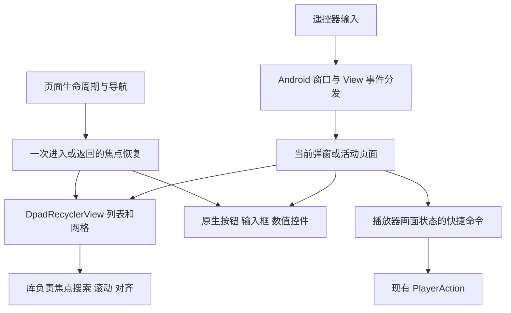

# TV 遥控器与焦点交互重写设计

日期：2026-10-28。状态：**待用户确认，尚未实施**。

本次授权是调查、选型和编写设计。用户确认后才开始依赖接入、代码改写和设备验证。本文中的目标行为、删除清单和迁移阶段均为提案，不代表已经完成。

> 范围更新（2026-10-28）：用户另行授权先移除全部 Bilibili 功能，包括弹幕来源。该任务独立执行；本设计覆盖移除后的保留页面，DPAD 重写仍待确认。

## 1. 目标与设计结论

用户反馈当前 TV 交互经常丢失焦点、移动到错误位置，要求替换复杂的自研实现，采用成熟的 DPAD 库。

推荐保留 Kotlin、XML、Fragment 和现有业务模块，采用 **DpadRecyclerView 1.4.3** 统一 TV 列表、网格及动态选项菜单的导航、滚动对齐和布局状态恢复。静态按钮、输入框与系统弹窗使用 Android 原生焦点和窗口机制；项目代码只保留页面入口、业务身份恢复以及播放/返回等产品语义。

重写的完成条件包含旧导航算法退出：不在新库上继续叠加手写索引移动、滚动补偿、逐帧焦点重试或全局抢焦点监听器。

PiliPlus 的 Flutter `dpad` 包不能直接用于本项目。借鉴其区域隔离、焦点与业务选中分离、播放器分状态处理输入的思路；不移植 Flutter UI 或另写一个 Kotlin 版 `dpad` 引擎。

## 2. 当前证据与未确认原因

本次检查针对当前工作区源码，工作区含已有未提交改动。没有实机复现本轮报告的故障，因此以下是已确认的结构问题与风险，不是每一次焦点丢失的已证实根因。

| 已确认的实现 | 对重写的影响 |
| --- | --- |
| [DpadRecyclerFocusDelegate](../../../core_ui_component/src/main/java/com/xyoye/common_component/focus/DpadRecyclerFocusDelegate.kt) 按索引和列数计算目标；[RecyclerViewFocusDelegate](../../../core_ui_component/src/main/java/com/xyoye/common_component/focus/RecyclerViewFocusDelegate.kt) 仍被其他页面使用 | 两套代理均退出 TV 导航，避免只迁移其中一套 |
| [RecyclerViewExt](../../../core_ui_component/src/main/java/com/xyoye/common_component/extension/RecyclerViewExt.kt) 自行保证可见、对齐中心线，并最多逐帧重试 10 次 | 用库的布局、选择和对齐完成事件取代，不能保留为新库的兜底路径 |
| [ViewPager2DpadPageFocusSync](../../../core_ui_component/src/main/java/com/xyoye/common_component/focus/ViewPager2DpadPageFocusSync.kt) 根据焦点落在哪一页反向切换当前页 | TV 页面必须先由导航决定活动页，再开放该页焦点；移除焦点驱动的隐式翻页 |
| [SettingPlayerActivity](../../../user_component/src/main/java/com/xyoye/user_component/ui/activities/setting_player/SettingPlayerActivity.kt) 使用不可聚焦的分类指示栏，内容区左右键切页 | 改成显式可聚焦分类，解除左右调整数值与左右切页的语义冲突 |
| [BaseBottomDialog](../../../core_ui_component/src/main/java/com/xyoye/common_component/weight/dialog/BaseBottomDialog.kt) 在关闭后异步恢复宿主 View；[MediaFragment](../../../local_component/src/main/java/com/xyoye/local_component/ui/fragment/media/MediaFragment.kt) 在恢复和数据更新时也请求焦点 | 统一限制恢复时机，防止已跳页或用户已移动后旧回调重新抢焦点 |
| [BaseAdapter](../../../core_ui_component/src/main/java/com/xyoye/common_component/adapter/BaseAdapter.kt) 同时支持 DiffUtil 和全量通知；默认身份比较可退回整个对象相等 | 为迁移列表声明真正的条目身份，避免状态刷新被识别成删除并插入 |
| [TvMainFocusSmokeTest](../../../app/src/androidTest/java/com/okamihoro/ddplaytv/ui/tv/TvMainFocusSmokeTest.kt) 主要检查存在且可见的焦点 | 新验收必须检查焦点属于哪个区域和条目；仅“有焦点”不足以发现错移 |

实施前要把用户报告转成可重复的失败用例，优先覆盖快速连续按键、刷新/分页、弹窗关闭、栏目切换和播放返回。缺少复现的场景记录为待验证，不因换库而宣称已修复。

## 3. 库选型与兼容性

### 3.1 选择 DpadRecyclerView

它基于 Android RecyclerView，提供 TV 方向导航、网格、焦点出口约束、滚动对齐、选择监听以及测试工具，可继续使用现有 Adapter 和 DataBinding。[项目说明](https://rubensousa.github.io/DpadRecyclerView/)、[焦点配置](https://rubensousa.github.io/DpadRecyclerView/recipes/focus/)

2026-10-28 直接核查 Maven 发布元数据：最高正式版本为 **1.4.3**，更新版本为 **1.5.0-beta01**。本设计固定使用 1.4.3，不使用动态版本或预发布版。在线文档包含 1.5 的 API，实施以 1.4.3 标签源码为准，例如不调用 1.5 才新增的 `setFocusSearchDebounceMs`。[Maven 元数据](https://repo.maven.apache.org/maven2/com/rubensousa/dpadrecyclerview/dpadrecyclerview/maven-metadata.xml)、[发布记录](https://rubensousa.github.io/DpadRecyclerView/changelog/)

| 方案 | 结论 |
| --- | --- |
| DpadRecyclerView + Android 原生页面/窗口机制 | 推荐；替换自研导航并保留现有技术栈 |
| AndroidX Leanback BaseGridView | 不作为新重写基础；官方已将 Leanback 标为弃用并推荐 Compose for TV，虽可服务已有工程，但不适合作为本次长期新依赖 |
| 全面迁移 Compose for TV | 可作为独立 UI 技术迁移方向；当前会把焦点重写扩大成全站 UI 迁移，不纳入本设计 |
| 引入 Flutter `dpad` | 需要 Flutter UI 运行环境，不适用于本项目原生 View |

Leanback 状态依据：[AndroidX 官方说明](https://developer.android.com/jetpack/androidx/releases/leanback)。不采用库主页中可能过时的 Compose 能力比较作为决策依据。

### 3.2 真实依赖差异与实施前置检查

| 项目 | 当前源码声明 | DpadRecyclerView 1.4.3 的公开构建/发布信息 |
| --- | --- | --- |
| minSdk / compileSdk | 21 / 35 | 21 / 35 |
| Kotlin Gradle 插件 | 1.9.25 | 库使用 Kotlin 2.0.0 构建 |
| Java/Kotlin JVM target | 1.8 | 库构建目标为 17 |
| RecyclerView | 1.2.1 | 发布依赖 1.4.0 |
| Kotlin 标准库 | 由当前 Kotlin 与依赖图解析 | 发布依赖 2.0.0 |
| 其他传递依赖 | 需要实际解析后确认 | Fragment 1.8.2、Collection 1.4.3 |

当前配置来源：[根构建](../../../build.gradle.kts)、[Dependencies](../../../buildSrc/src/main/java/Dependencies.kt)、[Versions](../../../buildSrc/src/main/java/Versions.kt)、[模块设置](../../../buildSrc/src/main/java/setup/Module.kt)。库信息来源：[发布 POM](https://repo.maven.apache.org/maven2/com/rubensousa/dpadrecyclerview/dpadrecyclerview/1.4.3/dpadrecyclerview-1.4.3.pom)、[构建文件](https://github.com/rubensousa/DpadRecyclerView/blob/1.4.3/dpadrecyclerview/build.gradle)、[SDK 配置](https://github.com/rubensousa/DpadRecyclerView/blob/1.4.3/versions.gradle)。声明版本不等同于项目最终解析版本，本次没有运行依赖解析或编译。

版本差异不能直接证明兼容或不兼容。实施第一阶段先在现有 Kotlin 1.9.25、AGP 8.7.2、Gradle 8.9 下验证依赖解析、Kotlin/KAPT/DataBinding、D8/R8 和发布 APK。RecyclerView 等传递依赖升级属于本方案必要影响，需要验证移动端及 Preference/ViewPager2 兼容性。

如果必须修改 Kotlin 插件或 JVM target，先提供实际失败证据与最小升级方案供确认；不绕过 Kotlin metadata 检查、不强制降级库的传递依赖、不为接入而 fork 库。这个前置检查未通过前，不铺开页面迁移。

### 3.3 依赖放置

在 `buildSrc` 统一声明固定版本，`core_ui_component` 使用 `api` 暴露 DpadRecyclerView，符合它现有公开 UI 基础依赖的方式。业务模块直接配置库的公开类型，不增加一个模仿库 API 的自研包装层。不新增 Gradle 模块，也不添加 feature 间依赖。测试辅助包仅在实际使用时加入 `androidTestImplementation`，版本与主库一致。

## 4. 范围与职责

覆盖从 TV 入口可达的主页、媒体库、文件浏览、搜索/详情、设置、弹窗和播放器交互。不是只替换主页 RecyclerView。允许为消除焦点冲突调整 TV 的局部结构，保留现有业务能力和设置存储语义。

| 负责方 | 负责什么 | 不负责什么 |
| --- | --- | --- |
| DpadRecyclerView | 列表/网格内部方向移动、布局与滚动对齐、选中位置、子条目焦点和布局状态 | 播放命令、路由、账号身份、哪个页面应当激活 |
| Android / AndroidX | 静态控件焦点、窗口隔离、生命周期、返回栈 | 项目特有的页面入口和播放快捷键 |
| 页面/现有宿主 | 活动页面、进入/返回目的地、条目业务 key、初始/空态目标 | 通用几何搜索、索引加减导航、重试直到抢到焦点 |
| 播放器输入层 | 画面/控制条/面板各状态的按键含义，调用现有 PlayerAction | 接管已展示菜单的普通上下左右导航 |

保留现有播放器内核、播放会话/租约、字幕弹幕渲染和网络协议的职责。手机保持触摸路径；只在 TV UI mode 启用新的容器与交互规则，复用 `isTelevisionUiMode()`。

不新增全局 `FocusManager`、焦点注册树、可配置导航图或优先级消息总线。复用现有宿主，必要共享代码限于小型配置/状态接线；它们不得决定列表中“下一个条目是谁”。

## 5. 目标交互规则

### 5.1 焦点、选中和执行分离

- 焦点表示遥控器当前操作目标；选中表示当前栏目/设置值/正在播放项，两者有不同视觉反馈。
- 移动到视频、选集或设置选项只浏览；按确认才执行对应动作。数值步进等明确允许即时生效的控件除外。
- 列表使用库的 `OnViewFocusedListener` 表示实际焦点，选择事件用于位置与布局状态；不得把一次程序设定 selection 当成焦点已到达或执行点击。[官方区分](https://rubensousa.github.io/DpadRecyclerView/selection/)
- 隐藏、禁用、不可操作的控件退出可聚焦集合；焦点高亮不得依赖 pressed。所选项在失去焦点后不能继续显示为“当前焦点”。

### 5.2 主页侧栏与内容

- 启动聚焦当前栏目侧栏项。侧栏上下由库导航；确认切换栏目，右键进入该栏目的内容。
- 内容内先完成列表/网格自身导航；左边界回到当前栏目侧栏项。返回键也先从内容回侧栏，侧栏再执行已有退出策略。
- 库的 focus-out 配置控制合法出口；跨区域目标优先用原生布局入口与显式关联表达。现有 `TvShellFocusCoordinator` 最多保留侧栏/内容两个入口的薄接线，取消逐次 `focusSearch` 试探和条目位置计算。
- 侧栏的方向跳转不能通过全局拦截所有左/右键实现；若原生出口不能满足“回当前栏目”，只在跨区域交接处作一次选中项恢复，并以首列/非首列、滚动中和连续按键测试验证，不能侵入库内导航。
- 切栏后旧页面不可聚焦，旧页面的数据回调不请求焦点。活动页切换以 Fragment 事务完成和 view 生命周期为准，而不是仅修改一个选中下标。

### 5.3 列表、网格、空态与更新

- 纵向列表、横向路径栏、网格、动态菜单均使用库自身的 `PivotLayoutManager`；配置方向、列数和 `DpadSpanSizeLookup`，不再把原有 `LinearLayoutManager` / `GridLayoutManager` 塞入新容器。
- 默认不循环、不从一行末尾跳到下一行开头。只开放页面实际存在的出口，没有目标的边界保持当前焦点。
- 使用库的 parent/child alignment；移除自定义中心线滚动。加载、刷新和动画期间不得显示不对应实际操作目标的焦点框。
- 每个普通条目保持一个主操作焦点；确有多个独立操作时使用库的 sub-position 或原生静态控件关系，不另写行内索引导航。
- 空数据/加载失败时有明确可聚焦的返回、添加或重试入口。加载文本不充当无反馈的占位焦点；网络没有返回时仍可离开页面。
- 刷新和分页优先保留仍存在的业务条目。原条目删除时，恢复到原位置附近仍可操作的条目；列表为空时进入空态入口。排序、重扫和异步图片更新不重置到第一个条目。

### 5.4 设置、分类与多页内容

TV 设置改为“可聚焦的分类导航 + 当前分类内容”。分类使用横向或纵向 DpadRecyclerView；左右/上下先在分类区域移动，确认切换，朝内容方向进入时可同时激活所指分类。内容区左右键只操作控件或正常导航，取消 `SettingsIndicatorOnly` 的隐式切页。

TV 的多分类页面不保留可同时参与焦点搜索的离屏 ViewPager 页面。使用普通 Fragment 容器展示当前页，复用现有业务 Fragment；非当前页隐藏并限制生命周期，所有延迟进入动作也必须检查当前页身份。手机继续现有 TabLayout/ViewPager2。搜索、动漫详情、源绑定、扫描管理按同一原则迁移；结构差异大时使用 TV 独立布局或入口，不强行维护两套焦点控制器。

`BasePreferenceFragmentCompat` 在 TV 分支通过 `onCreateRecyclerView` 提供 DpadRecyclerView，继续使用 Preference 数据模型、持久化和 Adapter。保留 Preference 的 ID/保存状态、分隔线和无障碍语义，测试分组标题不可聚焦、开关单次切换、选择器返回以及数值修改。先完成该集成验证再迁移所有设置页，不新建通用设置 renderer。

输入继续保留现有必要的文本/IME 能力；数值和枚举使用 DPAD 友好的步进/选择。IME 显示时文字编辑和首次返回由 IME/输入控件处理，外层不提前抢键。不在本次新增整套虚拟键盘或输入法。

### 5.5 弹窗与播放器

弹窗使用 Android 窗口隔离，列表内容使用 DpadRecyclerView。显示时选定明确的安全默认项；取消/关闭后恢复发起动作的条目或按钮。发起条目已经删除时按列表规则回退。关闭弹窗同时导航到另一页时，不再请求旧页面焦点。底部弹窗在 TV 上不依赖拖拽关闭，确认/取消始终可达。

播放器按当前用户可见状态分流，保留当前业务快捷键，不照搬 PiliPlus 的快进算法：

| 状态 | 方向与确认 | 返回 |
| --- | --- | --- |
| 画面态，控制条隐藏 | 确认播放/暂停；左右沿用当前快进；上打开选集或控制条；下显示控制条；菜单打开设置 | 执行现有播放器退出语义 |
| 控制条显示 | 静态按钮原生导航，动态选项交库；确认操作当前焦点；进度条聚焦时左右调进度 | 关闭控制条，焦点回播放器画面 |
| 设置/选集/轨道等面板 | 列表和网格由库导航；确认选择；业务按键不透传到画面快进/暂停 | 关闭最上层面板，恢复调用入口 |
| 锁定态 | 沿用解锁/显示控制的产品行为，不激活隐藏控件 | 沿用锁定提示/解锁入口 |

`RemoteKeyDispatcher` 保留为小型业务命令映射，收敛 `dispatchKeyEvent` 和 `onKeyDown` 的重复入口。同一按键不能在多个层级各执行一次。确认、菜单、返回按一次执行一次；方向键和快进允许按其既有语义连续输入。控制条自动隐藏只能在画面可继续接收输入时发生，面板打开时不被后台定时隐藏打断。

返回采用 AndroidX 已有的返回分发及当前宿主处理：输入法/顶层弹窗 → 播放面板 → 控制条 → 页面返回；主页内容先回侧栏。保留现有退出确认/二次返回产品策略，不另做通用返回优先级注册框架。

## 6. 状态恢复与数据契约

### 6.1 只恢复当前页面

焦点恢复只发生在明确的页面进入、从下级返回、弹窗关闭或当前条目消失时。条件同时满足：TV/非触摸输入、目标 view 已创建并附着、所属页面是当前活动页、没有上层模态窗口、用户未转移到其他区域。

业务层记录轻量的页面/列表身份、条目 key 和必要的子操作 ID；不长期持有 View 或 ViewHolder。一般 `onResume`、图片加载完成和后台列表更新不能无条件请求焦点。异步恢复任务绑定当前 view 生命周期和本次导航身份；旧页面销毁或新的导航发生后，旧任务无效。

### 6.2 优先使用库与框架状态

库的 selection/layout state 负责当前列表的位置与滚动；Activity/Fragment 的 SavedState 负责配置重建。在有多个或嵌套列表的页面，复用库的 `DpadStateRegistry` / `DpadScrollState`，不再创建项目级状态注册器。[1.4.3 状态实现](https://github.com/rubensousa/DpadRecyclerView/blob/1.4.3/dpadrecyclerview/src/main/java/com/rubensousa/dpadrecyclerview/state/DpadStateRegistry.kt)

使用这些 API 时遵守已核对的限制：同一个 SavedStateRegistryOwner 只创建一个 DpadStateRegistry；按页面/目录/栏目区分列表 key；数据准备好后才恢复；`DpadScrollState.save` 默认会拆下 adapter，在仅离开焦点而未销毁列表时不能误用默认行为。[DpadScrollState](https://github.com/rubensousa/DpadRecyclerView/blob/1.4.3/dpadrecyclerview/src/main/java/com/rubensousa/dpadrecyclerview/state/DpadScrollState.kt)

库保存的位置不是业务对象身份。当目录重载、排序或数据集替换后，页面先按业务 key 找到新位置，再提交 selection；普通持续分页交给库处理，不逐帧重新选中。需要等待条目布局时使用 `ViewHolderTask` 或布局/对齐回调；在回调中检查上述活动条件后请求一次焦点，不增加延迟循环。[选择和滚动 API](https://rubensousa.github.io/DpadRecyclerView/recipes/scrolling/)

### 6.3 Adapter 迁移

保留 BaseAdapter 的 DataBinding 和现有业务绑定，按迁移列表补充明确的 `areItemsTheSame`：媒体库用稳定库身份，文件用存储身份与文件路径/ID，轨道/选集用对应业务 ID，设置用 preference key。内容比较与身份比较分开，不能因为播放进度、封面或选中状态变化就把同一条目替换掉。

优先使用现有 `AdapterDiffCreator` 的身份配置；需要 RecyclerView stable IDs 的 Adapter 必须提供真实且不碰撞的 Long ID，不使用 position 或任意字符串 `hashCode()` 冒充。空态使用独立身份和 viewType。异步加载列表设置合适的 `StateRestorationPolicy`，不能让尚未到达的数据覆盖待恢复状态。设置值、账号数据或列表项被删除后的回退由业务层决定，库不自动解决这些问题。

## 7. 旧代码退场与页面迁移

### 7.1 替换/保留清单

| 现有实现 | 最终处理 |
| --- | --- |
| `DpadRecyclerFocusDelegate`、`RecyclerViewFocusDelegate` | 所有调用方迁移后删除；同一 TV 列表不得同时启用旧代理与库 |
| `RecyclerViewExt.requestIndexChildFocus` 及中心线/重试辅助 | TV 调用改用库；全仓检查剩余用途，无调用后删除相关代码，普通布局/数据扩展保留 |
| `ViewPager2DpadPageFocusSync` | TV 多页容器迁移后删除，不保留焦点反向切页 |
| `TabLayoutViewPager2DpadFocusCoordinator`、`SettingsIndicatorOnly` | TV 分类导航迁移后退出；移动端保持正常 Tab/Pager 行为 |
| `DpadFocusScope` | 不作为新方案状态层；查清实际调用，迁移相关用途后移除 |
| `DpadFocusOwner` | 迁移期只作兼容入口；状态由库/页面持有后取消通用 save/boundary 协议，若仍需跨模块入口，仅保留现有接口中的单一进入操作，不另增协议族 |
| `TvShellFocusCoordinator` | 收缩为侧栏与当前内容入口接线，删除搜索算法和冗余状态 |
| `DpadDialogFocusController` | 通用递归找焦点与延迟抢回退出；生命周期与关闭返回接线收敛在现有弹窗基类，复用库/页面的恢复目标 |
| `FocusPolicy`、`TvDpadInputPolicy` | 仅保留仍有调用的 TV/触摸分流和静态可聚焦属性操作；移除随旧协调器失效的函数 |
| `RemoteKeyDispatcher` / `TvVideoController` | 保留播放业务命令，减少输入入口；菜单内方向交库，焦点恢复改用明确的画面/按钮入口 |
| XML `nextFocus*`、focused 样式 | 保留合理的静态关系与视觉资源；移除指向隐藏控件/旧布局的关系，不批量删除 |

阶段间可以有尚未迁移的页面，但不能留下永久“新库失败就回旧引擎”的运行开关。一次迁移以完整页面/面板为单位；回退使用该批变更的版本回退，不长期维护双引擎。

### 7.2 迁移覆盖表

| 区域 | 主要入口 | 要验证的特殊行为 |
| --- | --- | --- |
| `app` | TvMainActivity、TvShellFocusCoordinator、ShellFragmentSwitcher | 冷启动、侧栏/内容、栏目切换、返回退出、隐藏页隔离 |
| `core_ui_component` | 两套列表代理、RecyclerViewExt、BaseAdapter、BasePreferenceFragmentCompat、BottomActionDialog、BaseBottomDialog、文件选择/确认/编辑弹窗 | 身份更新、空态、窗口恢复、输入法、动态按钮 |
| `local_component` | MediaFragment、BindExtraSourceActivity、绑定/下载/字幕相关页面和弹窗 | 返回原条目、源绑定分类、操作取消与失败 |
| `storage_component` | StorageFileActivity/Fragment、路径栏、存储配置与投屏页面 | 文件夹层级恢复、首尾边界、长列表、网络等待与重试 |
| `anime_component` | HomePageFragment、SearchActivity、SearchMagnetFragment、AnimeDetailActivity 及筛选弹窗 | 网格末行、分页追加、搜索分类、详情返回 |
| `user_component` | SettingPlayerActivity、Preference 页面、ScanManagerActivity、ScanExtend/ScanFilter、个人页 | 显式分类、数值调整、持久化、扫描列表更新 |
| `player_component` | 控制条、PlayerSettingView、SwitchVideoSourceView、SwitchSourceView、SettingTracksView、SearchDanmuView 等所有可达设置面板 | 焦点不触发播放、选择一次执行一次、禁用项、面板返回、设置/画面不串键 |

实施第一阶段据 TV 路由补齐页面/弹窗清单，逐项记录“迁移”或“原生静态控件保留及验证理由”。不能把未命名的 TV 可达页面默认排除，也不因该表出现某模块就重写其无关业务。

共享布局优先提取小型列表区域，以 `layout-television` 覆盖容器类型，保持 ID 和绑定契约；结构差异明显的分类页使用 TV 页面结构。初始化必须区分普通 RecyclerView 与 DpadRecyclerView，避免公共 `vertical()/grid()` 覆盖库的 LayoutManager。不复制整套业务页面只为更换一个控件，也不对所有手机 RecyclerView 静默启用 TV 对齐。

## 8. 实施顺序与停止条件

确认设计后再制定具体执行账本，按以下顺序推进：

1. **兼容性与问题基线**：验证固定依赖版本和发布构建；建立真实 TV 输入测试环境；补齐迁移清单并捕获现有失败用例。验证不通过则先处理已证实的兼容问题，不开始全站替换。
2. **基础列表与主路径**：媒体库 → 文件浏览 → 返回媒体库，加上空态/刷新/弹窗，落地库导航、身份与恢复契约；同批删除这些页面的旧代理调用。
3. **分类、设置与通用弹窗**：迁移 TV 多分类容器和 Preference 列表，统一显式导航与窗口恢复；同步更新旧测试中“内容左右切页”的预期。
4. **播放器与其他可达页面**：迁移所有动态面板，保留播放命令语义；完成搜索/详情/扫描等剩余路径。
5. **清理与整体验收**：删除无调用旧引擎，执行全路径 DPAD 回归和手机触摸回归，交付 release APK 供物理遥控器验收。

每一阶段必须具备完整可用路径，不以“新控件已经替换”作为完成标准。若库的公开能力无法满足一个必需场景，先评估局部布局简化；仍无法解决时提交具体限制和选型调整，不把原自研算法改名塞回去。

## 9. 验收标准

### 9.1 可自动验证的行为

| 场景 | 必须断言 |
| --- | --- |
| 冷启动、栏目/分类切换 | 焦点处于预期的可见、enabled、可操作条目，隐藏页面没有输入接收者 |
| 连续方向输入 | 固定夹具中 200 次方向输入及末行/边界操作不丢焦点、不越过合法区域；校验具体业务 key 和区域 |
| 刷新、分页、排序、删除 | 同一 key 保留；被删项按规定回退；空态可退出/重试；后台更新不抢焦点 |
| 弹窗/子页往返 | 连续 30 次进入/取消/返回后恢复正确目标；关闭后跳页不被旧恢复回调拉回 |
| 快速切换和重建 | Activity 重建、Fragment view 重建、前后台切换后恢复当前页面；旧回调无效；账号/目录切换不复用错误 key |
| 设置 | 分类与数值左右键不冲突；一次确认只切换一次；保存并退出重进后值正确 |
| 播放器 | 画面、控制条、面板、锁定状态的按键分流准确；焦点移动不触发换集；返回逐层关闭；不可用字幕/轨道项不抢焦点 |
| 输入/遥控器兼容 | DPAD_CENTER 与常见 ENTER 确认键单次执行；系统 BACK 与重复事件不重复执行；IME 优先级正确 |
| 移动端 | 共享列表滚动、点击、输入、设置、播放返回保持可用；不自动居中或强制抢 DPAD 焦点 |

使用确定性本地数据夹具隔离网络波动，同时补充真实异步列表路径；稳定 key 解析/删除回退等纯逻辑可用 JVM 测试。输入通过 Instrumentation/UiAutomator 或库的测试工具进入系统事件链，不直接调用业务按键函数冒充集成测试。

更新现有 TvMainFocusSmokeTest、DialogDpadFocusSmokeTest、PlayerSettingDpadNavigationTest，并增加列表刷新与播放器状态回归。断言真实焦点，不只断言 selectedPosition；检查边框与窗口裁剪的截图。TV 测试如果因设备模式而被 `assumeTrue` 跳过，必须报告 skipped，不能计为通过。

### 9.2 构建与设备验证

至少运行变更模块测试、`testDebugUnitTest`、`lint`、相关 ktlint、模块依赖治理和 debug/release APK 构建；所有 Gradle 结果读取输出尾部，记录 `BUILD SUCCESSFUL` 或 `BUILD FAILED`。依赖兼容性阶段同时检查最终解析版本和 release/R8 路径。已有基线失败单独记录，不隐藏在“整体通过”中。

仪器测试要求设备为 `device` 且真正进入 TV UI mode。项目现有 Pixel_5_API_34 手机 AVD 的普通运行不能替代 TV 分支；需可验证的 TV 环境或专门测试配置，并另外验证手机路径。

物理 TV 使用 release APK，仅靠遥控器走完“启动 → 媒体库/搜索 → 文件或详情 → 播放 → 设置/选集 → 返回”。加入至少 10 秒方向键长按、快速反向、弹窗往返和网络加载等待。记录设备/系统/APK、操作步骤、预期与实际目标，以及日志或视频证据；比较主观跟手性，不能以编译成功或模拟器测试代替。部署和控制实体设备在实施阶段按用户授权执行，本次不操作设备。

### 9.3 结构验收

- TV 列表导航中不再调用两套旧代理、索引加减移动、逐帧 requestFocus 重试和焦点反向切页。
- 库内部公开能力直接复用；项目没有新增通用焦点算法、全局抢焦点服务或永久双引擎。
- 迁移清单中的每个 TV 入口有结果与证据；遗留问题明确列出，不以测试总数替代覆盖说明。
- 业务身份、路由与设置保持原有归属，模块依赖单向；发布产物与实际被测版本一致。

## 10. 本次核验与待确认项

本次已检查现有焦点/输入实现、使用位置、Adapter、Preference、分类页面、历史验收边界，以及库的官方说明、Maven POM/版本列表和 1.4.3 标签的关键 API。尚未修改生产代码或依赖，未进行编译接入、故障复现或实机体验验证。

独立任务补充：随后获授权的 Bilibili 移除任务已完成现有 UI 的 TV 模式冒烟，证据见[移除记录](../plans/2026-10-28-remove-bilibili.md)。这些结果仅检查保留页面未被移除任务破坏，不是新焦点库的兼容性或重写验收；本设计仍未实施。

PiliPlus 参考路径为 `E:\Project\PiliPlus\lib\pages\tv\widgets\tv_dpad_root.dart`、`tv_focusable.dart`、`tv_browse_grid.dart`，以及 `main/view.dart`、`navigation/tv_back_dispatcher.dart`、`player/tv_player_input_controller.dart`。它们映射到本项目的 `core_ui_component`、`app` 主壳和 `player_component` 输入层；只参考交互原则，本地化为 Android View/Fragment/窗口机制。

本设计请确认的决定是：

1. 采用 DpadRecyclerView 1.4.3，覆盖全部 TV 可达交互路径，替换并最终删除旧列表焦点引擎。
2. 保留原生 View 与业务架构，允许必要的 TV 局部布局调整；设置/分类采用显式可聚焦导航，取消内容区隐式左右切页。
3. 通用导航交库，少量页面/返回/播放业务接线保留；依赖兼容性与主路径验证先行，工具链若必须升级则补充证据和确认。

用户确认前，本设计不进入实施阶段。
