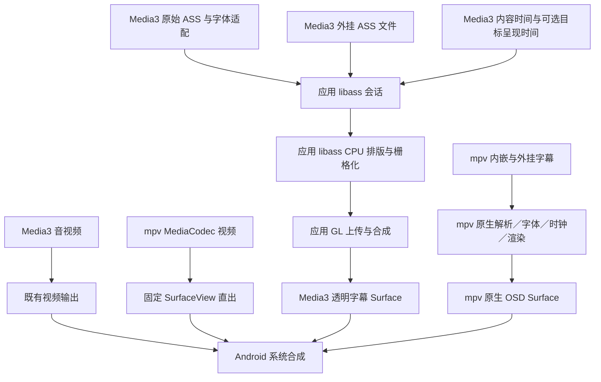

# Media3 应用 libass 接入完善设计

初稿：2026-10-29。实施更新：2026-10-30。状态：**时间、字体作用域、完整帧请求及几何/资源防线已实现；验证和剩余设备验收见[实施账本](../plans/2026-10-30-media3-libass.md)**。精确呈现、atlas、线程拆分及预热仍按测量门槛决定是否启用。

本设计仅完善 **Media3 的应用 libass 管线**。mpv 已由固定 Plezy AAR 负责字幕解析、字体、时钟与原生 OSD，不再向应用 libass 转交 ASS 事件；正文中的旧共享管线、应用时钟、字体提取缺口及位图切内核要求已移除。mpv 在本文中只作为现有边界与共用控制／Surface 变更的回归对象，实施和历史验证见[原生字幕记录](../plans/2026-10-29-mpv-native-subtitles.md)。

本文保留架构、接口语义、阶段依赖与验收要求，具体实现和验收范围以[字幕渲染维护说明](../../../document/player/subtitle-rendering.md)及实施账本为准；既有修复与历史验证以[libass 接入审查](../../../document/player/libass-integration-audit.md)为准。实现基础管线不代表代表性电视预算、精确呈现或完整设备矩阵已经通过。

## 1. 目标与范围

以 Jellyfin Android TV 校准 Media3、字幕适配、会话和显示资源的职责；参考 Plezy 完善目标呈现时间、尺寸语义和资源控制，再根据实际瓶颈决定是否引入 atlas 与计算／GL 线程拆分。

目标是让 Media3 的内嵌及外挂 ASS/SSA 在保留原始样式、字体、定位和动画的前提下，具备明确的时间坐标、媒体资源作用域与可测量的显示行为。两类 ASS 输入继续使用应用 libass 会话；mpv 的内嵌及外挂字幕均由原生后端处理。项目仅维护 TV 交互及 Media3、mpv 两个内核，字幕选择、偏移设置和返回均以 DPAD 验收。

本设计不包含视频解码策略重写、视频 effects、Anime4K 恢复、整个播放器迁库、新增 Gradle 模块、字幕简繁转换或后台／画中画改造。VLC 及 mpv `gpu`／`gpu-next` 视频路径已经移除，不再作为维护或回归对象。Media3 普通文字和支持的位图字幕保持已有路径；mpv 直接使用其原生文字／ASS／位图字幕能力，具体格式兼容性以素材验证为准。

mpv 视频固定使用原生 SurfaceView、`vo=mediacodec`、`hwdec=mediacodec`，字幕使用独立原生 OSD Surface。字幕功能及故障恢复不得改用 GPU 视频合成、TextureView 或软件解码回退。Media3 保留独立应用 libass GPU 字幕层及既有视频输出配置。应用 libass 库和 JNI 仍服务于 Media3，不能因 mpv 迁移而删除。TV 画面设置效果保持生效属于实机验收要求，不能仅由输出类型推断。

## 2. 证据基线与参考取舍

设计基线为 `ac0c5cb36ec0e63de950806f907271fd04f77c9b`，Media3 为 `1.11.1`。2026-10-30 的实现建立在该基线及未提交改动上，入口见第 3 节。Media3 时间映射、字体附件、完整帧请求与几何/预算防线已落地，mpv 作为回归对象；本轮测试、失败与范围均记录在实施账本。物理 TV、复杂 ASS、完整字体／位图矩阵、长期资源曲线和精确呈现仍未验收。

以下沿用 2026-10-29 的外部源码研究及固定版本，本轮未重新核对上游。源码机制与目标设备性能是不同证据，本轮未构建外部项目、未执行同机对照，也未确认它们在本项目设备上更稳定。

| 参考 | 固定版本 | 采用的设计依据 | 保留的限制 |
| --- | --- | --- | --- |
| Jellyfin Android TV | `v0.20.0-beta.4`，`344d26eb5e8b2a4bde5bfded3588acae1957fe4b` | 原生 TV 播放器装配、字幕分流、视频与 ASS 显示分离 | ASS 功能仍为默认关闭；整体应用成熟度不等于该功能已充分验收 |
| peerless2012/libass-android | `v0.5.1`，`504f64a325059ab5188c4c9d0eddc99c9356a23a` | 原始 ASS 事件、完整外挂文件、MKV 字体与选中轨道的衔接 | 固定时间偏移、Media3 私有字段反射、版本耦合；Jellyfin 应用释放路径未显式调用 handler 的 release |
| Plezy 的 Media3／应用 libass 实现 | `1f357ec0a6cef67ffe2b5eaf5d7cab5b9948f69f` | 实际 EGL presentation timestamp、请求交接、atlas、尺寸分离与资源预算 | 本地改造模块及自有 libass fork；多缓冲、推测和设备校准增加成本，不能直接照搬 |

Jellyfin 使用视频 SurfaceView 和独立 ASS TextureView；DDPlayTV 使用独立透明字幕 SurfaceView。采用的是职责与数据边界，不以更换 View 类型为前提。Plezy 与上游 Android glue 存在来源关系，不能将相近设计当作两份独立的设备稳定性证明。

上表的 Plezy 应用 libass 参考与现有 mpv 原生接入是两条管线。后者参考 Plezy `1dd75b3e5e95913cdaa5b8c22911490e72dfb7c5`，依赖固定 `mpv-build@b15bf59c043b45f9ad7fa227b2cc7d3164daf58f` 的原始 AAR；来源、版本和校验和以[产物维护说明](../../../document/mpv-build-notes.md)为准。本设计不修改该 AAR 或为其增加应用渲染接口。

关键参考源码与规范：

- Jellyfin：[VideoManager](https://github.com/jellyfin/jellyfin-androidtv/blob/344d26eb5e8b2a4bde5bfded3588acae1957fe4b/app/src/main/java/org/jellyfin/androidtv/ui/playback/VideoManager.java)、[默认设置](https://github.com/jellyfin/jellyfin-androidtv/blob/344d26eb5e8b2a4bde5bfded3588acae1957fe4b/app/src/main/java/org/jellyfin/androidtv/preference/UserPreferences.kt)。
- 上游扩展：[容器与字体](https://github.com/peerless2012/libass-android/blob/504f64a325059ab5188c4c9d0eddc99c9356a23a/lib_ass_media/src/main/java/io/github/peerless2012/ass/media/extractor/AssMatroskaExtractor.kt)、[ASS 样本](https://github.com/peerless2012/libass-android/blob/504f64a325059ab5188c4c9d0eddc99c9356a23a/lib_ass_media/src/main/java/io/github/peerless2012/ass/media/text/AssTrackOutput.kt)、[parser 分流](https://github.com/peerless2012/libass-android/blob/504f64a325059ab5188c4c9d0eddc99c9356a23a/lib_ass_media/src/main/java/io/github/peerless2012/ass/media/parser/AssSubtitleParserFactory.kt)、[时钟](https://github.com/peerless2012/libass-android/blob/504f64a325059ab5188c4c9d0eddc99c9356a23a/lib_ass_media/src/main/java/io/github/peerless2012/ass/media/render/AssRenderer.kt)、[会话与释放](https://github.com/peerless2012/libass-android/blob/504f64a325059ab5188c4c9d0eddc99c9356a23a/lib_ass_media/src/main/java/io/github/peerless2012/ass/media/AssHandler.kt)。
- Plezy：[呈现与缓冲管线](https://github.com/edde746/plezy/blob/1f357ec0a6cef67ffe2b5eaf5d7cab5b9948f69f/android/libass/src/main/java/com/edde746/plezy/libass/media/widget/AssSubtitleAtlasPipeline.kt)、[图集打包](https://github.com/edde746/plezy/blob/1f357ec0a6cef67ffe2b5eaf5d7cab5b9948f69f/android/libass/src/main/cpp/AssPack.c)、[native 配置](https://github.com/edde746/plezy/blob/1f357ec0a6cef67ffe2b5eaf5d7cab5b9948f69f/android/libass/src/main/cpp/AssKt.c)、[字体附件](https://github.com/edde746/plezy/blob/1f357ec0a6cef67ffe2b5eaf5d7cab5b9948f69f/android/libass/src/main/java/com/edde746/plezy/libass/media/extractor/AssMatroskaExtractor.kt)、[尺寸](https://github.com/edde746/plezy/blob/1f357ec0a6cef67ffe2b5eaf5d7cab5b9948f69f/android/libass/src/main/java/com/edde746/plezy/libass/media/AssHandler.kt)。
- 官方语义：[Media3 帧回调](https://developer.android.com/reference/androidx/media3/exoplayer/video/VideoFrameMetadataListener)、[EGL_ANDROID_presentation_time](https://registry.khronos.org/EGL/extensions/ANDROID/EGL_ANDROID_presentation_time.txt)、[本项目随附 libass API](../../../player_component/src/main/cpp/include/ass/ass.h)。

## 3. 当前实现与待完善项

| 当前入口 | 已有能力 | 本设计关注的差异 |
| --- | --- | --- |
| [Media3VideoPlayer](../../../player_component/src/main/java/com/xyoye/player/kernel/impl/media3/Media3VideoPlayer.kt)、[LibassAwareRenderersFactory](../../../player_component/src/main/java/com/xyoye/player/kernel/impl/media3/LibassAwareRenderersFactory.kt) | 官方 Media3 视频链路；自定义 legacy ASS decoder，避免普通 Cue 重复输出 | 评估原始事件与字体的适配出口，保持 Media3 依赖集中 |
| [LibassSsaStreamDecoder](../../../player_component/src/main/java/com/xyoye/player/kernel/impl/media3/LibassSsaStreamDecoder.kt)、[LibassTimelineRenderer](../../../player_component/src/main/java/com/xyoye/player/kernel/impl/media3/LibassTimelineRenderer.kt) | 原始事件/duration、公开 stream/period/window 映射，已移除 `1e12 us` 猜测 | 保留 Media3 legacy decoder API 耦合；升级时重新验证 |
| [Media3SubtitleFrameDriver](../../../player_component/src/main/java/com/xyoye/player/kernel/impl/media3/Media3SubtitleFrameDriver.kt)、[SubtitleFrameDriver](../../../player_component/src/main/java/com/xyoye/player/kernel/subtitle/SubtitleFrameDriver.kt) | 内容微秒、可选目标纳秒、随视频 Format 的 period 标记；metadata 超时后位置驱动 | 仅立即提交，未宣称精确呈现；tunneling 的真实设备路径仍需单独验收 |
| [MpvSubtitleRendererBackend](../../../player_component/src/main/java/com/xyoye/player/subtitle/backend/MpvSubtitleRendererBackend.kt)、[MpvNativeBridge](../../../player_component/src/main/java/com/xyoye/player/kernel/impl/mpv/MpvNativeBridge.kt) | 原生内嵌／外挂字幕、独立 OSD Surface 与加载所有权；mpv 不再实现应用字幕 `SubtitleKernelBridge` | 保留现有边界；不接入本文的应用时钟、字体注册、帧请求或 GL 调度 |
| [LibassGpuSubtitleSession](../../../player_component/src/main/java/com/xyoye/player/subtitle/backend/LibassGpuSubtitleSession.kt)、[AssGpuRenderer](../../../player_component/src/main/java/com/xyoye/player/subtitle/gpu/AssGpuRenderer.kt) | 内外轨仲裁、FIFO 命令、不可变帧快照、状态与 Surface 失效、释放和受控恢复 | 单渲染线程与立即提交；不提前引入多槽和双线程 |
| [LibassMatroskaExtractor](../../../player_component/src/main/java/com/xyoye/player/kernel/impl/media3/LibassMatroskaExtractor.kt)、[Media3SubtitleInput](../../../player_component/src/main/java/com/xyoye/player/kernel/impl/media3/Media3SubtitleInput.kt) | 公开 EBML 扩展点、媒体独立字体和样本缓存，支持预加载及旧输入隔离 | 字体 guardrail 为单份 16 MiB/媒体累计 32 MiB，尚未由代表性 TV 样本定型 |
| [ass_gpu_bridge.cpp](../../../player_component/src/main/cpp/ass_gpu_bridge.cpp) | GLES 2／3、字体注册、真实 storage/PAR/旋转、静态复用、64 MiB 覆盖纹理预算及完整帧拒绝 | 逐 ASS_Image 上传／绘制；无实际 presentation timestamp，缓存显式采用 libass 默认值 |
| [SubtitleSurfaceOverlay](../../../player_component/src/main/java/com/xyoye/player/subtitle/ui/SubtitleSurfaceOverlay.kt) | 两个后端分别使用的透明 SurfaceView 容器，对齐视频 View，surface 有序解绑／重建 | Media3 需分离源视频、栅格和显示尺寸；共用容器的几何／生命周期改动须回归两后端；全窗口字幕属于后续产品选择 |

已有显隐、清轨、GLES 2、加载结果与恢复修复继续有效。静态内容已有 `change == 0 && !pending_invalidate` 复用，不能重复列为缺失能力。未显式配置 libass cache limit 也不代表 libass 没有默认缓存限制。

## 4. 目标职责与数据流

沿用 `player_component` 内现有边界，不新增全局管理器或通用渲染框架。共享字幕选择入口、设置和 Surface 容器不意味着共享渲染会话、时钟或字体资源；不为仅剩 Media3 的应用渲染需求扩展多内核抽象。

| 负责方 | 目标职责 |
| --- | --- |
| 播放页面／现有控制器 | 媒体与字幕选择、可见性、用户偏移、错误提示；不解析容器或操作 EGL |
| Media3 适配 | 解释 Format、原始样本、容器附件及时间偏移；通用 sink 不承载 Media3 私有对象 |
| Media3 应用 libass 会话 | 当前媒体／轨道所有权、外挂与内嵌仲裁、字体作用域、状态版本、暂停重绘与释放 |
| 应用 native libass | 字体注册、ASS 头部与事件处理、按内容时间生成 ASS_Image；不认识页面、媒体库或播放恢复业务 |
| 应用 GL／Surface | Media3 字幕栅格上传、合成、目标呈现提交、surface 生命周期与错误回传 |
| mpv 原生后端 | 原有轨道命令与属性映射、视频／OSD 双 Surface 交接；解析、字体、时钟和绘制由 AAR 内部负责 |

Media3 内嵌 ASS 使用头部与带开始时间／duration 的原始事件；完整外挂文件保持单独输入语义。两类输入共享应用会话与渲染，不强行转换成同一种包，也不先转换为普通文本 Cue。mpv 外挂继续经过现有管理器后交给 native `sub-add`，不进入上述事件 sink。每种字幕只保留一个实际显示所有者，切换 ASS／SRT／位图或关闭字幕时清理旧显示层。

## 5. 时间与帧请求契约

本节仅适用于 Media3 → 应用 libass。mpv 使用原生字幕时钟与 `sub-delay`，不接入应用帧请求，也不增加播放位置轮询驱动。

### 5.1 两个时间域

基础实现已采用以下字段语义；具体 API 和调度能力以维护说明及实施账本为准。

| 字段 | 语义与单位 | 约束 |
| --- | --- | --- |
| `contentTimeUs` | 当前媒体内容时间，64 位微秒 | 字幕事件和视频帧必须归一到相同坐标；进入 libass 时才转 64 位毫秒 |
| `targetPresentTimeNs` | 可缺省的目标显示时间，64 位纳秒 | 使用 `System.nanoTime()`／`CLOCK_MONOTONIC` 时间域；缺省表示立即提交 |
| `stateRevision` | 当前会话渲染状态版本 | 与时间组成不可变请求，一次发布；尺寸、轨道、时间线、显隐或样式失效后拒绝旧结果 |

Media3 使用归一后的视频 PTS 作为内容时间；仅有效 `releaseTimeNs` 可作为目标呈现时间，`C.TIME_UNSET` 在适配边界转成“无目标时间”，通用接口不依赖 Media3 常量。Choreographer 仅提供绘制节拍，其帧时间和 `elapsedRealtimeNanos()` 不冒充视频未来显示目标。暂停补画及 Media3 无 metadata 时的位置驱动路径采用立即提交；回调恢复时停用替代驱动，避免两条时钟同时提交。

字幕偏移沿用当前设置约定：正值加到内容时间，使字幕取样前移；最终显示行为及正负方向要用样例确认。不要同时改内容时间和目标显示时间而重复补偿。设备显示链路补偿是另一种量，本轮不新增自动补偿设置。

### 5.2 时间线归一化

实施先验证字幕样本、renderer 时间、视频 PTS 与 window／period 的关系。偏移只在适配边界转换一次；seek、媒体或 period 切换时重建所需映射。以实际 stream／period offset 或容器时间关系替代量级猜测前，必须有对应 API 与样例证据，不凭固定减 `1e12` 宣称通用正确。

保留现有桥接直到替代方案通过非零起点、跨 period、seek、倍速及大时间戳回归。API 迁移与 MKV 字体出口可以分开交付；不为保持原始 ASS 而自动引入对 Media3 私有字段的反射依赖。若公开出口不足，先记录最小适配选项、版本耦合和兼容用例，再确定局部方案。

### 5.3 显示提交

本节定义后续启用精确呈现调度时的契约。基础交付先保证时间单位、完整请求快照、立即提交和失效规则正确；精确调度的启用由实机时序偏差与收益测量决定，不阻塞时间归一化或字体出口交付。未启用时不宣称已按目标时间呈现。

有效目标时间沿 frame driver → session → renderer → JNI 保留纳秒值，在 swap 前设置 presentation timestamp；探测扩展支持并检查调用结果。扩展不可用时立即提交并记录调度能力，继续正常字幕输出，不伪报精确同步。

使用有界、可取消的调度；迟到帧记录迟到程度，避免追赶历史请求。不得在当前唯一状态处理线程中长时间 sleep 等待目标时刻。启用前先评估非阻塞调度能否满足要求；若必须分离提交线程，先定义第 7 节的缓冲所有权，再启用目标时间调度。

隐藏、清屏、暂停设置更新和停止不等待未来视频帧；它们立即生效并使相冲突的旧请求失效。已提交到系统 BufferQueue 的帧不能仅靠应用版本号撤回，需提交新的透明／正确帧，并验证队列不会使旧内容重新可见。

EGL 目标时间是提交意图，不能保证两个 Surface 同一刷新周期显示；swap 成功、设置时间成功和实际呈现分别记录。

## 6. 字体与媒体资源作用域

本节新增的字体入口、预算与生命周期限于 Media3 应用会话，不能用于管理 AAR 内部的 mpv 字体资源。

### 6.1 容器输入

MKV 附件提取位于 Media3／容器适配边界。向会话传递字体名称和字节，利用 libass 的字体注册能力；Android View 的 Typeface 不能替代这条链路。复用现有桥接，必要时补一个明确字体入口，不新增跨模块附件总线。

mpv 已通过 `embeddedfonts=yes` 使用原生附件字体能力，并保留默认字体目录；应用无需从 mpv 提取附件或复制到另一个 libass 实例。完整字体素材矩阵尚未验收，不能将“已有原生能力”写成“全部字体通过”。本设计只补 Media3 的容器出口，不建立跨内核字体总线或第二套解复用器。

字体可能早于字幕头部到达。当前媒体内暂存并按顺序注册，已取得的字体在使用它的首帧布局前完成注册；后到字体触发字体选择更新及重绘。是否需要重建 renderer，以所用 libass API 的真实行为和测试确定。

| 资源 | 生命周期 |
| --- | --- |
| 默认字体与用户字体目录 | 沿用现有字体管理；每个应用 libass 会话配置可用来源 |
| MKV 附件字体与待注册字节 | 绑定当前媒体；同媒体切轨、seek、隐藏和内外 ASS 切换不误删；换媒体／释放时清理 |
| ASS 轨道与事件 | 随字幕轨道加载、替换、flush 或结束；不把轨道释放当作媒体字体全部释放 |
| EGL／纹理／缓冲 | 随显示资源及渲染所有者释放；Surface 销毁不等于媒体资源与 native library 已释放 |

字体预算覆盖待注册队列与已注册数据的累计输入，避免只限制其中一侧。Plezy 的单字体 16 MiB／媒体累计 32 MiB 可作样机候选值，最终值由目标设备与样本确定。超限或不可用附件跳过并记录原因，沿用已配置字体选择，不阻断音视频；字体退回导致的画面差异必须可观测。

字体提取、外挂加载和内嵌样本在发起时绑定所属媒体及轨道／加载代际，进入待注册队列或 native 前再次校验；沿用既有作用域与修订号，不新增消息框架。媒体切换后才返回的旧附件或样本不得登记到新会话。

暂停、显示恢复与 Surface 重建保留可重建字幕画面的数据。外置 ASS 支持不等于能自动取得配套字体，本设计不新增服务端字体下载。

## 7. 命令顺序、线程与生命周期

以下规则约束 Media3 应用会话及其渲染所有者，不延伸到 mpv AAR 内部线程。mpv 继续使用既有串行命令和独立视频／OSD Surface generation。

- 状态、样式、字体及事件命令按顺序处理；绘制请求可以合并，字幕事件和轨道命令不能作为过期帧丢弃。
- 先保留单渲染线程与最新待绘制请求，合并时间与版本为一个快照，避免两个独立 AtomicLong 产生帧参数错配。沿用现有 Surface 修订号；会话状态版本只解决其未覆盖的失效范围。
- 计算前及提交前校验媒体／轨道、状态版本和 Surface 所有权。暂停重绘与隐藏、切轨、seek 竞态必须有确定顺序，旧结果不得覆盖新状态。
- 如测量证明计算与 GL 提交互相阻塞，再分离 worker。跨线程交接持有自己拥有的像素／顶点缓冲和内容标识，不传递会被下一次 libass 调用改写的裸 ASS_Image 指针；生产者不得覆盖消费者正在使用的槽。
- 双线程时限制待计算与待提交结果数量，缓冲槽数根据内存／耗时选择。应用队列有界不代表系统 BufferQueue 长度已受控，也不能持续取消正在交付的帧造成长期无输出。
- `change == 0` 可以复用已显示内容；新增缓冲、扩容、Surface 重建或样式失效时仍须强制填充／重画。未来若引入预渲染，明确区分“上次 libass 计算内容”与“屏幕当前内容”。

释放由现有会话所有者执行：停止帧回调与输入 → 使旧请求失效 → 在渲染所有者线程完成解绑及 native 释放 → 停止线程并解除 UI 引用。保留 Surface 销毁同步解绑、超时诊断及受控恢复；不能依赖 finalizer 或以 View detach 代替 native 释放。引入调度后需重新验证现有等待上限，不能让等待未来目标时间拖延销毁。

## 8. 尺寸与资源预算

以下 storage／frame／缓存／纹理预算用于应用 libass；mpv 保持已有视频矩形与原生 OSD 配置。修改共用 overlay 的对齐或销毁行为时，分别验证两个后端。

### 8.1 布局与栅格分离

独立传递 ASS 脚本坐标、原始视频 storage size、字幕栅格 frame size、最终 Surface 尺寸和视频显示矩形。storage size 使用实际视频存储尺寸，像素宽高比、媒体旋转元数据、fit／fill／zoom 与显示矩形在几何适配处解释，不将解挤压后的显示宽度冒充存储宽度。旋转范围仅指媒体变换，不恢复已移除的手机方向传感器或随设备旋转行为。

降采样仅等比缩小 frame 和相应 margins，保留源尺寸与脚本坐标，再由 GL 映射到输出尺寸。默认保持 1.0 比例，确认清晰度与耗时后再选择像素预算；不预设低分辨率必然更适合全部 ASS。

本轮设计保留字幕 Surface 对齐视频 View 的产品行为。全窗口 Surface、黑边字幕与屏幕锚定单独评估；它们不是呈现时间或 atlas 的前置条件，也不能借优化静默改变裁剪范围。

### 8.2 分项预算

| 资源 | 预算与观测要求 |
| --- | --- |
| libass cache | 显式选定 glyph／bitmap cache 配置；记录默认与峰值，不能当作整个进程内存上限 |
| 字体 | 第 6 节的单附件、媒体累计及生命周期 |
| 纹理／atlas／交接槽 | 统计 CPU 和 GPU 分配、槽数、最大尺寸、峰值与释放；扩容前检查预算 |
| 渲染像素 | frame 与输出分离，测量降采样后的定位、模糊与清晰度 |
| 事件与命令 | 观测长播放、seek 后的队列／事件规模；出现增长后再依据回放需求确定裁剪，不直接删除可能仍被 seek 使用的数据 |

Plezy 默认的 10,000 glyph／128 MB bitmap cache 及多缓冲不是本项目默认值。先测代表设备，再冻结具体参数和降级边界。现有 25 ms／连续 5 次／500 ms 冷却策略需评估对动画与显示截止时间的影响，不能以平均耗时低证明节流没有长时间冻结字幕。

## 9. Atlas 采用条件与正确性

本节只评估应用 libass 的 GL 路径，不改造或替换 AAR 原生 OSD。全局透明度要求也只适用于 Media3；mpv 继续隐藏不支持的透明度控制并保留 Media3 设置值。

只有上传、状态切换或 draw 调用被证实是主要瓶颈时，才将逐图像纹理路径改为 ALPHA8／R8 图集与批量顶点；libass 的排版、模糊和栅格化仍在 CPU，打包本身也有成本。

必须保持的语义：

1. 按原 ASS_Image 顺序合成；多页分批也不能重排交叠内容。参考 Plezy 的单页存储位置排序／原序输出，以及多页按序装页，不采用任意塞页后按页排序的捷径。
2. 保留 ASS 反向透明度转换、覆盖率、预乘 alpha、全局透明度、垂直偏移、stride 与裁剪。若使用 RGBA 合成，用户透明度施加阶段与逐块路径保持等价，覆盖半透明重叠样例。
3. 内容未变化与目标缓冲已有效是两个条件。首次跨页、图集／顶点扩容、RGBA 转换及 Surface 重建均明确 force-repack／invalidate，不依赖同时间再次 render 一定返回 changed。
4. 图集页数、尺寸、顶点及 RGBA 退路均有预算。超预算不能静默截断尾部字幕；可在预算内选择原逐块路径或有界 RGBA 路径，否则进入现有可观测降级。CPU RGBA 合成的内存与耗时一并计入。
5. GLES 2 与 GLES 3 分别验证纹理格式、上传与 shader；旧静态帧复用和错误回传语义继续有效。

推测下一帧、未来事件预热、设备自动校准及自定义 libass 多线程 fork 均为后置研究项，不纳入基础接入完成条件。采用它们前，需要独立证明收益覆盖额外内存、功耗和失效管理成本。

## 10. 兼容与失败行为

Media3 应用 libass 沿用既有“错误回传 → 进入降级 → 在 Surface／seek／换轨等受控边界恢复”的策略。已有 `FALLBACK_CPU` 状态名不代表有 CPU renderer 自动接管；不将 GL 异常静默伪装成成功或普通 Cue 回退。mpv 的错误与恢复留在现有原生后端，不接入应用 libass 恢复协调器。

| 条件 | 目标行为 |
| --- | --- |
| 外挂文件失败／取消 | 保留现行清理与恢复内嵌输入语义，等待真实 native 结果后报告 |
| 无 EGL presentation 扩展 | 立即提交并记录能力；字幕仍可用，时序验收标注能力限制 |
| Media3 无视频 metadata 回调 | 核实 tunneling 等配置下的回调能力；保证可用的位置驱动与立即提交路径，不能长期无字幕；启停与回调恢复时避免双重驱动 |
| 字幕 Surface 失效／重建 | 拒绝旧提交，有序解绑，重建后即使内容时间相同也重绘 |
| GL／swap 或 native 失败 | 保留错误类别与恢复状态，不每帧重建；恢复失败沿现有 UI 提示处理 |
| 字体／渲染预算不足 | 按对应资源策略处理并记录画面质量／降级原因，不中断视频或静默丢部分字幕 |

上表针对 Media3。涉及共用代码时，mpv 另行回归以下已有契约：外挂等待真实 native 结果，取消和失败不遗留旧外轨；隐藏保留轨道并清除可见字幕；视频与 OSD Surface 独立解绑／重绑，可 seek 媒体的非零暂停位置恢复后重绘字幕。非 seekable 流不列入精确位置恢复的通过范围。位图由 mpv 原生处理，不恢复旧的统一“请切换 Media3”限制，也不以应用 libass 或 GPU 视频输出作为故障回退。

视频继续第 1 节约定的输出路径。字幕开启、关闭、切轨、显示层重建及错误恢复后，目标 TV 的画面设置效果应保持生效；这与 HDR、DRM、厂商合成行为一起在实机验收，不能仅凭独立叠加或模拟器通过宣称正确。Media3 升级时重新核对 parser、decoder、extractor 与帧回调语义，记录固定依赖，避免只验证编译。

## 11. 后续实施顺序与决策门槛

A1、A2、B 的基础实现以及 C 的几何和资源防线已落地；具体通过范围见实施账本。C 的代表性设备参数定型与长期资源曲线仍待验收。D、E 未启用，不提前铺开未经测量证明的优化。下表保留各阶段的目标和关闭条件，不能把基础实现等同于全部验收通过。

| 阶段 | 产出与依赖 | 该项交付或启用所需的证据 |
| --- | --- | --- |
| A1：时间与输入边界 | 确定时间映射方案；保留既有原始 ASS 输入、分流与释放 | 原始事件／duration、非零起点／多 period、seek／倍速及大时间戳通过 |
| A2：字体资源 | 独立确定 Media3 MKV 字体出口、预算及媒体作用域 | 字体画面、延迟附件隔离、同媒体保留与跨媒体清理通过 |
| B：帧请求正确性 | Media3 原子帧请求、完整时间单位、立即提交与状态失效 | 暂停／seek／显隐竞态不回显旧内容；无 metadata 的替代驱动及回调恢复不重复提交 |
| C：尺寸与预算 | storage／frame／output 分离；冻结代表设备缓存、字体、纹理和像素预算 | 定位与变换画面正确；资源峰值、长播放及降采样影响可量化 |
| D：按测量完善呈现与性能 | 根据实际时序偏差或性能瓶颈决定精确呈现调度、atlas／线程拆分是否需要；需要拆线程时先完成缓冲所有权 | 同样片／同设备画面一致；时序或性能改善可量化，内存、视频播放和 TV 画面设置效果不超出验收边界；无扩展路径仍可用 |
| E：可选研究 | 推测、预热、自动校准 | 单独对照收益、取消成本和设备覆盖；不阻塞基础正确性与资源边界的交付 |

A1 与 B 的正确性优先，A2 字体出口不与精确呈现调度互相阻塞。公开 EBML/offset API、真实解码视频的裁剪/跨 period 和无 metadata 驱动已有本地回归，版本耦合仍须在升级时复查。当前内存限制是明确的保护边界，代表性电视上的缓存数值、提交提前量、缓冲槽数、时序容差和 atlas 退路仍不能从上游数字直接推导。mpv 原生迁移已完成，共用代码按第 12 节回归。影响产品行为的选择单独沟通，不将常规接线变成额外审批流程。

## 12. 验收与证据要求

### 12.1 Media3 行为与画面矩阵

| 范围 | 至少覆盖 |
| --- | --- |
| 输入与分流 | MKV 内嵌 ASS/SSA、外挂 ASS/SSA、普通文字切换、关闭与恢复、失败文件／取消；既有位图路径保持可用 |
| 字体 | 附件早于轨道、缺失／不可用／超预算字体、多字体；同媒体切轨和换媒体隔离；媒体 A 的字体在切换 B 后延迟返回，不污染 B；重建后恢复 |
| 时间 | 0 与非零起点、前后 seek、暂停 seek、0.5／1／2 倍速、正负偏移、大时间戳、跨 period、有效／缺省目标时间及缺少 metadata；替代驱动与 metadata 恢复切换；启用精确调度时再验证扩展受限路径 |
| ASS 视觉 | 静态对白、`\pos`、`\move`、`\t`、`\k`、模糊、描边阴影、半透明交叠、多个事件与不同脚本分辨率 |
| 几何 | fit／fill／zoom、媒体旋转元数据、非方形像素、分辨率／Surface 变化、垂直偏移与降采样；保持当前裁剪行为，不含手机传感器旋转 |
| 生命周期 | 快速换轨／内外字幕切换、隐藏时仍有旧任务、释放时待提交、页面退出再进入；视频 Surface 与字幕 overlay 分别及组合销毁／重建；可 seek 媒体在非零暂停位置恢复后视频与字幕一致、无旧内容回显；媒体 A 的样本／外挂加载在切换 B 后返回，不污染 B |
| 资源与设备 | 长播放／重复 seek／换媒体后的 native 与纹理曲线；GLES 2／3、代表性 TV；HDR／DRM 单独记录 |
| TV 画面设置 | 同一实机、样片、画面预设和视频输出下，对照字幕关闭／开启、切轨、overlay 重建与恢复前后的画面设置效果；SDR 与设备支持的 HDR 模式分别记录，不以输出配置或 AVD 结果代替 |
| TV 操作 | 普通 UI mode 的盒子同样使用 TV 行为；DPAD 完成字幕选择、偏移设置、返回与退出 |

### 12.2 mpv 与共用入口回归

改动字幕后端选择、控制器、外挂管理或 `SubtitleSurfaceOverlay` 时，按影响范围运行以下回归；这不是重做 mpv 迁移的任务单。

| 范围 | 保持的行为 |
| --- | --- |
| 后端与设置 | mpv 使用 `MPV_NATIVE`，Media3 保留应用 libass／既有后端偏好；来回切内核不将原生后端写为全局偏好；mpv 隐藏透明度且重置不覆盖 Media3 保存值 |
| 轨道与控制 | 内嵌 ASS、外挂 ASS/SRT、内外轨切换、显隐、字号、位置、正负延迟；外轨真实加载结果、取消／失败／释放后的所有权清理；既有 DPAD 入口可达可返回 |
| Surface 与视频 | 原生字幕实际像素；视频／OSD 分别及组合重建；可 seek 媒体暂停恢复后的位置与字幕一致；保持固定直出与控制器／弹幕层级 |
| 能力边界 | 原生字体与位图按对应素材补测，不恢复旧 app 事件桥接或位图切内核限制；物理电视 PQ/HDR、复杂 ASS 和性能不由 AVD 结果推断 |

### 12.3 测量方法

复用现有 [LibassSsaStreamDecoderTest](../../../player_component/src/test/java/com/xyoye/player/kernel/impl/media3/LibassSsaStreamDecoderTest.kt)、[LibassGpuRenderingTest](../../../player_component/src/androidTest/java/com/xyoye/player_component/ui/LibassGpuRenderingTest.kt)、[Media3SubtitleCompatibilityTest](../../../player_component/src/androidTest/java/com/xyoye/player_component/ui/Media3SubtitleCompatibilityTest.kt)，按行为缺口增加用例。JVM sink 断言不替代 native 像素；native 像素也不替代真实呈现时序。

已有 [MpvSurfaceLifecycleTest](../../../player_component/src/androidTest/java/com/xyoye/player_component/ui/MpvSurfaceLifecycleTest.kt) 已包含原生 OSD 像素、字幕控制、外挂加载／取消和视频／字幕双 Surface 重建，不再是仅视频出帧测试。其暂停重建用例比较实际稳定的媒体位置，不以低帧率素材的 seek 请求值代替实际落点。既有通过记录见[mpv 执行账本](../plans/2026-10-29-mpv-native-subtitles.md)；它不替代 Media3 组合重建用例、精确呈现时序或完整字体／位图矩阵。

Media3 应用管线分别记录 libass、pack、upload、draw／swap 的 CPU 耗时及队列等待、目标迟到、纹理／native 内存、视频掉帧。CPU 提交耗时不能标作 GPU 完成时间；支持时结合 Surface 帧时间／Perfetto 观察。对照使用同一设备、样片、轨道、字体、视频输出、刷新率和渲染比例，并记录预热条件与重复次数；mpv 原生 OSD 不套用这些应用分段指标，也不据减少桥接代码推断性能收益。

针对字幕变化帧，尽可能比较同一 PTS 的视频与字幕实际呈现；只有 target timestamp 或 swap 日志时标为调度证据。启用阶段 D 的精确呈现调度前需冻结时序容差与统计方法，再判断验收，不能用平均耗时或“已传 releaseTimeNs”代替。静态帧已有复用，不把没有重复提交计作掉帧。

### 12.4 构建与完成声明

实施阶段按改动运行匹配的 JVM、native／设备、lint 和构建检查；模块／播放边界检查继续有效。设备须处于 `device` 状态，TV 路径使用 DPAD，查看 Gradle 尾部确认 `BUILD SUCCESSFUL`／`BUILD FAILED`。实际命令、失败与范围限制记录到后续执行账本。

审查中的 ASS-04 已有 Media3 附件出口、媒体隔离与实际字形证据；ASS-05 的量级猜测已移除，legacy API 耦合仍保留；ASS-06 扩展本地覆盖，不等于完整设备验收关闭。具体状态见审查顶部更新。物理电视、复杂字幕、HDR、长期资源和精确呈现验证继续独立记录。
