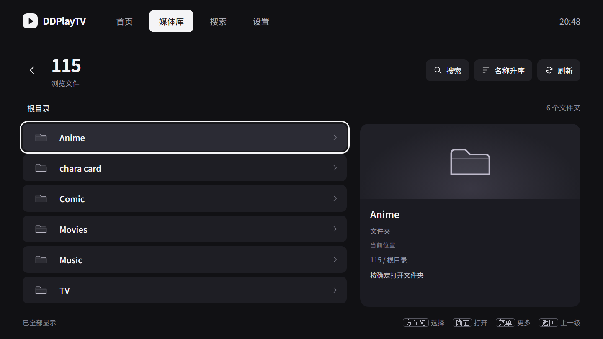

# 文件浏览页设计：C 列表与预览

日期：2026-10-31。状态：**用户已确认 C「列表与预览」，实施暂缓，原生未验收。** 用户要求当前先创建任务文档，等其他任务之后再恢复；执行入口为 [C 方案实施任务](../plans/2026-10-31-file-browser-preview.md)。设计确认不等于现在开始实施。

## 设计依据与范围

沿用 `document/prototypes/tv-ui/index.html` 已选的「沉浸放映」风格，补齐从媒体来源进入目录后的文件浏览页。原原型只有文件行示例，没有完整的目录页、分页状态与文件操作设计；不能将此前文件页样式调整视为原型一致性验收通过。

电视当前截图为 `.tmp/cinema-parity/tv-current-after-install.png`。已观察到文件夹使用宽大灰色行、重复“目录”副标题和明显图标底块，列表结束文字获得整行焦点。截图上方部分行被裁切可能是滚动位置，不能据此认定布局存在裁切缺陷。

本次只交付设计。示例名称、封面、文件大小、时长和进度都保存在网页内存中，不代表用户真实文件，不访问电视或存储服务，不修改 Android 源码。

## 预览

在项目根目录运行：

```powershell
node document/prototypes/tv-ui/server.cjs
```

打开 `http://127.0.0.1:4173/files-prototype.html?variant=preview`，或直接打开 [HTML 原型](../../../document/prototypes/tv-ui/files-prototype.html)。底部切换布局，顶部切换场景；方向键移动、Enter 确认、Esc 返回、M 模拟菜单键，支持鼠标和全屏。

| 方案 | 构图与适用点 | 取舍 |
| --- | --- | --- |
| A：目录网格（未选） `?variant=grid` | 纯文件夹目录为三列网格；有视频时使用纵向列表。六个文件夹一屏展示，与沉浸放映的横向卡片节奏接近。 | 文件夹与视频场景采用不同布局，原生需要明确保存每个目录的布局与焦点。 |
| B：紧凑列表（未选） `?variant=list` | 文件夹与视频保持单列，弱化卡片底色，突出名称。 | 密度高、结构稳定；纯文件夹时更像文件管理器。 |
| **C：列表与预览（已选）** `?variant=preview` | 左侧列表，右侧跟随焦点显示已有封面和文件信息。 | 可见名称较短；目录缺乏图片时，预览区信息价值较低。 |

用户已选择 C，取代 agent 先前对 A 的推荐。文件浏览主体固定为左列表、右预览；A/B 仅保留为历史对照，不改变首页、媒体库、播放器或设置的已选方向。原型默认及后续实施均以 `variant=preview` 为准。



## C 方案视觉规则

- 1440 × 810 为设计画布，对应 960 × 540 dp。电视 1920 × 1080 / 320 dpi 与此是同一逻辑比例，不以缩放解释既有视觉差异。
- 背景 `#111114`，常规行 `#1e1e24`，主文字 `#f5f5f7`，辅助文字 `#9999a7`。左右留白 54 px；延续已有顶部导航、圆角与白色焦点。
- 顶部先显示来源名，下一行显示可返回的目录路径；搜索、排序、刷新在右侧。数量属于当前已加载目录，不推测未加载数量。
- C 保持左侧列表与右侧预览，目录、视频和混排使用同一结构，不实现 A 的目录网格。文件夹使用小幅填充的线性图标，不叠加图标底块或重复“目录”文字；右侧显示目录名称、路径和操作提示，不虚构海报与子文件数。
- C 的列表标题 20 px，视频缩略图 76 × 46 px，行间距 9 px。左列声明宽 790 px、两栏间距 32 px；目录最小行高 64 px，视频最小行高 66 px，实际高度还受内容与 padding 影响。列宽、面板和行高以渲染后的 C 画面量测为准，不套用 A 的尺寸。文件名优先，大小、已知格式和已有观看进度放在次行，已知时长右对齐。
- 没有封面使用低对比度视频占位；未知时长、大小、格式与进度不填假值。文件扩展名不能自动推导分辨率、HDR 或音轨能力。
- 长名称单行省略，文件操作面板完整换行显示。C 的预览标题最多三行，完整名称仍从相同操作入口查看。
- 焦点使用约 3 px 白色轮廓、4 px 外间距及轻微背景提亮，不大幅缩放整行。列表容器预留轮廓空间。
- “已全部显示”为无背景、不可聚焦的辅助文字。列表末尾没有大面积按钮式结束提示。

## 操作与状态

1. 新目录默认聚焦首项；返回上一级恢复原文件或文件夹及滚动位置。返回根目录以后，再返回媒体库原来源入口。
2. 上下移动左侧列表，右侧预览随当前文件更新且不抢焦点。首行向上可到路径与工具栏，再到顶部导航。末项向下停在末项，普通状态文字不得进入焦点链。
3. 视频行按确定播放；向右进入该行的“⋯”，向左回到主操作。菜单键提供同一入口；关闭面板恢复精确调用按钮，而不统一跳回第一行。
4. 文件操作沿用既有 `StorageFileAdapter` 的字幕、弹幕、音频绑定及解除能力，按文件状态显示。作品资料入口只在 `CatalogSourceReader` 支持的来源出现；115 示例不默认显示扫描/匹配功能。原型仅展示已有操作入口，不模拟绑定成功。
5. 搜索与排序使用居中面板。原型只筛选已加载示例，提供名称升降序；原生应保留来源原有搜索范围、按大小排序、目录优先等能力，并显示准确的范围文案，不能因这张设计移除现有功能。
6. 空目录保留路径及返回入口；首次加载失败显示“重新加载”和“返回上一级”；首次加载中保留返回。登录过期应使用来源现有重新授权入口，不能伪装成空目录。
7. 分页“加载更多”与失败重试是真正操作，必须可聚焦。加载时保留现有条目、避免焦点跳动；成功后从新增内容继续浏览，失败保留已有结果。原型的分页场景仅演示成功追加，加载中、分页失败、登录过期和刷新失败保留旧数据的细节尚未画入交互稿。
8. C 在目录、视频、混排和分页期间保持两栏列表结构。右侧预览以当前文件身份为准，移动到同一行更多按钮不切换对象；快速移动、返回与晚到封面不得显示上一文件的内容。

## 检查与实现边界

以下是选择 C 之前的网页探索证据，不能作为 C 全场景验收：网页以独立无界面浏览器渲染，检查三个方案及混排、长名称、空目录、首次加载失败、首次加载中、分页场景。2026-10-31 记录了 18 个观察步骤，浏览器运行异常为 0；方向键打开目录后返回到原 `TV` 文件夹，视频行右移到更多按钮并在关闭面板后恢复该按钮，列表到底仍停在末个视频，重试和分页追加可操作。两张 HTML 的脚本语法检查通过。截图位于 `document/prototypes/tv-ui/previews/`；网页检查记录位于 `.tmp/files-prototype/inspection.json` 和 `inspection.log`。这些是网页交互观察，不计为 Android 测试通过数。三个方案都有根目录截图；上述交互与大部分状态检查主要使用 A。C 其余状态须按新任务的 C01–C11 矩阵补验。

本设计没有改变原生文件绑定、存储协议、分页、播放或历史身份。布局已确认 C；原生尺寸映射和完整 DPAD 回归等待用户恢复任务后实施；网页检查不是 Android、物理电视或真实来源验收。
