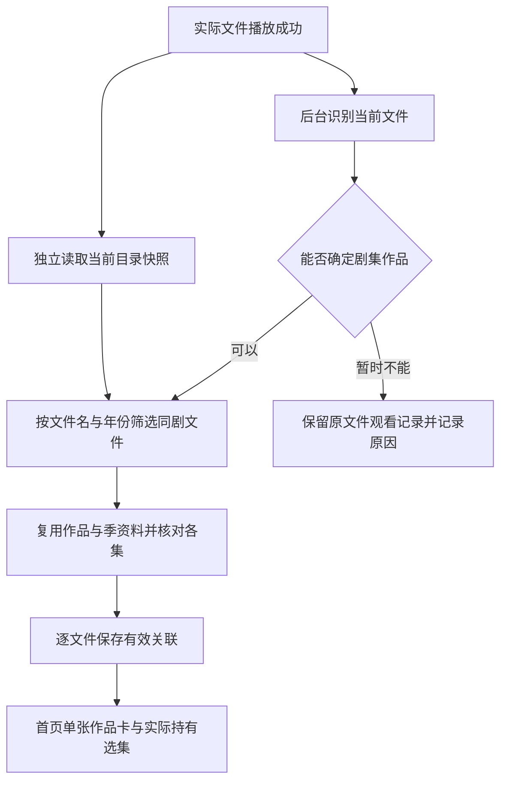

# 播放触发的自动刮削与同目录剧集入库设计

日期：2026-10-31。

状态：**设计文档；尚未实施。** 用户要求结合讨论方向、项目约束与成熟产品做法形成方案，本次未要求修改业务代码。本文中的新增接口、行为和验收项均为待实现设计。

本文接替[初版 TMDB 设计](2026-10-31-tmdb-media-library-design.md)中的识别入口、人工纠错和扫描触发方案；文件身份、资料缓存、来源隔离、播放进度与数据库事务等已有约束继续保留。既有实现与历史验证仍见[实施记录](../plans/2026-10-31-tmdb-media-library.md)，不能作为本文行为的验收证据。

## 1. 产品目标与设计判断

用户正常打开视频观看，应用在不打扰播放的情况下整理出海报、作品和已拥有的剧集。用户无需学习刮削流程、配置目录类型，或逐个搜索候选并绑定季集。

讨论中明确的方向是降低媒体维护成本；以下选择是综合后的设计，不把每个文件都带年份、必须手动改名等细节变成新的使用门槛。

| 议题 | 本方案选择 | 原因 |
| --- | --- | --- |
| 默认触发 | 播放成功后自动识别当前文件；剧集同时发现当前目录中的同剧文件 | 从真实观看需求开始，无需先整理整库 |
| 文件与目录 | 完整、合理的文件名足以识别；不要求目录分类或固定层级 | 电影和剧集可以混放，避免重复维护目录配置 |
| 识别策略 | 综合片名、年份、季集及可选显式 ID；明确结果自动入库，有歧义保留原文件 | 自动化不能建立在任取第一条搜索结果之上 |
| 人工操作 | 常规流程只提供问题说明、重新识别和资料刷新；不设计候选搜索、手选作品/季集向导 | 先解决解析和自动匹配能力，避免把工作逐项交给遥控器用户 |
| 命名要求 | 发布推荐格式，同时兼容可确定含义的常见命名；信息不足才提示补充 | 不因解析器过窄而要求用户批量重命名本来合理的文件 |
| 提前建库 | 保留用户主动扫描目录的能力，与自动流程共用识别逻辑 | 未播放的收藏也可以提前进入作品库 |
| 任务寿命 | 应用进程内异步执行；退出播放页仍可完成，重启后按下一次触发恢复所需范围 | 首期无需常驻服务，也不承诺退出应用后继续扫描 |

不增加新的在线资料源，继续使用 TMDB；弹幕匹配独立。令牌沿用构建注入并随 APK 提供，电视端不要求用户输入 API 凭证。

## 2. 成熟产品参考与本地取舍

下列官方资料已在本次讨论中于 2026-10-31 查阅，参考其公开行为，不据此宣称本项目具有相同识别率。

- **Infuse** 默认自动获取资料，支持按来源控制自动扫描、按需加载图片和文件规格。本方案借鉴“正常使用即可形成媒体库”和控制索引成本的做法；首期把自动范围收敛到正在观看的作品及其当前目录。[扫描与索引](https://support.firecore.com/hc/en-us/articles/27862264977047-Library-Scanning-Indexing)
- **Infuse** 纠正一集可以让同剧其他集重新匹配，说明剧集归属适合按作品处理。本方案把这一点用于自动归组和共享季资料，不引入逐集手动选择流程。[误匹配处理](https://support.firecore.com/hc/en-us/articles/4405035033495-Fixing-Mismatched-Titles)
- **Kodi** 在来源级配置媒体类型、目录结构，并区分新增内容扫描与已有资料刷新。本方案借鉴两种操作的区别，但不要求用户提供目录类型。[添加来源](https://kodi.wiki/view/Adding_video_sources)、[更新媒体库](https://kodi.wiki/view/Add_videos_to_library)
- **Jellyfin** 将媒体库视作多个路径的逻辑集合，并支持在文件名中指定资料 ID。本方案保留来源文件与作品的独立身份，可选 ID 只作为少数同名内容的精确线索，不成为普通命名必填项。[媒体库](https://jellyfin.org/docs/general/server/libraries/)、[资料标识符](https://jellyfin.org/docs/general/server/metadata/identifiers/)

Infuse 的番剧也依赖 TMDB 季集组织；连续集数不能普遍等同于第一季集号。本方案必须支持明确季集，但不凭目录位置或播放顺序猜测跨季关系。[命名说明](https://support.firecore.com/hc/en-us/articles/215090947-Metadata-101)

## 3. 当前实现依据与需要改变的部分

源码核对基线：`779ada366`，核对日期 2026-10-31。本次仅阅读源码，未运行新的应用测试。

| 当前依据 | 已有能力或缺口 | 设计要求 |
| --- | --- | --- |
| [MediaNameParser](../../../core_metadata_component/src/main/java/com/xyoye/common_component/metadata/MediaNameParser.kt)、[MediaMatcher](../../../core_metadata_component/src/main/java/com/xyoye/common_component/metadata/MediaMatcher.kt) | 普通电影解析出的类型为空，自动匹配直接拒绝；无显式 ID 时还强制要求年份，连续集数不自动确认 | 普通电影通过文件名和候选证据判断，不依赖目录配置；增加真实解析输入到匹配结果的连贯测试 |
| [MetadataCoordinator](../../../core_metadata_component/src/main/java/com/xyoye/common_component/metadata/MetadataCoordinator.kt) | 自动识别位于手动扫描内部，扫描默认递归；没有播放成功后入库的接口 | 提取共享识别流程，新增播放触发，明确当前文件/当前目录同剧/主动目录扫描三种范围 |
| [MetadataRepository](../../../core_metadata_component/src/main/java/com/xyoye/common_component/metadata/MetadataRepository.kt) | 已有身份校验、人工绑定保护、缓存和目录映射；文件变化判断未包含文件名本身 | 保留事务保护，增加命名输入变化的失效规则；不依赖手动目录映射 |
| [CatalogSourceReader](../../../core_storage_component/src/main/java/com/xyoye/common_component/storage/catalog/CatalogSourceReader.kt) | 首批支持本地、SAF、SMB、WebDAV；本地只读取已有视频索引 | 自动目录发现必须能看到授权范围内尚未索引的同级视频，不能要求先手动扫描本地全盘 |
| [PlaybackStateView](../../../core_contract_component/src/main/java/com/xyoye/common_component/playback/handoff/PlaybackStateView.kt)、[PlaybackDescriptor](../../../core_contract_component/src/main/java/com/xyoye/common_component/playback/handoff/PlaybackDescriptor.kt) | 已有会话版本与稳定文件引用，但公开状态不包含完整文件/父目录引用 | 在播放所有者处捕获稳定输入，通过窄契约提交；不能从显示标题、临时 URL 或历史排序反推当前文件 |
| [MetadataLibraryViewModel](../../../local_component/src/main/java/com/xyoye/local_component/ui/metadata/MetadataLibraryViewModel.kt) | 页面组合观察 Room 中的作品、文件、关联与历史 | 自动入库后由数据库驱动页面更新，保持文件历史身份和焦点 |
| [DatabaseInfo](../../../core_database_component/src/main/java/com/xyoye/common_component/database/DatabaseInfo.kt) | 当前数据库版本为 20，初版元数据迁移为 18→19 | 若需新增字段，从实施时实际版本增量迁移，不能沿用初版版本号 |

## 4. 用户流程与触发时机

### 4.1 首次播放电影

1. 用户从文件浏览、播放历史或已有详情入口打开视频，按原流程解析并播放。
2. 当前实际文件首次进入成功播放状态后，提交一次后台识别任务。不开等待弹窗、不要求确认，不在播放准备链路中等待网络或目录遍历。
3. 已有观看记录先按原文件名与可用缩略图展示；识别完成后补充作品信息和图片。
4. “继续观看”仍使用这份文件的真实历史与位置。电影自动触发只处理当前文件，不顺便刮削同目录其他电影。

### 4.2 首次播放一集，入库同目录同剧文件

例如当前目录有《示例剧》S01E01～S01E12，用户播放 S01E03：目录读取和识别成功后，12 集均进入同一作品详情；只有第 3 集产生实际观看记录，继续观看仍指向第 3 集及原进度。不是把 12 集标记为已播放。

默认只读取当前目录的一层，不递归父目录、子目录或整个来源。目录中其他作品、无法确认归属的文件、花絮不混入当前剧。相同作品的多个明确季可归入同一作品，分别核对各季资料；不同版本保留各自文件与来源。

### 4.3 再次播放、换集和资料更新

| 触发 | 行为 |
| --- | --- |
| 同一文件暂停/恢复、缓冲、seek、画面重建 | 不重复启动识别和目录任务 |
| 同一会话真正切换到另一物理文件 | 提交新文件触发；同目录已有运行任务合并，不创建重复全目录任务 |
| 后续再次进入播放 | 复用已绑定资料；对当前目录做受控的增量检查，识别新文件和命名变化 |
| 用户选择“重新识别” | 重新读取文件名/来源快照并重新执行匹配，可绕过该输入的失败抑制 |
| 用户选择“刷新资料” | 保持已有作品身份，更新简介、海报和季集文本；不把刷新等同于改绑 |
| 用户主动扫描目录 | 提前入库所选范围的电影和剧集；递归范围明确告知，与播放触发的一层同剧扫描区分 |
| 应用重启后 | 上次任务标记中断；下一次相关播放或用户重试时重新读取所需范围，保留已保存结果 |

建议默认同一目录成功读取后 60 秒内复用快照，避免连续换集反复访问来源；显式重试绕过该间隔。这是内部初始策略，需真实来源测量后调整，不增加电视端配置项。首次播放、过期快照、来源配置变化和已知目录变更不能被永久跳过。

## 5. 文件识别与同剧归组

### 5.1 命名与输入信息

| 示例 | 期望处理 |
| --- | --- |
| `电影名 (2024).mkv` | 用标题和上映年份查询电影，唯一且证据一致时自动绑定 |
| `电影名.mkv` | 可以查询；标题精确且能消除类型/同名歧义时自动绑定，不能仅因缺年份一律拒绝 |
| `剧名 (2023) S01E03.mkv` | 年份用于作品首播年份，季集用于具体播放集；不把每季播出年份当成新作品 |
| `剧名.S01.E03.1080p.mkv`、`剧名_1x03.mkv` | 常见等价季集格式应归一化，实际支持格式须有测试和用户说明 |
| `剧名 S00E02.mkv` | 核验 TMDB 第 0 季第 2 集是否存在 |
| `剧名 S01E01-E02.mkv` | 一份文件关联两集，保留同一播放进度，不虚构第二集起点 |
| `[字幕组] 剧名 - 13 [1080p].mkv` | 提取标题及连续集数；没有可靠季集依据时提示补充标准季集编号，不自动换算 |
| `剧名 S01E03 [tmdb-tv-123].mkv` | 可选的明确 ID 帮助消歧，仍验证类型及目标季集；不要求普通用户添加 |

目录名可作为辅助线索或兼容信息，但不是标准文件名识别的必要输入，也不能覆盖文件名的明确作品、年份或季集。短标题、数字片名、续作编号和中日文字符必须保留。只去掉可以确认的编码、分辨率、发布标签等噪声。

### 5.2 自动选择规则

1. 明确季集标记优先提供剧集类型线索；无季集时结合标题、年份、候选类型判断，不把“未知类型”直接判失败或强制全部当电影。
2. 可选显式 ID 校验通过时优先；否则比较规范标题、原名、可靠别名、年份与候选冲突。年份是强线索，不是所有文件的必填门槛。
3. 模糊匹配只用于寻找和排序候选，不能以热度、最高分或“搜索第一项”作为单独确认依据。同名同年或跨类型冲突不能消除时保留未识别。
4. 自动搜索有预算；候选结果截断或预算不足时不能冒充已确定唯一。不得把内部评分显示为未经测量的准确率百分比。
5. 查询成功但无结果、命名信息不足、服务请求失败分别记录。符合规范而解析失败是程序缺陷，不能统一提示用户改名。

### 5.3 同目录扩展规则

先确定当前播放文件的作品身份，再扩展同剧文件。标题和年份一致的一组文件可以复用作品查询；别名、不同语言标题或年份差异需要额外证据，最终必须落到同一个 TMDB 剧集 ID，不能单凭位于同一目录就关联。

每个候选文件都要验证自己的季与集存在；某一文件失败不回滚其他已确认文件。对同一剧集、同一季复用查询结果，不按每集重复拉取整季。当前文件未识别成功时，不把全目录任意文件搜索结果强行当作它的作品；保留文件入口和问题状态，等待下一次有效触发。

资料服务中的全集仅用于核对。选集列表只提供实际发现且已关联的文件，不能把 TMDB 上存在而用户没有的集数变成播放按钮。

## 6. 职责与接入方式

沿用现有模块，不新增通用事件总线、插件框架或第二套媒体数据库。

| 层/模块 | 责任 |
| --- | --- |
| `player_component` 的播放所有者 | 在实际来源首次成功播放时捕获不可变触发输入；覆盖 Media3、mpv、历史恢复和真实换集；不执行目录或 TMDB 请求 |
| `core_contract_component` | 新增窄的自动入库提交契约，传递稳定文件/目录引用、会话与来源版本；不暴露元数据实现 |
| `core_metadata_component` | 实现提交契约，管理应用级异步任务、去重、命名解析、作品归组、匹配及保存 |
| `core_storage_component` | 提供独立只读文件/目录快照，保留来源配置版本、真实父目录与完整性信息；不引用 metadata 实现 |
| `core_network_component` | 继续负责 TMDB 鉴权、请求、限流与错误分类 |
| `core_database_component` / `data_component` | 保存文件、作品、绑定、命名版本及必要任务状态，执行版本检查与增量迁移 |
| `local_component` / `storage_component` / `user_component` | 展示海报库、实际选集、任务/问题及刷新入口，移除常规人工选作品/季集流程 |

推荐沿用跨模块 Service/ARouter provider 方式，契约提供快速提交方法，具体命名在实施时确定。`player` 只依赖 contract，不新增 `player → core_metadata` 或 `core_storage → core_metadata` 依赖。

触发输入至少包括：`PlaybackSessionVersion`、来源 ID、播放解析时对应的来源内容代次/配置版本、`PlaybackFileReference`、可得的真实父目录引用。来源版本须随解析得到的输入保留，不能在异步处理时读取新配置并冒充播放当时的来源。提交只入队，任何入库失败不能传播为播放失败。

`PlaybackStateView` 当前只有来源摘要，不能直接当成完整目录扫描输入。应从活动来源的稳定描述符获取文件引用；投屏或其他无法还原到持久来源文件的播放，不按临时 URL 猜测目录。

## 7. 来源、完整性与执行成本

首批实施沿用已支持的本地、SAF、SMB、WebDAV。FTP、Alist、PC 和云盘仍需独立目录快照适配与验收，不能把本设计写成所有播放协议均已支持。未支持自动入库的来源仍正常播放，并在资料状态中明确能力限制。

- **本地**：补充授权范围内当前物理目录的定向发现，读取文件名和必要身份信息，不触发全盘扫描，不读取视频流来推测作品。仅查询旧索引不能宣称已找到同目录所有集。
- **SAF**：父目录来自真实浏览上下文/可验证目录快照；文档 ID 是不透明标识，不能截取 URI 推断父目录。无法获得父目录时先处理当前文件，并说明同目录发现未完成。
- **网络来源**：创建独立 Storage 读取当前目录，释放自己的连接；不能借用播放中的实例、分页游标、搜索筛选列表或可关闭的播放租约。
- **完整性**：只读取一层也必须覆盖完整目录。部分失败允许保留已成功入库项，不得删除未读到的旧关联或声称“全部完成”。
- **同剧筛选**：筛选后的文件集合不是完整目录快照。播放触发任务首期只做发现/更新，不调用全目录缺失清理；主动完整扫描仍使用原完整性规则。
- **成本**：沿用有界 TMDB 并发，同作品/季合并请求；图片按显示需要加载。播放与用户主动重试优先，不通过后台拉取媒体内容来补充装饰信息。

短时间内以来源版本、目录及作品识别输入合并任务；不同作品即使在同一目录也不能被错误合并。暂停/恢复事件按会话来源版本去重。应用级任务可以在播放页退出后完成，来源删除、配置变更或文件身份变化则使对应结果失效。

## 8. 数据兼容、改名与失效

### 8.1 沿用已有身份

继续使用来源/文件身份保存历史，使用 TMDB 类型与 ID 保存作品身份。一部剧合并显示不代表不同文件、副本或来源共用进度。后台元数据更新不能切换播放器来源、重新 prepare、覆盖字幕/弹幕或重置播放位置。

识别输入的文件名、相关路径身份或规则版本发生变化，应使旧识别尝试失效。当前 `index()` 只比较 uniqueKey、大小和修改时间，实施时必须覆盖“文件名变了但其他标记未变”的情况。有效绑定不做无条件定时重搜；失败输入保存必要原因和重试状态，避免每次播放都重复相同无效请求。

### 8.2 用户在媒体源中改名

应用不负责重命名视频。重新播放或扫描时读取真实新名称，并按新输入自动识别，无需先清缓存或解除绑定。

若协议提供稳定文件 ID 或已有可验证的重命名关联，可以迁移文件定位并保留历史；仅有路径、相似名称、大小或同一 TMDB ID 时，不能证明新旧文件是同一份。此时保留旧历史，新文件独立建立关联，不能自动把另一版本的进度移过去。**所有协议改名后无缝继承进度仍是能力边界，不在缺少证据时作出承诺。**

### 8.3 兼容旧人工结果

移除人工匹配入口不意味着升级时删除用户已有数据。现有有效手工关联继续使用，不在升级时全库重新绑定；内部事务、revision 与迟到结果保护继续保留。

对明确变化的文件重新识别时，先校验身份与输入版本，再按新自动规则处理；网络失败不清空旧的有效资料。“重新识别”可以显式替换旧绑定并解除该项旧忽略状态，但只在新结果确认且事务成功后报告完成。未重新识别的旧 `IGNORED` 保留原意，不能因升级偷偷重新加入。

不为新流程新增目录类型、人工季度偏移或用户维护的目录映射规则。需要持久化的少量命名版本/重试字段应复用现有实体职责；实施时根据实际 schema 设计迁移，不因移除界面就删除兼容所需列。

## 9. 首页、详情与问题处理

| 页面/状态 | 目标体验 | 必须保留的行为 |
| --- | --- | --- |
| 首次播放、识别未结束 | 视频直接播放；观看记录显示原文件信息 | 不弹候选、不阻塞播放器 |
| 作品识别成功 | 首页补上海报和作品名；同剧按作品聚合 | 当前观看集、来源和精确进度不变 |
| 同目录部分完成 | 详情逐步增加已确认集数，可查看尚未完成状态 | 不把未播放集标成已观看，不隐藏原文件入口 |
| 同一集多个副本 | 展示可用来源/文件版本供播放选择 | 选择播放文件属于现有能力，不等于手动选择 TMDB 候选 |
| 命名信息不足/歧义 | 问题页显示原文件名、具体原因和建议格式，提供重新识别 | 不要求选择作品、季或集；不把所有失败归咎于用户 |
| 网络/权限/资料缺失 | 分别提示暂时不可访问、来源权限或 TMDB 条目问题 | 重试失败保留旧资料与播放能力 |
| 任务页 | 展示扫描范围、已入库/未识别/失败数量与重试、取消 | 默认焦点落在相关任务或返回操作；缓存清理放到次要设置 |

“待确认”作为内部旧状态可以保留兼容，但新用户文案使用“未识别/识别问题”，避免暗示必须人工选择候选。详情及问题页提供“重新识别”“刷新资料”，去掉“搜索候选”“手选季集”“预览人工映射”等常规入口；不为这些动作恢复已由[菜单精简任务](../plans/2026-10-31-file-browser-menu-simplification.md)规划移除的逐文件操作菜单。

维持已选 Cinema 页面结构与 TV 焦点规则。卡片从文件信息变成作品信息、同剧合并或选集增量更新时，要将原焦点映射到对应的新卡片，不能跳到首项或不可见位置。页面重订阅仅观察数据，不重新启动任务。

本设计规定交互行为，不重新选择视觉方案。实施前需要给受影响的菜单、任务与问题状态补齐页面覆盖矩阵；有结构变化时沿用既有原型与截图对照要求。

## 10. 验收要求

以下均为待验证项，没有因为文档创建而标记通过。

| 编号 | 场景 | 通过条件 |
| --- | --- | --- |
| AM01 | 标准电影名，未配置目录类型 | 文件解析到自动绑定整条路径通过；不能在测试中预先手工补 `kind=movie` 掩盖缺口 |
| AM02 | 唯一无年份标题、同名翻拍、数字片名、中日文、续作 | 可确定的常见名称正常入库；歧义及年份冲突不错误自动绑定 |
| AM03 | 播放目录中第 3 集，实际有 12 集 | 成功发现并绑定 12 集；只有第 3 集有观看历史，续播位置不变 |
| AM04 | 混放其他剧、电影、花絮、同剧不同季及多个版本 | 同剧按 TMDB 身份归组，季集分别正确；其他作品不混入，副本历史分开 |
| AM05 | S00、合并集、连续集数及 TMDB 缺集 | 明确季集正确关联；无依据的连续集数提示原因；不存在的集不可播放 |
| AM06 | 暂停/恢复、seek、快速换集、页面重建 | 无重复任务堆积；同目录任务合并；Media3/mpv 均不会因刮削重新准备或切源 |
| AM07 | 大目录、多页、部分权限失败、超时、源离线 | 不把已加载一页当完整目录，不误清理其他作品或旧文件，成功项可保留 |
| AM08 | 播放前同级文件未进本地索引；SAF 无可靠父目录 | 本地可定向发现新增集；SAF 明确回退当前文件，不猜目录或扩大扫描范围 |
| AM09 | 修改文件名、同路径替换、来源更换、旧结果迟到 | 新命名触发重新识别，旧输入不能覆盖新结果；来源与文件身份保护有效 |
| AM10 | 升级带人工绑定/忽略状态、旧播放历史的数据库 | 无破坏性迁移、无静默丢历史；旧数据与重新识别的兼容语义符合第 8 节 |
| AM11 | 网络错误、限流、凭据缺失、无候选、图片失败 | 原因正确区分，重试有界；无需用户输入 TMDB 令牌；视频仍正常播放 |
| AM12 | 首次入库、增量加集、返回首页及问题页 | 纯 DPAD 可达、可返回；焦点稳定、文案不裁切；无强制候选选择流程 |
| AM13 | 后续新增第 13 集、任务中断后重新播放 | 更新范围后补入新增集；已保存关联复用；不声称进程退出后继续执行 |

先建立真实电影/剧集命名样本集，再分别报告自动覆盖率、错误绑定数、未识别原因与完成耗时；没有样本前不承诺准确率。除解析单测外，必须覆盖播放事件到持久化到首页的集成路径，并在两个内核上验证网络不可用时仍可及时播放。

实施后的验证包括与改动匹配的 Gradle 构建、JVM、lint、模块/播放边界检查，查看日志尾部确认 `BUILD SUCCESSFUL` 或 `BUILD FAILED`。AVD 行为、实际来源、截图对照与物理电视验收分别记录；使用物理电视仍遵循当次用户授权。

## 11. 实施顺序与范围边界

前置独立任务是[文件浏览菜单精简](../plans/2026-10-31-file-browser-menu-simplification.md)：移除冗余操作与文件级资源绑定入口，保留播放器控制、旧绑定，以及目录扫描/媒体库待识别列表中的旧识别流程。该任务当前也仅为计划；不能在自动识别可用前整体退役人工匹配页面。

随后，本设计内部建议依次完成：

1. 建立命名样本与自动匹配回归，修复普通电影类型缺口，明确命名诊断。
2. 接入播放成功后的窄契约，先打通单文件自动入库及首页更新。
3. 增加同目录同剧发现、按作品/季复用、去重和增量检查，补齐本地定向读取与 SAF 父目录传递。
4. 调整人工入口、问题/任务展示和旧数据兼容，完成 AM01～AM13 验证。

这一顺序用于实现安排，不构成当前已开始开发的记录。无需先建设全源自动扫描或常驻后台服务。

本次设计不扩展 NFO 导入导出、自选图片、多资料源、自动重命名、跨目录搜集全集、跨作品自动连播或跨设备同步。无稳定身份的外部改名、尚未支持的来源协议和实际识别覆盖率需要明确记录能力边界；不能通过重新引入强制目录配置或人工匹配步骤掩盖未完成项。
