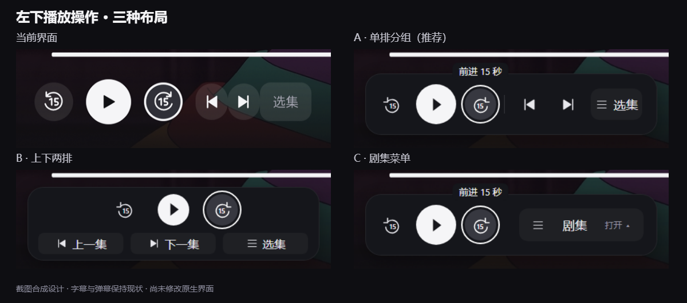
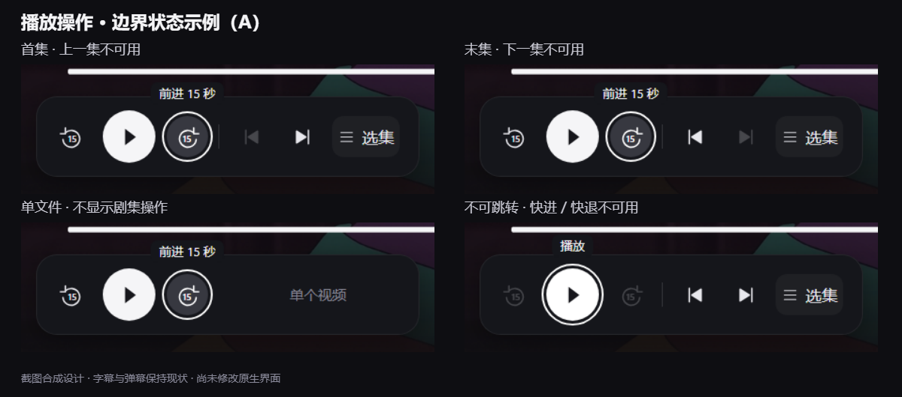

# 播放器左下操作组：A 单排分组

日期：2026-10-31。状态：**用户已确认 A「单排分组」，后续已授权并完成原生调整及部分本地验收。** 完整状态见 [本轮执行账本](../plans/2026-10-31-ui-polish.md)。 后续任务为 [UI-PLAYER-CONTROLS](../plans/2026-10-31-player-controls.md)。文件浏览页已选 C 是另一项任务，不代表本页也选 C。

## 用户确认的范围

用户纠正截图判断：“1，3不是问题，2才是需要调整的，这一块也要重新设计。”本次仅重设计左下角后退 15 秒、播放 / 暂停、前进 15 秒、上一集、下一集和选集。

**字幕位置、字幕与控制区的相对关系、弹幕覆盖标题均为用户接受的现状，不列入问题或整改清单。** 进度条、右侧字幕 / 音轨 / 弹幕入口及顶部控件不在这次改版范围。

依据为用户授权取得的电视截图 `.tmp/tv-current/tv-2026-10-31T07-12-44-176Z.png`；可复现副本为 [当前界面](../../../document/prototypes/tv-ui/previews/player-controls-baseline.png)。本设计复用该截图，没有再次连接或操控电视。

## 实施前缺口（历史依据）

`document/prototypes/tv-ui/index.html` 的 `playerPage()` 仅画了快退、播放和快进，未涵盖上一集、下一集、选集，不能据此宣称完整播放按钮组已经符合设计。

设计时 `player_component/src/main/res/layout/layout_player_bottom.xml` 中，播放键为 42 dp，快退 / 快进为 36 dp；上一集 / 下一集为 30 × 34 dp，且这两个按钮与选集之间没有独立间距。`PlayerBottomView.updateSourceAction()` 根据来源隐藏不可用的前后项，文件组大于 1 才显示选集。这说明原生确实保有这三项能力；改版必须完整保留，而不是继续按缺项原型实现。

## 已选 A 与历史方案对照



| 方案 | 结构 | 取舍 |
| --- | --- | --- |
| A：单排分组 `grouped`（已选） | 左侧为播放三键，细分隔线后为上一集、下一集、选集；六项直接可达。 | 保持单排路径，次级图标等大、间距一致；上一集 / 下一集通过焦点提示补充文字。 |
| B：上下两排（未选） `stacked` | 第一排播放三键，第二排带文字的上一集、下一集、选集。 | 功能辨识直接，但控制区更高，需要上下导航。 |
| C：剧集菜单（未选） `menu` | 常驻播放三键和剧集入口；菜单提供上一集、下一集、选集。 | 常驻界面最简洁；切换前后集需要多打开一层，选集也是二级入口。 |

三版使用同一暗色托盘承载按钮。白色主播放键、细白焦点环、统一线性图标延续沉浸放映风格。大面积媒体背景、字幕和弹幕保持截图原样。这里的图片是**局部合成设计**，不是修改后 APK 的截图。

用户随后明确选择“就 A 吧”。后续固定为 A 单排分组，六项能力直接可达；原型已移除 B / C 的交互分支和方案切换，历史对照图仅解释取舍。设计确认不等于原生实现或验收完成。

## 尺寸与状态

- 设计画布为 1440 × 810，原截图为 1920 × 1080，按 0.75 等比呈现。已选 A 托盘边界为 `(50, 699, 408, 86)`。这只是设计像素，原生必须重新核对 dp / density，不能直接抄作 dp。
- A 主播放键为 56 × 56，次级图标按钮为 44 × 44；播放组三键间距 12，剧集组间距 10，两组相距 24，选集宽 72。焦点为 2 px 轮廓与 3 px 外间距，不缩放挤压邻项。
- A 的按钮焦点显示短操作名，焦点提示不得覆盖进度条。
- 当前截图中字幕左缘约在设计坐标 x488，托盘止于 x458。本稿以此检验局部宽度，没有把字幕位置当作需要修复的内容。
- **A 的边界状态**：首集 / 末集的不可用前后集保留位置、降低亮度并跳过焦点，避免按钮跳位。设计时会隐藏这些按钮；后续已实现禁用占位，实际证据见执行账本。单个文件不显示剧集入口；“单个视频”为无焦点辅助文字。
- 不可快进 / 快退时，两键禁用且不可聚焦；播放键保持可达。不能仅改变透明度而仍允许操作。
- 原型 `scene=playing` / `middle` 分别展示播放中 / 暂停；`first` / `last` / `single` / `unseekable` 展示边界。片名、字幕、进度条是静态截图，底部评审栏显示模拟状态；不代表真实切集或播放成功。



## 方向键与返回

1. 原型默认聚焦前进 15 秒，用于与截图对照。正式页面默认焦点沿用现有播放行为；再次打开控制条恢复有效调用位置，不以截图焦点改变默认逻辑。
2. A 从左到右经过六项，再进入原有右侧字幕、音轨、弹幕控件；不可用项跳过。不增加 B 的第二排或 C 的剧集菜单。
3. 选集返回恢复选集按钮。切集后原按钮不可用时回到选集；不要把焦点留在禁用控件。原型的三项示例列表只验证入口、确认和返回，**不替代现有完整来源列表面板设计**。
4. 播放 / 暂停和 ±15 秒继续调用现有控制器；列表来自真实播放来源，不能改成 TMDB 集数或原型示例。实际切换失败保留现有错误语义与可恢复焦点。
5. 范围外按钮在网页中仅作为焦点占位；不会打开字幕、音轨、弹幕设置，也不声称验证了这些原生功能。

## 预览与检查

```powershell
node document/prototypes/tv-ui/server.cjs 4175
```

访问 `http://127.0.0.1:4175/player-controls-prototype.html?variant=grouped`，或直接打开 [HTML](../../../document/prototypes/tv-ui/player-controls-prototype.html)。页面固定为已选 A，顶部选择状态或查看当前截图；方向键、Enter、Esc 可操作。所有状态仅在网页内存中。

选择 A 之前的探索证据：2026-10-31 本地隔离 Edge 在 1440 × 810 下记录了 33 个观察步骤、0 个脚本运行异常，覆盖三版的选集入口 / 返回、右侧可达、播放切换和边界场景，以及 A 的快进、前一项切换与末项选择。实际查看了三版整体图、评审页面、菜单、选集和边界状态对照。发现并修正 B 的焦点提示压到进度条，以及白色播放键提示文字不清晰。脚本语法检查通过。记录为 `.tmp/player-controls-prototype/inspection.json` / `inspection.log`，这是网页模拟检查，不是 Android 测试数。

最初设计阶段未修改 Android、执行 Gradle、打包或安装。此前原生构建和行为检查仍是历史证据；左下按钮组视觉完成结论不能继续沿用。真实列表、切集失败、加载期间的可操作性和两种播放器内核仍须在实施时验证。

用户选择 A 后，原型固定为 A 并移除未选分支；本地复查 13 个网页观察步骤、0 个运行异常，选集返回、边界焦点、右侧可达及播放模拟保持正常。已查看更新后的评审页，记录为 `.tmp/player-controls-prototype/selected-a-inspection.json`。这只验证选稿后的网页整理；原生后续实施和剩余验收另见执行账本。
