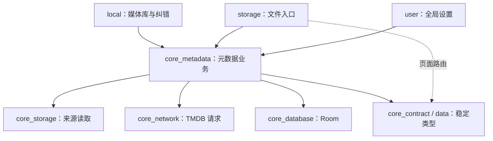

# TMDB 媒体库与刮削设计

日期：2026-10-31。状态：**用户已授权实施，代码与验证进展见实施记录**。本文保留设计依据和验收约束；实际交付范围、检查结果与未验收项目以 [实施记录](../plans/2026-10-31-tmdb-media-library.md) 为准。

已确认的产品范围见 [TMDB 待办](../../../document/media-library/tmdb-metadata-followup.md)。交付顺序为：**文件关联与手动纠错 → 使用真实数据的新 UI → 批量与增量刮削**。真实 TMDB 请求、识别率测量与物理电视验收仍需独立完成。

## 1. 目标与设计前提

用户从本地或网络来源进入媒体库，能以作品浏览电影、电视剧和番剧，查看海报、简介、季度及单集，并播放实际拥有的文件。元数据不可用时，文件浏览、历史及播放仍然可用。

已确认约束：

- 在线作品资料统一使用 TMDB；弹弹play 弹幕匹配和现有番剧资源搜索保持各自职责。
- 新页面采用已选的暗色「沉浸放映」方案，使用现有原生 XML、MVVM 与 DpadRecyclerView。
- 来源连接参数按来源保存；用户播放、浏览偏好保持全局化。
- 历史、快照和活动会话继续遵守现有身份与恢复契约，显式进度（含 0、90%、95%）优先。
- 本地索引与在线资料保存在电视端；本方案不要求搭建媒体服务器。

本次实施采用的默认选择：新增一个 `:core_metadata_component`；首期以用户触发的单文件匹配为主，来源限定本地、SAF、SMB、WebDAV；资料默认中文，缺失字段回退原名或英文；自动匹配采用保守规则。实现不等同于四类真实服务已经通过验收。

首期不包括：NFO 导入导出、文件重命名/搬移、演员中心、预告片、收藏合集、跨设备同步、多个在线提供方、AI 识别，以及常驻后台全盘扫描。TMDB 返回的未持有单集不能成为可播放项目。

## 2. 参考项目：借鉴内容与本地适配

调研日期为 2026-10-31。NOVA 核对到 `aos-MediaLib` 提交 `0eb2e2108f76cc3533d652c663e91d6f0ea81936`；Jellyfin 为当日读取的 `master` 文件，实施时应重新固定 revision。tinyMediaManager 仅参考官方功能说明，未完成其当前源码审查。

| 参考与证据 | 可借鉴经验 | DDPlayTV 的适配 |
| --- | --- | --- |
| NOVA [SearchPreprocessor](https://github.com/nova-video-player/aos-MediaLib/blob/0eb2e2108f76cc3533d652c663e91d6f0ea81936/src/com/archos/mediascraper/preprocess/SearchPreprocessor.java) | 独立预处理文件名/目录与用户输入，分开电影、剧集的识别规则 | 解析器成为可离线测试的纯 Kotlin 逻辑；保留未知类型，不把剩余所有输入默认当电影 |
| NOVA [ShowScraper4](https://github.com/nova-video-player/aos-MediaLib/blob/0eb2e2108f76cc3533d652c663e91d6f0ea81936/src/com/archos/mediascraper/xml/ShowScraper4.java) | 年份回退、同名剧候选、季信息复用、特别篇与连续集数处理 | 保留有界候选与按季复用；有歧义时让用户确认，不默认跨季累加集数 |
| NOVA [AutoScrapeService](https://github.com/nova-video-player/aos-MediaLib/blob/0eb2e2108f76cc3533d652c663e91d6f0ea81936/src/com/archos/mediascraper/AutoScrapeService.java)、[ScraperCache](https://github.com/nova-video-player/aos-MediaLib/blob/0eb2e2108f76cc3533d652c663e91d6f0ea81936/src/com/archos/mediascraper/ScraperCache.java) | 扫描批次身份、成功/错误分开、共享缓存与语言隔离 | 采用协程与 Room；任务不持有页面；不复制其 Service、广播和持久化架构 |
| NOVA [误匹配记录](https://github.com/nova-video-player/aos-MediaLib/blob/0eb2e2108f76cc3533d652c663e91d6f0ea81936/doc/scraper_improvements.md) | 短标题、续作编号、译名会导致误匹配，候选排序与查询词错误需要分别定位 | 建立本项目样本集；流行度不作为自动确认依据；参考项目的识别率不能当成本项目结果 |
| Jellyfin [TmdbMovieProvider](https://github.com/jellyfin/jellyfin/blob/master/MediaBrowser.Providers/Plugins/Tmdb/Movies/TmdbMovieProvider.cs)、[TmdbEpisodeProvider](https://github.com/jellyfin/jellyfin/blob/master/MediaBrowser.Providers/Plugins/Tmdb/TV/TmdbEpisodeProvider.cs) | 已知 ID 与搜索分流；剧集依赖作品、季、集定位；一个文件可能覆盖多集 | 元数据 ID 与文件身份分离；合并集保留多个单集关联，播放和进度仍以文件为单位 |
| Jellyfin [TmdbClientManager](https://github.com/jellyfin/jellyfin/blob/master/MediaBrowser.Providers/Plugins/Tmdb/TmdbClientManager.cs) | 集中请求、语言参数、缓存以及 episode group 映射 | 缓存键覆盖全部影响响应的参数；首期按 TMDB 常规季集组织，其他排序留给明确的手动映射 |
| tinyMediaManager [刮削说明](https://www.tinymediamanager.org/docs/scrapers) | 元数据、图片、语言回退分开配置与处理 | 保留必要的刷新/纠错语义；首期不引入桌面工具的多提供方和文件整理功能 |
| [tmdb-java](https://github.com/UweTrottmann/tmdb-java) | Retrofit API 接口和模型可以作为字段参考 | 推荐沿用项目 Retrofit + Moshi，先实现实际需要的接口，避免同时引入另一套序列化与客户端生命周期 |

上述是行为与职责参考，不是整模块复制方案。参考项目存在的兼容分支、默认值和未修缺陷，不自动成为本项目需求。

## 3. 当前源码依据与必须保留的边界

本仓库核对基线：`6a9a1e817fb6532faf43736c4d782854202efb8d`，设计开始时工作区无业务代码改动。入口文档仍有过期模块数量/Bilibili 描述，本方案以当前源码与已确认退役决策为准，不修改 AGENTS.md。

| 当前实现 | 设计约束 |
| --- | --- |
| [MediaLibraryEntity](../../../data_component/src/main/java/com/xyoye/data_component/entity/MediaLibraryEntity.kt) 保存来源连接；[VideoEntity](../../../data_component/src/main/java/com/xyoye/data_component/entity/VideoEntity.kt) 是本地视频表 | 不把作品字段堆入来源表，也不把本地视频表改成所有网络协议的文件表 |
| [Storage](../../../core_contract_component/src/main/java/com/xyoye/common_component/storage/Storage.kt) 有可变目录状态；[PagedStorage](../../../core_storage_component/src/main/java/com/xyoye/common_component/storage/PagedStorage.kt) 的分页只对应当前目录 | 索引必须使用独立 Storage 实例；浏览页已加载的一页或搜索结果不是全库快照 |
| [VideoStorage](../../../core_storage_component/src/main/java/com/xyoye/common_component/storage/impl/VideoStorage.kt) 刷新会扫描并增删本地 video 表 | 元数据任务不通过 `openDirectory(refresh=true)` 偷偷触发本地全盘刷新；索引已有结果，扫描刷新是独立动作 |
| [PlayHistoryEntity](../../../data_component/src/main/java/com/xyoye/data_component/entity/PlayHistoryEntity.kt) 使用 `(uniqueKey, storageId)`；其中 `episodeId` 用于弹幕 | TMDB ID 不替换历史键、不写入弹幕 episodeId，也不因作品相同合并历史 |
| [PlaybackReferenceFactory](../../../core_storage_component/src/main/java/com/xyoye/common_component/source/handoff/PlaybackReferenceFactory.kt)、[PlaybackDescriptor](../../../core_contract_component/src/main/java/com/xyoye/common_component/playback/handoff/PlaybackDescriptor.kt) 传递稳定引用 | 元数据不能持久化临时直链、请求头或活动 Storage；点击播放仍重新解析资源 |
| [RemoteStorageFile](../../../core_storage_component/src/main/java/com/xyoye/common_component/storage/file/impl/RemoteStorageFile.kt) 使用 Hash/路径生成 uniqueKey，PC 还可通过视频 ID 定位 | “历史身份”“物理文件定位”“TMDB 内容身份”分别保留；相同 Hash 不足以证明同一个来源或文件副本 |
| [DatabaseInfo](../../../core_database_component/src/main/java/com/xyoye/common_component/database/DatabaseInfo.kt) 当前为 Room 18 | 实施时从实际最新版本增量迁移；不破坏来源 ID、高水位、凭据和播放历史 |
| [RetrofitServiceProvider](../../../core_network_component/src/main/java/com/xyoye/common_component/network/RetrofitServiceProvider.kt) 支持独立 client + Moshi；[ImageViewExt](../../../core_ui_component/src/main/java/com/xyoye/common_component/extension/ImageViewExt.kt) 使用 Coil | 复用网络/图片基础；TMDB API 使用独立鉴权与错误处理，不套用弹弹play 签名或存储动态域名拦截器 |

异步结果、View 生命周期、浏览错误和续播遵循 [UI-readiness 契约](2026-10-30-ui-readiness-repairs-design.md)；全局设置和 PC 分组遵循 [全局配置契约](2026-10-30-global-settings-design.md)。

## 4. 功能模块与依赖

### 4.1 推荐一个集中的元数据模块

选择新增 `:core_metadata_component`，集中负责解析、匹配、关联、刮削编排和媒体库查询。它复用 storage/network/database，不拥有协议连接实现、播放器状态或 View。

另一种方案是在 `core_storage_component` 加 metadata 包，初期不需要新增模块边。但作品匹配、目录索引和播放器来源解析会继续集中在同一模块，而且 local/storage 两个页面仍需要共享完整规则。本功能已形成独立职责，因此建议增加一个模块，不再拆解析器、调度器、提供方等更多 Gradle 模块。

| 模块 | 本次设计的职责 |
| --- | --- |
| `data_component` | TMDB DTO、Room 实体、不可变展示数据和匹配状态；不依赖网络/数据库实现 |
| `core_contract_component` | 来源目录/文件的稳定快照类型及跨功能页面路由；复用现有播放描述符 |
| `core_network_component` | `TmdbService`、专用 OkHttp client、响应/错误映射；不决定文件是否匹配 |
| `core_database_component` | 元数据、关联及后续扫描状态的 DAO、事务、迁移；不发起 HTTP |
| `core_storage_component` | `CatalogSourceReader`：独立来源连接、目录分页、文件定位及快照；不依赖元数据模块 |
| **`core_metadata_component`（新增）** | `MediaNameParser`、`MediaMatcher`、`MetadataRepository`、`MetadataCoordinator`、媒体库查询；按下述契约管理任务和人工修正 |
| `local_component` | 首页、海报库、作品详情/选集、纠错页面；呈现 Room 查询结果 |
| `storage_component` | 文件浏览中的“识别/更正资料”“扫描此目录”入口，通过 contract 路由进入公共纠错页 |
| `user_component` | 全局元数据设置、任务/缓存入口、TMDB 署名；沿用现有凭据与配置方式 |
| `core_ui_component` | 通用焦点、列表、图片展示；不调用 TMDB 或读取元数据数据库 |
| `app` / `player_component` | app 装配现有功能入口；player 继续接收文件描述符，不运行刮削 |

新增模块仅向下依赖 contract/data、network/database/storage、system/log；local/storage/user 可直接依赖它，app 无需增加实现层直连，player 首期无需依赖它。禁止 `core_storage → core_metadata`，避免互相依赖。实现时同步模块治理允许矩阵、生成快照并运行治理检查，不理想化已有快照。

### 4.2 最小调用契约

- `CatalogSourceReader` 为指定 `libraryId + directoryReference` 创建独立来源，输出不可变文件快照和目录完成状态，在 `finally` 释放；取消必须向上传播。
- `MetadataCoordinator` 提供识别文件、搜索候选、确认关联、解除关联、刷新已绑定资料；后续增加扫描指定目录。所有变更带目标身份与预期 revision。
- `MetadataRepository` 提供作品、季集、文件关联和继续观看的可观察查询；页面只观察一次状态，不在重订阅时启动任务。
- 类型、语言、年份和季集参数均为显式输入。返回内容、无匹配、待确认、网络失败和鉴权失败必须可区分，不能统一转换为空列表。
- 单一 TMDB 实现直接使用具体服务；不先建设多提供方插件框架、全局事件总线或通用工作流引擎。

## 5. 数据模型：来源文件与作品分别保存

以下为逻辑实体和约束，字段名供实现定位；实施时再生成实际 SQL/schema。

| 逻辑实体 | 身份和关键字段 | 关系与规则 |
| --- | --- | --- |
| `CatalogSourceState` | `libraryId` 唯一；内容代次 `contentGeneration`、请求 revision、内容变更时间 | 首期即保存；服务器/账号/根目录变更创建新内容代次，密码轮换只使旧请求失效；不存凭据副本 |
| `MediaAsset` | 本地 `assetId`；`libraryId + contentGeneration + locatorKey` 唯一；历史 uniqueKey、协议文件引用、storagePath、原始文件名、父目录、可得的大小/修改标记、发现时间、可用状态 | 一个可定位文件副本一条；缺少大小/修改时间必须记为未知，不用 0 证明未改变 |
| `MetadataWork` | `(mediaKind, tmdbId)` 唯一；电影或剧集、原名、本地化标题/简介、日期、类别、评分、海报/背景路径、语言和抓取时间 | `movie:123` 与 `tv:123` 不同；动画使用 TMDB 类型/类别，不另创与 TV 冲突的 ID 空间 |
| `MetadataSeason` | `(seriesTmdbId, seasonNumber)` 唯一；名称、海报、日期、抓取状态 | 季号 0 是有效值；季列表来自接口，不能假设从 1 连续编号 |
| `MetadataEpisode` | `(seriesTmdbId, seasonNumber, episodeNumber)` 唯一；可得的 episode TMDB ID、标题、简介、日期、剧照 | TMDB 单集存在不代表有文件；列表按与文件关联的结果决定播放能力 |
| `MediaBinding` | 每个 asset 至多一个当前作品绑定；匹配状态、作品键、`AUTO/MANUAL`、锁定标记、revision、解析证据/规则版本、最近失败类别 | 人工关联拥有独立保护；未匹配的文件也能显示；刷新错误不抹掉已确认绑定 |
| `MediaBindingEpisode` | `(assetId, episodeKey)` 唯一及顺序 | 允许一文件多集、一集多文件版本；电影绑定无单集行，剧集可先确认作品再补单集 |

`locatorKey` 由协议读取侧用已有稳定引用生成：存在稳定协议文件 ID 时优先使用，否则使用来源内规范路径/SAF 文档身份。不能用临时 URL、显示标题或 TMDB ID 代替。跨来源相同内容可共享作品资料，但文件和历史仍分开；同来源内相同 Hash 的两个路径也不能丢失副本。第一期不实现自动搬移识别，不因文件重命名猜测继承绑定。

一个来源换成另一服务器/账号后，即使路径和 uniqueKey 相同，也按新内容代次建立 asset；旧绑定不自动继承，旧内容代次不进入当前作品库。来源编辑保存与代次更新需在同一数据库事务中提交。对内容变更前且无法核实归属的历史，保留原历史入口，不自动关联到新来源的作品卡片。

仅确认剧集作品、尚未确认单集时，保留作品键但状态为 `NEEDS_CONFIRMATION`，作品详情可在“待确认文件”中展示，不伪造选集项。文件大小/修改标记不可靠时不能保证识别出同路径替换；明确观察到变化则停止自动复用并待核查，缺少证据时保留人工关联并标明验证能力边界，不声称强内容指纹保证。

元数据首期保存当前全局资料语言的一份有效快照，并记录请求语言及回退字段来源；请求缓存仍区分语言。以后开放切换语言时，旧快照可暂时显示，但不能当成新语言刷新成功；旧语言请求必须被设置 revision 拦截。首次实施不需要多套翻译表。

关联提交事务：检查来源仍存在、asset 仍对应同一文件指纹、binding revision 未变化 → 写入有效元数据 → 替换该 asset 的作品/单集关联 → revision 增加。读取和写入历史不属于该事务。解除关联同样增加 revision，并默认进入“忽略自动识别”；用户可明确重新开启识别，防止刚解除又被后台绑回。

Room 迁移采用新增表与索引；若实施时仍为 18，则新增 18→19，不能提前假定版本未变。不重建已有 `video`、`media_library`、`play_history`，不采用破坏性迁移。数据库不存完整响应日志、访问令牌、Cookie、临时播放 URL 或活动连接。

后续批量阶段才增加 `ScanRun` 与目录检查点：记录范围、来源配置 revision、运行状态、目录完成标记和计数；文件身份/绑定依然只有上述一套。

## 6. 识别、候选与人工纠错

### 6.1 解析和自动确认规则

1. 从原始文件名及有限父目录上下文提取标题、年份、类型、季集、连续集数与可选显式 TMDB ID；原始值保留，用于回溯和重新识别。
2. 只移除可确认的扩展名、分辨率、编码、发布组等标签。不能粗暴删除所有括号、数字、罗马数字或日文字符；`1917`、续作编号可能就是片名。
3. 显式 ID 也须校验媒体类型、条目存在性及季集约束；无 ID 时先按类型、标题及可信年份搜索。无结果可有界地去掉年份重试，但年份冲突降级为待确认。
4. 自动绑定限于唯一且强证据候选：明确 ID 校验通过，或规范标题/已验证别名精确匹配、类型一致、已知年份一致、季集也可验证。同名翻拍、仅相似标题、缺少年份导致的多个候选均不自动绑定。
5. 受控模糊匹配用于排序候选，展示标题、年份、类型及关键冲突。评分不是概率，不宣称“95% 准确”；流行度只能辅助排序，不能覆盖编号或年份矛盾。
6. 选择作品后再查询需要的季；相同季的文件共用季详情。手动搜索支持分页，自动流程限制查询次数和候选数量，耗尽预算则转待确认。

### 6.2 番剧、特别篇和合并集

| 输入/情况 | 处理规则 |
| --- | --- |
| `Title (2024).mkv` | 电影候选按标题/年份查询；类型不明确时保留切换电影/剧集入口 |
| `Title.S02E03.mkv` | 验证作品后映射到第 2 季第 3 集；不能只因标题匹配就提交错误集号 |
| `[Group] Title - 13 [1080p].mkv` | 解析为可能的连续集数 13，不默认等于 S01E13；无已确认季集映射时待确认 |
| `Title.S00E02.mkv` | 使用 TMDB 特别篇季，确认该单集存在 |
| `Title OVA/SP/NCOP.mkv` | 标签提供线索；不把所有 OVA/SP 强制塞到第 0 季，NCOP/花絮默认保留文件入口并待确认/忽略 |
| `Title.S01E01-E02.mkv` | 一个文件关联两个已验证单集；两集入口指向同一文件，显示“合并集”；未获得章节位置时不伪造各集起点 |
| 一集有 1080p/4K 或不同来源副本 | 选集后选择实际文件；显示来源、文件名和已有规格，不额外解析视频流获取装饰标签 |
| TMDB 无单集/剧照/简介 | 保留已确认作品和原始文件信息；不生成虚假的单集 ID 或图片 |

首期手动选择“作品 → 季 → 集/集范围”即可处理连续集数；目录级偏移规则在批量阶段提供预览后提交。TMDB 提供 [episode groups](https://developer.themoviedb.org/reference/tv-series-episode-groups)，但不能假设所有番剧都有正确的绝对集数排序；自动 episode-group 映射不纳入首期。

### 6.3 操作语义

- **识别/重新识别**：重新解析并展示候选；对已有人工绑定，确认新选择前保留旧绑定。
- **更正资料**：选择作品及季集，提交后设为人工锁定。批量应用必须先展示具体文件数、映射预览与冲突，范围默认当前文件。
- **刷新资料**：按已绑定 ID 更新文本/图片，不重新猜作品，不改变人工锁定；失败保留旧数据。
- **解除关联/忽略**：文件仍保留，可继续播放；不删除历史、字幕或弹幕。
- **更换图片**：首期先采用自动选图和缺图回退；用户自选图片作为后续独立能力，避免与识别首版捆绑。

## 7. 来源索引、任务和并发

### 7.1 分阶段读取来源

首期从当前选中文件捕获稳定引用，再由独立 Storage 验证并读必要信息；无需递归遍历，也不能以“只识别一个文件”为由调用播放链接解析或下载整段媒体。第一批端到端覆盖本地、SAF、SMB、WebDAV。

FTP、Alist、PC、百度、115 Open、115 Cloud 后续按同一契约接入，但必须逐项验证分页、鉴权、身份与失败语义。已有协议实现不等于已验收全量索引能力。直链、临时投屏和磁链暂不参加自动全库刮削。

PC 的按番剧分组可能只展示 AnimeId 有效资源，因此全库索引不能遍历该展示树并声称完整。PC 接入前应提供来源层的完整文件快照，复用现有视频 ID/无 Hash 兼容规则，不修改全局展示开关。云盘读取目录只用目录/文件标识；实际播放时才获取有时效的地址。

### 7.2 批量扫描完整性

- 扫描范围是用户明确选择的来源目录；第一版批量仅手动触发。展示偏好保持全局，扫描范围和人工映射属于内容数据，不重新引入单库播放器或展示偏好。
- 每个 Storage 实例内按目录串行处理分页，读取完整目录后再推进下一个目录；扫描器不借用浏览页实例、分页游标或筛选后的列表。
- 每页成功数据可增量落库用于展示；只在目录的所有页成功完成、来源配置/范围未改变时，确认该目录的缺失文件。
- 取消、超时、登录失效、分页重复/游标无进展、服务端结果截断、文件权限缺失均意味着不完整。保留已有记录，不执行缺失清理。
- 成功扫描后未见文件先标记不可用；不自动删除视频或历史。来源暂时离线显示“暂不可访问”，不能等同于文件不存在。
- 来源被用户删除时终止相关任务，清理该源新增的 asset/binding；共享元数据只有无剩余引用时才可回收。既有历史删除语义继续由原有流程决定。
- 改服务器/账号/根目录属于来源内容变化：推进 `CatalogSourceState` 内容代次与请求 revision，使旧任务失效并重新建立当前文件索引；单纯修改显示名不改变身份。密码轮换仅推进请求 revision、关闭旧连接，不销毁同一内容代次的人工关联。不把凭据写进比较字段或日志。

### 7.3 状态和任务寿命

绑定状态与执行阶段分开：`UNMATCHED / NEEDS_CONFIRMATION / MATCHED / IGNORED` 描述长期结果；`QUEUED / RUNNING / WAITING_NETWORK / FAILED / CANCELLED / COMPLETED` 描述本次任务。刷新失败可同时保留 `MATCHED`，不能把海报清空。

首期由应用内 Coordinator 管理有限任务，页面离开仅取消其候选搜索，不销毁已确认提交；进程结束不承诺继续运行。成功关联逐文件事务保存；重启显示未完成项可重试，不宣称自动恢复后台任务。批量阶段再引入持久化 ScanRun/目录检查点；中断目录从第一页重扫并幂等 upsert，不能复用不可靠的远程分页游标。WorkManager/前台服务仅在明确需要离开应用后继续扫描时评估。

每次提交检查 `taskId + libraryId + contentGeneration + sourceRevision + assetId/fingerprint + bindingRevision + settingsRevision`。人工纠错、忽略、重识别、来源删除/编辑后，旧结果不能覆盖新状态。只取消协程不足以保证这一点，数据库更新需包含 revision 条件。同一 asset 的变更串行；共享作品资料可按完整请求键合并下载，但不共享文件绑定决策。共享资料另按资源请求代次提交，防止较早刷新的迟到结果覆盖较新快照；文件任务取消不能取消仍被其他调用方使用的共享请求。

批量任务去重键为来源、规范目录及扫描模式；重叠范围串行或合并，不同时遍历同一源。首期建议全局最多 2 个 TMDB 请求，前台候选搜索优先；上线前用实际电视验证该预算。

## 8. TMDB 请求、缓存与失败回退

### 8.1 必要接口

首期覆盖 `/configuration`、`/search/movie`、`/search/tv`、`/movie/{id}`、`/tv/{id}`、`/tv/{id}/season/{n}`，以及确有展示需要的作品/季/集图片查询。优先利用季详情的单集信息，避免每个文件重复查询整部剧；`append_to_response` 只合并本次需要的数据，不预取演员、预告片或所有季。[搜索流程](https://developer.themoviedb.org/docs/search-and-query-for-details)、[季详情](https://developer.themoviedb.org/reference/tv-season-details)

沿用安全配置入口注入项目自己的 TMDB 凭证；缺凭证时识别入口明确显示未配置，文件功能照常可用。客户端固定 TMDB API 主机，访问令牌仅加入 API 请求；图片客户端不带令牌或存储源认证头。构建注入不意味着 APK 中的凭证不可提取，发布配置须按实际 API 使用方式处理。首期不增加面向电视用户的密钥输入向导。

### 8.2 三类数据分开管理

| 内容 | 存储/读取规则 |
| --- | --- |
| 文件与人工关联 | Room 持久保存，不受 HTTP/图片缓存淘汰影响 |
| 作品资料 | Room 保存最后一次有效快照；页面先读缓存，显式刷新或后续到期策略再更新；离线保留旧资料 |
| HTTP 与图片 | HTTP 缓存按服务响应与完整参数处理；Coil 按目标尺寸加载图片并使用有限磁盘缓存；清图片缓存不解除关联 |

请求键至少覆盖接口、媒体类型/ID、季集、查询词、年份、语言、地区、成人内容过滤、图片语言与附加字段。不得删除 `Vary` 或把不同语言请求塞到同一键。首期成人内容搜索默认关闭。无结果可短期记忆，但错误不能变成“无匹配”，手动重试必须能绕过负结果缓存。

资料文本默认请求 `zh-CN`；缺失字段再考虑原始标题/`en-US`，不以空翻译覆盖有效字段。刷新成功返回的新值与网络失败须区分；图片路径明确移除时可以退回占位，不无限保留失效地址。

图片地址由 configuration 与返回路径组合，按海报/背景/剧照分别选尺寸。图片语言参数使用 `zh` 等图片语言代码及 `null`，不能只传 `zh-CN` 过滤掉无文字背景；优先遵循接口返回的默认海报/背景。[图片基础](https://developer.themoviedb.org/docs/image-basics)、[图片语言](https://developer.themoviedb.org/docs/image-languages)

图片回退为 TMDB 对应图片 → 已有本地/来源缩略图 → 原生占位与文件名；不为了生成缺失图片而后台拉取远程视频。只预取当前屏幕及相邻少量条目，退出详情取消不再需要的图片请求。

### 8.3 失败类别

| 结果 | 行为 |
| --- | --- |
| 无搜索结果 | 标记未匹配，保留改词/手动选型入口 |
| 401/403 | 停止无效重试，显示凭证/访问错误；不触发存储来源重新登录 |
| 429 | 遵守服务端可得的重试等待，降低并发；不硬编码旧版固定速率保证 |
| 超时、断网、5xx | 有界退避；保留旧资料与任务范围，提供手动重试 |
| 已绑定 ID 返回 404 | 标记资料不可用，保留原绑定供用户处理，不自动改绑到搜索第一项 |
| 数据库写入失败 | 不报告匹配已保存；保留既有绑定，任务失败可重试 |
| 图片失败 | 局部占位，不把整次作品识别判为失败 |

具体超时、重试次数与缓存容量在真实网络/电视基线后定值；设计不把服务端速率当固定 SLA。[TMDB 限流说明](https://developer.themoviedb.org/docs/rate-limiting)

“关于/致谢”提供 TMDB 标志及官方要求的来源说明；使用条件在正式接入时按 [官方 FAQ](https://developer.themoviedb.org/docs/faq) 复核。诊断只记录任务 ID、结果类别、耗时、重试次数、候选数量和脱敏来源标识，不记录令牌、完整私有路径或认证请求头。

## 9. 页面与播放行为

| 页面 | 内容与动作 | 状态/DPAD 要求 |
| --- | --- | --- |
| 首页 | 大背景、继续观看、已入库作品入口、来源入口 | 没有已识别作品时突出添加来源/浏览文件，不展示示例作品；图片到达只更新视觉，不重置焦点 |
| 作品库 | 电影/剧集、已识别作品、未识别文件入口 | 有文件关联的作品才进入持有库；稳定 item key，焦点不随后台刮削自动跳动 |
| 作品详情 | 资料、可用文件/来源；剧集显示季与已持有集 | 有多个版本时显式选择文件；资料存在而文件不可用时给出原因和返回/重试 |
| 识别与纠错 | 原文件名、候选标题/年份/海报、季集选择、确认/取消 | 首次进入明确焦点；季集以方向键列表/步进选择；提交成功返回并恢复触发文件焦点 |
| 文件浏览 | 文件名始终可见，资料作为附加信息；识别/刷新/解除入口 | 未识别、失败、忽略不影响原播放入口；菜单 BACK 返回调用控件 |
| 任务/设置 | 范围、成功/待确认/失败数量、重试/取消、缓存与署名 | 计数区分识别成功与扫描完整；取消后旧回调不再更新当前任务 |

继续观看首期按现有历史查询聚合显示：同作品卡片可选最近播放的实际文件，点击仍使用该文件的 history/descriptor 和精确来源身份；未匹配历史也显示文件名。聚合只是显示去重，不将不同版本的进度互相复制。先保留有效历史进度，不新增 90%/95% 自动隐藏或从头播放规则；“已看完阈值/标记”留作独立产品决策，不能阻塞本次数据接入。

首期选集播放单个确定文件，原有文件浏览顺播保持当前语义。若后续要按 TMDB 季集跨目录自动连播，应另行扩展队列契约并验收；不能把季集顺序塞入现有目录排序字段，或误用 `PlaybackReferenceFactory.fromFile()` 从共享目录推断整个作品队列。

资料加载和图片加载不会创建播放源。用户点击后通过稳定文件描述符交给既有解析器，播放过程中刮削更新不会切换文件、清空进度、覆盖轨道或重新 prepare。弹幕继续使用现有匹配来源，TMDB 关联不能自动冒充弹幕剧集编号。

## 10. 分期交付与可验收条件

| 阶段 | 范围 | 进入下一阶段的条件 |
| --- | --- | --- |
| **M1：可用的关联闭环** | 元数据模块、必要请求、增量 schema、文件快照、常见命名、手动候选/季集、锁定/解除/刷新、缓存与原文件回退；在现有页面提供最小入口 | 真实电影与番剧可以识别、纠错、重启保留并播放；未匹配/断网仍可浏览；四类首批来源完成各自验收 |
| **M2：真实数据的新 UI** | 沉浸放映首页、海报库、作品详情、已持有选集、文件版本选择、继续观看；沿用 M1 服务 | 无样例数据依赖；纯 DPAD 完成浏览→纠错→详情→播放→返回，焦点与进度正确 |
| **M3：批量与增量索引** | 目录范围、完整分页、ScanRun/检查点、去重/取消/重试、文件变化处理、更多来源；有预览的目录级季集映射 | 中断/离线不误删、人工结果不被覆盖、进程重启可明确重试、请求次数按作品/季复用 |

M1 的候选和纠错页是必要功能，不要求先完成整套新 UI；M2 也不等待所有特殊命名和协议实现。首期没有大规模刮削时，“全部作品”准确表示“已入库作品”，不能暗示已扫描整个存储源。

### 10.1 行为测试矩阵

- **解析/匹配**：中英日标题、数字片名、续作、同名翻拍、错误年份、SxxExx、连续集数、S00、OVA、合并集、多版本；固定候选响应，既测正确绑定，也测应拒绝自动绑定。
- **准确性**：建立人工标注的电影/番剧样本集；分别报告自动绑定精确率、自动覆盖率、待确认率、错误绑定数，不用大量跳过提高单一“成功率”。验收样本不得出现已知错误自动绑定，覆盖率作为独立指标记录。
- **数据/迁移**：已有来源/历史/弹幕/凭据引用不变；movie/tv 同号、跨源同内容、同源同 Hash 多副本、合并集、解除与人工锁定正确；升级链以实际 schema 为准。
- **并发**：自动识别未完成时人工改绑/忽略；连续搜索、来源修改/删除、文件被替换、页面重建/取消；旧结果不能提交，失败不覆盖有效缓存。
- **来源完整性**：多页目录、第二页失败、重复页、目录离线、SAF 授权撤销、PC 分组切换、云盘鉴权失效；未完整扫描不标记缺失，不污染浏览页游标。
- **缓存/网络**：中英回退、图片无语言、429、401、404、5xx、断网、响应缺字段；网络错误与零候选分开；同季多个文件复用请求；清图片缓存不丢人工关联。
- **播放/TV**：Media3/mpv 各一次真实播放；未识别文件、历史 0/90%/95%、文件版本选择、合并集、返回焦点、设置持久化；播放中元数据更新不能切源或重置进度。

实施后的工程门禁包含 Debug 构建、相关及全量 JVM 测试、lint、相关格式检查、模块/播放边界检查，并核对 Gradle 输出尾部。设备测试必须确认 adb 为 `device`，纯 DPAD 验证真实入口；物理电视、真实服务、AVD 和固定响应测试分别记录，不能相互替代。

## 11. 尚需在实施前/分期中解决的事项

1. **配置与网络**：确认项目 TMDB 凭证注入方式，实际电视访问 API 与图片域名均可用。本次没有读取凭据或发起带凭据请求。
2. **首期素材**：确定用于验收的实际文件名样本，尤其是番剧连续集数/特别篇；未测量前不承诺自动识别率。
3. **工程选择**：本稿推荐新增单一元数据模块及首批四类来源；若实施范围改变，先更新职责与依赖，不在开发中隐式扩大首期。
4. **后续产品决策**：已看完分类、跨文件自动连播、后台持续扫描、NFO 与手动选图均未由本文授权，不混入 M1。

新增模块、schema、API、扫描器和原生页面的实现与验证统一追踪于 [实施记录](../plans/2026-10-31-tmdb-media-library.md)；本节保留未由本次实施覆盖的产品决策与外部验收要求。

## 12. 设计阶段文档核验（历史记录）

2026-10-31：已回读设计与关联导航，检查 82 个本地 Markdown 链接和代码围栏，`git diff --check` 通过。通过项目 JDK 17 包装脚本运行 `verifyModuleDependencies verifyPlaybackBoundaries --offline --console=plain`，输出尾部为 **BUILD SUCCESSFUL in 49s**，日志为 `.tmp/tmdb-design-governance.log`。

这些检查覆盖文档和现有工程边界；新增模块尚不存在，不能视为其依赖已获门禁验证。本次未改业务代码，未执行业务单测、lint、API 联调或设备测试；第 10 节是后续验收要求，不是通过记录。
