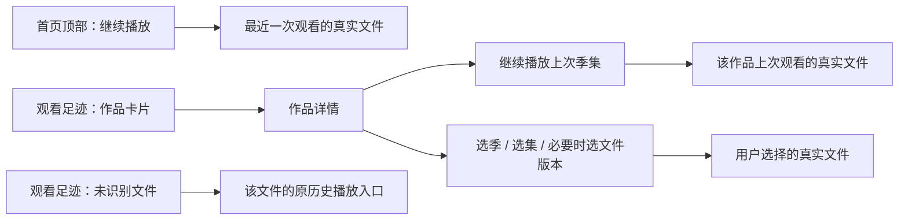

# 首页观看足迹与作品详情入口设计

日期：2026-11-01。状态：**用户已选择 B「沉浸剧集」，原生实施尚未开始。** 用户确认的问题是首页只能续播单集，访问整部剧还要去媒体库查找；随后明确要求详情页也重新设计，并要求用 Web 出稿、参考 Apple 等成熟产品。用户本次明确回复“我选择B”，因此 B 为详情页视觉与布局的权威稿；本次选择确认设计，不扩展为原生实施或部署授权。

## 1. 目标与依据

从首页最近看过的作品直接进入整部剧，能够续播原文件、切换季、选择其他已入库集数；保留最近一次观看的一键续播。

核对基线为 `18b09d5b1` 加当前工作区改动。当前存在其他任务的未提交改动，包括作品详情页和相关测试；实施前必须重新读取，保留并发改动。

| 已确认现状 | 源码依据 | 对本任务的影响 |
| --- | --- | --- |
| 首页按作品去重，最多显示 8 张足迹卡；卡片点击按历史 ID 直接播放 | [CinemaFragment](../../../local_component/src/main/java/com/xyoye/local_component/ui/metadata/CinemaFragment.kt) | 卡片展示作品，但没有进入作品的动作 |
| 副标题只有“继续观看 · 百分比” | 同上、[足迹布局](../../../local_component/src/main/res/layout/item_metadata_continue.xml) | 剧集进度缺少季集归属 |
| 详情已按季集组织实际关联文件，同集多版本可选择 | [MetadataDetailActivity](../../../local_component/src/main/java/com/xyoye/local_component/ui/metadata/MetadataDetailActivity.kt) | 复用现有详情页，无需另建剧集页 |
| 详情默认选最小季号，初始焦点在“管理作品资料”，没有作品续播按钮 | 同上、[详情布局](../../../local_component/src/main/res/layout/activity_metadata_detail.xml) | 仅改首页跳转仍不能形成顺畅追剧路径 |
| 剧集识别成功后发现当前目录一层的同剧文件，未播放文件不生成观看记录 | [PlaybackMetadataIndexer](../../../core_metadata_component/src/main/java/com/xyoye/common_component/metadata/PlaybackMetadataIndexer.kt) | 本任务不扩大扫描范围，不伪造已观看状态 |
| 历史按来源和真实文件保存；详情选文件不构造目录播放队列 | [MetadataLibraryViewModel](../../../local_component/src/main/java/com/xyoye/local_component/ui/metadata/MetadataLibraryViewModel.kt)、[播放解析器](../../../core_storage_component/src/main/java/com/xyoye/common_component/source/handoff/PlaybackSourceResolver.kt) | 作品聚合仅用于展示与导航，不合并文件进度 |

首页沿用已选 [Cinema](../../../document/prototypes/tv-ui/index.html?variant=cinema)。旧[作品详情](../../../document/prototypes/tv-ui/deep-pages.html?page=metadata&state=normal)作为本轮问题基线，新详情由用户选定的 [B「沉浸剧集」](../../../document/prototypes/tv-ui/series-detail-prototype.html?variant=B)取代；不替换其他页面或早先已确认的播放器 A / 文件浏览 C。

### 1.1 实体电视证据与已选网页设计

用户授权读取电视当前截图，未授权操作导航或播放。[电视详情原图](../../../document/prototypes/tv-ui/previews/series-detail/tv-before.png)为 2026-11-01 的 `1920×1080`、`320 dpi` 画面，对应 `960×540 dp`：简介直接覆盖亮色人物背景；长标题和简介横跨屏幕；原始文件名占用列表空间；首屏仅两条完整集行；主要可见操作是管理与返回。只增加续播按钮不足以解决这些问题。

[网页原型](../../../document/prototypes/tv-ui/series-detail-prototype.html?variant=B&state=normal)使用 `1440×810` 画布，现固定展示 B，顶部保留场景切换和电视原图对照。A/C 渲染器与方案切换条已移除，下面只保留评审取舍记录。海报与前两集剧照裁自用户截图，其余集数、时间和进度为明确标识的示例，缺少剧照使用占位图。

| 候选 | 结构 | 取舍 |
| --- | --- | --- |
| A：分栏选集（未选，仅保留评审记录） | 左侧固定作品信息与续播，右侧纵向剧集列表；首屏 6 条完整集行 | 兼顾长标题、续播和上下选集 |
| [B：沉浸剧集（用户已选）](../../../document/prototypes/tv-ui/series-detail-prototype.html?variant=B) | 上方作品信息与续播，下方横向剧集卡片；首屏 4 张完整卡片并提示后续内容 | 更偏 Apple TV 的内容组织，剧照更突出；左右浏览剧集 |
| C：选集优先（未选，仅保留评审记录） | 顶部紧凑作品信息，左下 12 集网格，右下联动分集预览 | 最快定位集数；作品简介通过独立入口查看 |

2026-11-01 查阅了 Apple 的[作品浏览与详情说明](https://support.apple.com/guide/tv/find-things-to-watch-atvb7d7bec9f/tvos)、[tvOS 设计原则](https://developer.apple.com/design/human-interface-guidelines/designing-for-tvos)和[焦点与选择规范](https://developer.apple.com/design/human-interface-guidelines/focus-and-selection)。借鉴清晰播放动作、季集浏览和远距离可辨的焦点；具体 A/B/C 排版为本项目的设计取舍，未照搬 Apple 的品牌、收费入口或系统视差效果。原始文件名下沉到实际文件版本选择器。遵循用户最新决定：页面内不恢复返回/关闭图标，使用遥控器 BACK；取消版本选择等业务动作保留。

## 2. 入口选择

| 方案 | 使用成本与问题 | 建议 |
| --- | --- | --- |
| 卡片确认进入作品详情，顶部按钮保留一键续播 | 最近作品仍可一键继续，其他作品从详情再按一次续播；整部剧入口明确 | 采用 |
| 卡片仍续播，长按或 MENU 打开详情 | 快捷，但整部剧入口不易发现，依赖隐藏操作 | 不采用 |
| 每次点击弹出“续播 / 查看剧集”选择框 | 两个动作可见，但每次都多一道确认，打断浏览 | 不采用 |

首页保留“你的观看足迹”名称和现有数量、排序、横向布局。已识别的电影也进入作品详情，统一作品卡语义；未识别记录保持可播放的文件入口。



## 3. 首页行为与信息

- 顶部“继续播放”继续使用全局最近的历史记录；已知季集时，主视觉信息行补充“第 2 季 · 第 3 集”。焦点停在其他作品卡时不动态替换顶部续播目标，避免标题、按钮和实际文件不一致。
- 已识别卡片按 `(mediaKind, tmdbId)` 聚合，按作品最近一次实际播放时间倒序；点击进入对应作品详情，携带最近观看历史的身份提示。
- 剧集副标题示例：“第 2 季 · 第 3 集 · 本集 42%”。主标题保持作品名；进度条表示这一个物理文件的进度。
- 电影副标题示例：“上次观看至 42%”。没有有效时长时显示“上次观看至 12:34”，隐藏百分比进度条；位置也不可用时显示“最近播放”。不显示虚假的 0%。
- 特别篇显示“特别篇 · 第 2 集”。合并集显示“第 1 季 · 第 3–4 集 · 文件 42%”，仍只有一份文件进度；非连续或过长的关联使用“合并集 · 文件 42%”，详情保留完整信息。
- 已关联作品但没有可靠季集信息时，显示“季集待确认”，可以进入作品详情，不从文件名临时猜集号。
- 无可靠作品关联时显示原文件名及“文件记录 · …”进度，点击沿用该记录的播放入口。后台识别成功后自动转为作品卡，保留视觉位置和焦点的对应关系。
- 不引入“看完 90% 算完成”等新阈值；不把本集结束解释为整部剧看完，不自动从足迹中移除作品。

首页局部结构（沿用现有 Cinema 比例、图片和样式）：

```text
作品名
年份 · 剧集 / 番剧 · 第 2 季第 3 集
简介
[继续播放]

你的观看足迹                                    浏览媒体库
[作品画面及文件进度条]  [另一部作品]  [电影]  [未识别文件]
作品名
第 2 季 · 第 3 集 · 本集 42%
```

卡片继续只设一个可聚焦目标，不增加卡片内播放小按钮、更多菜单或长按必经路径。本轮不处理已有的图片内外标题重复问题。

## 4. 作品详情

详情页属于完整视觉与交互重设计范围。复用现有作品、季集、实际文件和播放能力，按用户已选择的 B 实现：上方作品信息与主播放操作，下方横向剧集卡片。以下结构图仅说明通用内容层级，不能覆盖 B 网页稿的位置、比例与导航。

```text
[海报]  作品名
        年份 / 分类 · 简介（最多两行）
        上次观看：第 2 季第 3 集 · 本集 42% · 客厅 NAS
        [继续播放 · 第 2 季第 3 集]

[第 1 季] [第 2 季（当前选择）] [特别篇]
第 1 集  …
第 2 集  …
第 3 集  …  上次观看
第 4 集  …

[管理作品资料]
```

1. **续播**：主按钮绑定该作品最近的、身份仍能核对的真实历史，沿用 `PlayHistoryDescriptor` 与现有位置恢复策略。显示真实来源；不用同剧另一文件代替、不重新按 TMDB ID 猜文件。
2. **默认季**：优先恢复当前详情实例已保存的选择；没有保存状态时定位该作品最近观看集所在季；没有对应历史时选择首个有实际文件的常规季，只有特别篇时选择特别篇。后台入库更新不能反复重置用户主动切换的季。
3. **默认焦点**：首次加载完成后，有可用续播或开始观看目标则落在主播放按钮。主播放按钮不可用时落在首个可操作的集/电影文件行；没有可播放行时落在空态的媒体库入口或可用的资料管理动作。恢复页面时优先恢复原焦点，不重复执行首次定位。网页加载场景的管理焦点仅用于静态场景演示，原生异步就绪不能反复抢焦点。
4. **选集定位**：有上次观看集时，首次选集列表预先滚动到该行并标注“上次观看”；从主按钮向下可经季选择进入该行。标注是持久状态，焦点描边是当前操作位置，两者不能混用。
5. **多版本**：主按钮精确续播上次文件。主动点击有多个文件的某一集时，沿用现有版本选择器，让用户选择来源；其他文件使用各自进度，不复制上次文件进度。
6. **合并集**：选择被同一物理文件覆盖的任意一集，仍打开该文件；沿用“合并集共享同一文件进度”提示，不虚构分集起点。
7. **没有观看历史**：主按钮显示“开始观看”，明确从首个可播放的常规季与集开始；仍可直接选集。没有可播放文件时禁用该按钮。用户从媒体库进入同一详情页时也使用这套行为，避免维护两套详情页。网页 `fresh` 场景演示第 1 季第 1 集；原生必须按实际持有文件推导。
8. **文件不可用**：已知上次文件失效时显示原因，禁用续播并把默认焦点转到可用选集；没有其他可用文件时转资料管理。网络问题在实际播放请求失败后显示，不在打开详情时额外连通性探测，不静默切换版本。

详情保留实际已发现的集数，不展示“TMDB 有资料但没有本地/远程文件”的可播放假集数。进入详情不触发新扫描，也不等待 TMDB 网络请求才允许浏览已有内容。

最终布局以 B 网页方案为准。长标题按可用区域平衡换行，本次样本为两行，不能通过强行缩小字体或静默删掉后半标题来适配。简介限制在独立的低干扰文字区域，完整内容可展开；主播放动作始终可见。原生以 `960×540 dp` 与网页 `1440×810` 对照，首屏应能展示 4 张完整剧集卡片与后续卡片提示；1.3 字体的原生行为与视觉尚未验证，不能用目前网页样例推定通过。

## 5. 数据、路由与职责

本任务预计只需 `local_component` 的展示逻辑、布局与相关测试；保留 Room 结构、扫描流程和播放会话所有权。

- 在现有 metadata UI 范围提取一个可测试的历史展示投影，首页与详情共用“历史 → 可核对文件 → 作品/季集”的规则。输出应包含稳定卡片键、展示内容、可选作品身份及真实历史引用；不向通用 `MetadataCardAdapter` 塞入业务查库逻辑。
- 已识别卡片键使用作品身份，未识别键使用历史 ID。最近集从第 3 集变为第 4 集时，仍视为同一张作品卡。未识别卡转为作品卡时保留历史 ID 到作品键的焦点迁移映射。
- 历史和文件至少核对 `storageId + uniqueKey`，不能仅靠名称、相同剧名、相同 TMDB ID 或相同路径拼接历史。`MediaBindingEpisode` 才是季集归属来源。
- 现有历史没有内容代次字段，而首页对无法证明属于当前代次的记录采取保守回退。此次沿用该边界：不能简单去掉 `contentGeneration == 1L` 就把旧历史接到新来源。无法证明关联的记录继续作为文件记录，不新增 schema 或悄悄认领旧进度。
- 历史入口的路由参数在现有 `kind`、`tmdbId` 上增加可选 `historyId` 提示。详情收到后重新校验它是否仍属于该作品；失效时重新从该作品当前有效历史推导，不信任路由携带的进度、季集或文件地址。媒体库现有调用不必传新参数。
- 需要区分首次数据尚未就绪与真正空列表；在数据准备前不把焦点先放到管理按钮，再抢回主按钮。已有内容刷新时保留内容、季和焦点。
- 同一作品跨来源聚合为一张卡，但底层所有历史、文件、版本和进度仍独立。续播目标不可用时保留原因，不悄悄换到另一份更早的可播放历史。

## 6. DPAD 与返回

- 首页保持“顶部续播 → 足迹横排”的上下关系；左右切作品，确认进入详情。详情 BACK 回到原作品卡和原横向滚动位置。
- 主操作、季选择、剧集与管理入口均通过方向键可达：从主操作向下进入上次观看集，左右选择剧集，向上返回季选择或主操作。只有一季时显示不可聚焦的季标签，不保留无意义的季切换焦点。
- 详情启动播放器后，BACK 先回到详情原季和原集；再次 BACK 回首页。首页直接续播则退出播放器后回首页原按钮。
- 多版本弹窗 BACK 回原集行。播放失败留在原页面并恢复触发动作的焦点，允许重新尝试或选择其他集。
- 播放其他集导致足迹排序更新时，用作品键恢复原卡；卡片已消失时选择相邻项，再退到顶部有效动作，不让焦点落空。
- 重建页面时恢复季、列表位置和焦点；后台入库、图片加载和简介更新不主动移动用户正在操作的焦点。

## 7. 页面与状态覆盖

下表是原生实现的设计要求和未来验证清单，**原生全部尚未实施/验证**。用户已选择的 B 网页提供 `state=normal/seasons/versions/fresh/unknown/missing/empty/loading` 八类场景。首页行为仍为设计要求；浏览器验证不代替 Android 行为、字体或实体电视验收。实施时补齐需要的原型边界并对照原生截图；示例数据只能用于原型和测试。

| 编号 | 页面 / 状态 | 设计与预期 | 主要实现位置 | 验证证据要求 |
| --- | --- | --- | --- | --- |
| WH01 | 首页已识别剧集 | 卡片进入作品，明确最近季集与本集进度 | CinemaFragment、历史投影 | 投影测试、DPAD 跳转、截图 |
| WH02 | 首页电影 / 未识别 / 季集未知 | 电影进详情；无作品的文件直接播放；不猜季集 | 历史投影、卡片 | 三类投影测试及界面行为 |
| WH03 | 首页空 / 初始加载 / 识别完成 | 空态可浏览媒体库；首次加载不闪假空；识别后原位更新焦点 | 首页与 ViewModel 状态 | 延迟数据、空数据、异步入库截图与 DPAD |
| WH04 | 详情有历史 / 多季 | 显示原文件续播，默认上次季与集，能换季 | MetadataDetailActivity、布局 | 第 2 季非首集作为样本，续播与选集回归 |
| WH05 | 详情无历史 / 只有一季 / 只有特别篇 | 无假续播，开始观看指向首个实际文件；单季标签不产生切换焦点 | 详情渲染与焦点 | 对应三类状态截图与 DPAD |
| WH06 | 同集多来源 / 合并集 | 续播锁定原版本；手动选版本各用自身历史；合并集共用文件进度 | 历史投影、现有版本选择器 | 来源隔离、选择/取消、合并集测试 |
| WH07 | 已知文件失效 / 请求失败 / 作品资料失效 | 可见原因；已知失效不抢默认焦点；失败不换源、不清进度；无有效文件时可返回 | 详情与原播放请求路径 | 故障注入、BACK 和原焦点恢复 |
| WH08 | 未知时长 / 零位置 / 接近片尾 | 不造百分比、不推断整剧完结、不新增归零规则 | 进度展示 | 边界投影测试与实际恢复点核对 |
| WH09 | 返回 / 重建 / 重排 / 卡片合并 | 保持原作品、季、集和可见焦点 | 稳定键、页面保存状态 | 纯 DPAD 主路径、Activity 重建、异步更新 |
| WH10 | 长标题 / 1.3 字体 / 列表滚动 | 主要操作和季集信息可见，焦点描边不裁切 | 两个页面布局 | 同逻辑视口、同数据与焦点位置的原型/原生截图 |

## 8. 实施顺序与完成标准

实施授权后按以下顺序推进，不必重做扫描或媒体库架构：

1. 历史投影与边界规则 → 验证同剧去重、最新记录、季集、来源隔离、无关联回退及稳定键。
2. 补齐任务原型，接通首页作品路由和详情续播/初始季集 → 验证首页两种入口与详情无历史路径。
3. 完成 DPAD、返回与异步更新 → 验证从非首张足迹卡进入第 2 季、选择其他集播放、逐层返回；覆盖弹窗取消与播放失败。
4. 运行改动范围内单元测试、Debug 构建和 lint，再在任务模拟器验证 Media3/mpv、页面重建、字体与截图。Gradle 必须读取输出末尾并记录 `BUILD SUCCESSFUL` / `BUILD FAILED`，不以运行任务数替代结果。

验收主路径：从首页非首张剧集足迹卡按确认进入详情，默认显示该剧上次观看的季与集；可以续播原文件，也可以只用 DPAD 选择另一集；播放退出回详情，再返回恢复到首页原作品卡。全过程不需要进入媒体库重新找剧。

视觉对比、行为测试、构建结果、实体电视验证与用户验收分别记录。候选评审时完成了源码分析、用户授权的电视当前画面截取和浏览器检查：三版长标题与图片正常，未出现页面 JavaScript 错误；方向键进入上次观看集、确认/返回恢复焦点、多季浏览后仍续播原季、返回后保留浏览季、另一来源不套用原来源进度均已在浏览器演示中检查。常规、文件不可用、多版本等截图已实际查看。用户随后选择 B，网页已固定为 B。未运行本任务的 Gradle/AVD 回归、未改动原生代码、未操作电视导航或播放；设计选择不代表原生验收。

## 9. 范围边界

- 不新增跨目录/全库自动扫描，不修改刮削匹配规则；其他季尚未入库时仍不会凭空出现。
- 不构造新的连续播放队列，不在片尾自动跳下一集；现有播放器前后集行为不由本任务扩展。
- 不新增整剧完成率、已看完阈值、删除/隐藏足迹菜单或每张卡的快捷菜单。
- 不修改播放进度存储、全局播放设置、资料管理流程和其他页面的视觉结构。
- 不把源码已实现、测试通过或安装成功等同于实体电视/用户验收；本设计也不自动授权实施、提交或部署。
