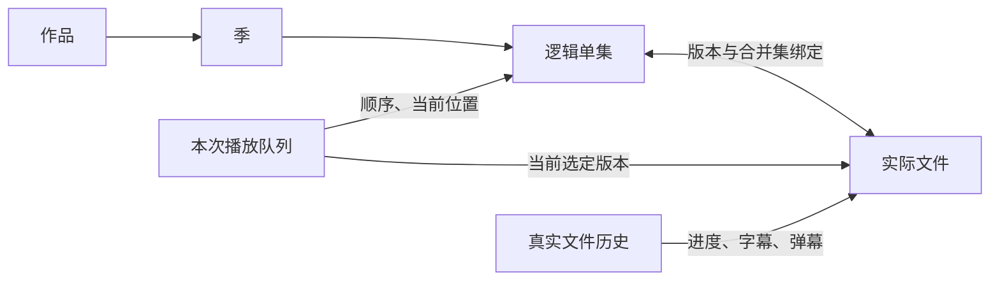

# 统一剧集播放队列设计

日期：2026-11-01。状态：已按用户确认范围实施并完成本地验证；物理电视、真实云账号与用户验收另计。执行、失败修正和验证证据见[任务账本](../plans/2026-11-01-series-playback-queue.md)。

## 目标与已确认决策

从作品详情选择一集、继续观看，或从已识别的播放历史进入时，创建同一套剧集队列。队列包含已发现、已关联且有实际文件的整剧常规季单集，按季号、集号升序排列，当前位置落在用户选择的单集；支持跨季。选择特别篇时仅组织特别篇队列，避免正片播完后自动进入花絮。

用户确认：优先沿用当前来源；下一集在当前来源缺失时，提示选择其他版本，不自动跨来源替换。当前来源内部存在多个无法区分的版本时也提示选择。用户选中其他来源后，后续以新的当前来源为优先。

“有队列”和“自动播放下一集”分开：队列支持查看、前后切集；是否自动继续沿用现有全局设置。文件浏览保留目录队列，电影、未识别文件、季集不明确的文件保留单文件入口，投屏保留发送端队列。

## 问题与现有基础

核对基线 `aa7bfade8`：

- `MetadataLibraryViewModel.play(asset)` 明确只提交单个 `StoredLibraryFileDescriptor`，没有传递作品和季集上下文。
- `PlayHistoryDescriptor` 解析为单项队列；详情续播也走这条路径。
- `PlaybackQueueContext` 表达目录及排序，不能表达跨目录、跨来源的逻辑单集和版本候选。
- `ActivePlaybackSession` 已拥有队列选择、独立来源准备、快照、原生预加载和失败保留旧播放；复用其所有权，不新增第二个队列运行时。
- Room 已区分作品、季、单集、实际文件与绑定；一集多个文件、一个文件包含多集均可表达，无需新增数据库表或合并历史。

上一轮[首页足迹与详情 B 设计](2026-11-01-home-watch-history-design.md)明确不扩展队列。本任务承接该缺口，不将此前 UI 验证解释为连续播放已验收。

## 领域关系

- **作品 / 单集**：TMDB 作品与季集身份，决定归属和顺序。未取得文件的资料条目不进入播放队列。
- **实际文件**：以 `assetId`、文件修订、来源 ID、内容代次及协议稳定引用定位；临时 URL 不成为队列身份。
- **版本候选**：某集已发现的实际文件集合。版本不会作为多个连续播放项展开。
- **队列快照**：一次用户播放意图对应的有序单集、版本候选、所选单集及当前文件。后台识别或目录排序变化不会静默替换活动队列。
- **播放历史**：仍属于真实来源和文件。选择另一版本读取该版本自己的进度；不把不同剪辑、时长的百分比直接搬过去。

## 职责与契约

| 位置 | 职责 |
| --- | --- |
| `core_metadata_component` | 统一构建剧集播放描述；在 Room 一致性事务内读取绑定、可用文件、来源与季集；历史入口按来源和文件身份寻找关联 |
| `core_contract_component` | 定义 `SeriesPlaybackDescriptor`、`SeriesQueueEntry`、`SeriesQueueFile` 及需要用户选择版本的结构化结果；只有稳定数据 |
| `core_storage_component` | 校验队列文件的当前来源代次、文件修订和可用性；只为当前选定文件创建独立播放来源；返回队列投影 |
| `player_component` | 继续由 `ActivePlaybackSession` 选择、准备、持久化并激活来源；播放器展示版本选择并提交带预期会话版本的命令 |
| `local_component` | 详情保留被点击的季集身份，统一调用构建器；详情续播、首页继续播放和历史页共享历史转换；不构造运行时播放源 |

`SeriesPlaybackDescriptor` 保存作品 ID、有序条目、所选条目、优先来源和明确选定的文件；每个条目含季号、集号、展示标题和版本候选。候选包含文件及来源稳定身份、内容代次、文件修订和来源展示名。禁止嵌套目录队列、连接、凭据或播放器对象。

存储解析层无需依赖 metadata 实现；构建器只提交 contract 类型。所有已识别入口共享构建逻辑，避免各页面自行排序和猜测下一集。

## 队列构建规则

1. 以用户实际选择的文件为锚，重新验证它仍属于当前来源内容代次、可用且未标记 `FILE_CHANGED`。
2. 已确认的 `tv` 绑定且季集明确时，查询同作品的可播放文件与绑定。常规季与特别篇分组，按季集稳定排序。
3. 详情选集保留明确的季号、集号；同一合并文件从不同集卡进入时仍可定位用户选择。历史入口没有逻辑单集提示时，以文件绑定顺序中的首个集号定位，并保留真实文件进度。
4. 同一集的所有有效文件组成候选；初始明确选择的文件固定为当前文件。后续优先当前来源的唯一候选；没有或存在多个候选时请求用户选择。
5. 合并集没有分段时间轴，不虚构每集播放进度。同一预计实际文件只占一个连续播放项，标题体现覆盖的集；明确选择其中一集时保留该集锚点。版本改变后按新当前来源重新投影，避免重播同一合并文件或漏掉其他单集。
6. 只读取数据库中的已发现文件，不发起新扫描、不请求 TMDB、不预连接整剧所有来源。超过旧目录 fallback 的 200 项仍保留完整剧集队列，不静默截断。
7. 已删除来源、内容代次过期、不可用文件和失效绑定不成为候选。没有可靠作品或季集关联时返回原文件/历史描述，不从文件名猜队列。

## 切集、版本选择与失败

- 播放列表与前后切集复用现有控件。条目显示逻辑季集标题；当前选择和列表焦点继续由原有控件管理。
- 缺少当前来源或存在多版本歧义时，复用可用 DPAD 操作的底部版本选择弹窗，展示来源、真实文件名；BACK 取消，保留当前播放、队列位置和进度。
- 版本选择不创建外部新播放请求，不消费另一笔 pending。确认携带期望 `PlaybackSessionVersion`；旧弹窗、旧回调不得切换已被替换的新会话。
- 原生预加载遇到需要选择版本时只放弃预加载；在实际自动下一集或用户切集时才提示，不在观看中提前弹窗。
- 准备下一集或激活前快照保存失败，保留旧来源；遵循现有会话的独立租约与唯一释放树。网络错误不当作整剧结束，不自动跳过失败的一集。
- 用户选择其他来源后保留其独立历史，并将其作为后续来源偏好。不能因为整个作品聚合为一张卡就串用来源或文件进度。

## 恢复与兼容

- 加密 handoff 编解码器新增 `series` 描述类型；旧 `library`、`history`、`screencast` 请求与快照继续解码，无 Room schema 变更。
- 当前快照保存整剧稳定候选、当前位置、选定文件和来源偏好。手动或原生切集后快照指向实际当前文件，进程恢复不退化成单文件队列。
- 恢复时重新验证来源与文件身份；失效后可见失败，不自动播放另一版本。配置变化复用现有运行时；普通冷启动仍进入首页。
- 只持久化稳定引用，继续使用既有加密、TTL、原子写入和过期清理；新类型的诊断字符串不输出文件路径或敏感引用。

## 成熟项目参考与本地适配

2026-11-01 已查阅以下固定修订：

| 参考 | 采用的思路 | 本地适配 |
| --- | --- | --- |
| Jellyfin Android TV `7ec47a0014b8ac8bac56d66ed75cbe442706f0ce`：[SdkPlaybackHelper](https://github.com/jellyfin/jellyfin-androidtv/blob/7ec47a0014b8ac8bac56d66ed75cbe442706f0ce/app/src/main/java/org/jellyfin/androidtv/util/sdk/SdkPlaybackHelper.kt) | 入口明确区分整剧、整季、单集与后续集 | 用户已选择整剧跨季；本地数据库提供剧集关系，无 Jellyfin 服务端依赖 |
| Plezy `90b7ccca68cffcfe51fc8994c3463fcbf769ec18`：[EpisodeNavigationService](https://github.com/edde746/plezy/blob/90b7ccca68cffcfe51fc8994c3463fcbf769ec18/lib/services/episode_navigation_service.dart)、[episode_collection](https://github.com/edde746/plezy/blob/90b7ccca68cffcfe51fc8994c3463fcbf769ec18/lib/media/episode_collection.dart)、[MediaVersion](https://github.com/edde746/plezy/blob/90b7ccca68cffcfe51fc8994c3463fcbf769ec18/lib/media/media_version.dart) | 有序剧集加当前位置；版本独立；跳过同一合并文件；保留已有队列上下文 | 沿用本项目文件历史、来源内容代次、独立租约、双内核与 TV 弹窗，不复制 Flutter 状态层 |
| Kodi `3eff8d522011e84c40fce07b3f63daa323b19bc1`：[VideoGUIUtils](https://github.com/xbmc/xbmc/blob/3eff8d522011e84c40fce07b3f63daa323b19bc1/xbmc/video/guilib/VideoGUIUtils.cpp) | 播放意图、队列范围及当前项明确分开 | 已识别媒体库使用剧集队列；文件浏览仍保留目录语义 |

## 验收矩阵

| 编号 | 场景 | 判定 |
| --- | --- | --- |
| SQ01 | 从第 3 集进入详情播放 / 续播 | 整剧在队列中，当前为第 3 集，进度属于原文件 |
| SQ02 | 第 1 季末集 → 第 2 季首集 | 手动和自动切集按季集顺序完成；关自动播放仍可手动切 |
| SQ03 | 同集多个版本、来源不完整 | 每集只占一个播放位置；优先当前来源，缺少/歧义时选择；取消保留旧播放 |
| SQ04 | 合并集与独立版本并存 | 同一文件不连续重播，选集锚点正确，版本变更后不漏集 |
| SQ05 | 历史 / 首页继续 / 详情继续 | 使用同一构建规则；未识别、电影和目录入口保持其原有语义 |
| SQ06 | 来源被替换、文件过期、解析/保存失败 | 失效候选不播放，旧来源不被提前释放，错误可恢复 |
| SQ07 | 重建、切集后进程恢复、旧加密记录 | 完整队列、当前集、版本与进度保留；旧记录继续解码 |
| SQ08 | 特别篇、缺集、未知季集、超过 200 集 | 特别篇单独播放；仅真实文件入队；不猜集、不截断 |
| SQ09 | TV 实际交互 | Media3/mpv 纯 DPAD 完成进入、查看列表、切集、版本选择、取消和逐层返回；焦点可见 |

设计和测试通过不替代真实云账号、物理电视或用户验收。执行账本分别记录代码、构建/JVM、AVD、截图与用户设备证据。
