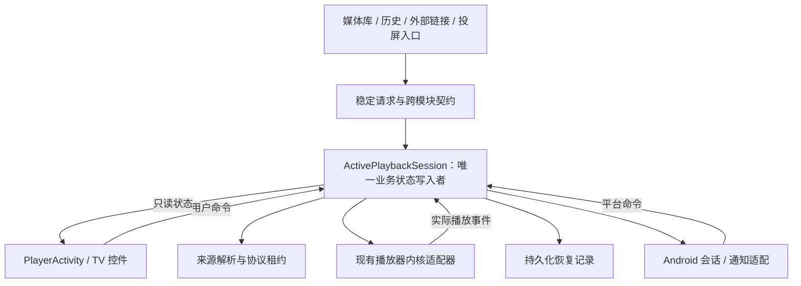

# 播放重构方案与参考项目源码复核

> 核对日期：2026-10-27  
> 本仓库基线：`f8d4c54c41eb1401107849417afcac68dc88869a`，另包含工作区中未提交的两份播放设计和租约实施计划。  
> 性质：架构审查与修订建议；未实施生产代码修改，未完成运行验证。

> 后续状态（2026-10-27）：用户要求按参考架构调整设计后，两份设计和租约计划已完成文档修订；随后已补写交接实施计划。下文“发现”保留修订前证据；请以处理表和链接设计判断当前方案状态，不能把文档修订当成代码缺陷已修复。

> 实施状态（2026-10-28）：租约计划已完成 37/37；[交接实施计划](../../docs/superpowers/plans/2026-10-27-playback-handoff-session.md)已完成任务 1–13，合计 62/65 项检查。旧写入路径已删除，边界检查接入根治理任务和 CI；补齐三种内核的定位快照、FTP Range 和字幕恢复线程修复。最终 478 项 JVM 测试、模块／播放边界治理、完整 lint、限定范围 ktlint 及 APK 构建通过（BUILD SUCCESSFUL），5 项最终设备回归通过。用户明确自行验收，余下 3 项综合场景保留未勾选。FTP 曾间歇出现 EOF／非法范围错误，后续回归通过但未隔离该间歇问题的原因；全仓旧 ktlint／Pager 基线仍失败。Bilibili 真实验证、BT 完整播放、非零进度进程恢复和实体 TV 等范围以任务 14 清单为准。下文保留设计审查时证据，不替代当前实施记录。

## 发现的设计处理状态

| 发现 | 已写入的设计决策 | 位置与验证状态 |
| --- | --- | --- |
| F1 连接隔离 | factory 创建独立 SMB/FTP Storage，重新解析文件；测试经过真实 acquisition | [租约设计](../../docs/superpowers/designs/2026-07-19-playback-transport-leases-design.md) §7、§9–10、§14；计划 Task 1/3/4/7/8；未实施 |
| F2 多处状态写入 | ActivePlaybackSession 唯一业务写入者，旧字段逐项迁移/删除，平台服务使用完整状态投影 | [交接设计](../../docs/superpowers/designs/2026-07-18-playback-handoff-design.md) §6.3–6.6；未实施 |
| F3 释放边界 | 会话 → PreparedPlayback → Source → Addon/lease；只有 lease 关闭底层资源，Addon 不删 token | 两份设计 §7/§12 及计划 Task 6/8；未实施 |
| F4 请求与恢复分层 | contract 定义稳定输入/provider；player 管请求/快照策略；core_storage 只解析并获取资源 | 交接设计 §6、§13；无新增 Gradle 模块；未实施 |
| F5 无恢复用途的候选 | 删除磁盘候选，原生切换真实事件后保存；保留主动切换的保存门槛 | 交接设计 §8.1、§12.2；已明确行为差异及进程恢复限制；未实施 |
| F6 禁用网关依赖 | 本地状态/能力来自运行时和内核，平台适配读投影，替代后删除无调用的网关转发 | 交接设计 §6.6、§14 阶段 4.2；不重新开启远端接口；未实施 |

租约计划包含 9 个任务、37 个检查项，已替换早期的大段示例代码和重复提交步骤；任务目标保留，并增加工厂装配、取消交接、原生队列退役及 CI 验证。[交接实施计划](../../docs/superpowers/plans/2026-10-27-playback-handoff-session.md)包含 14 个任务、65 个检查项，覆盖稳定契约、加密存储、唯一会话、全部入口与内部切源、结构化验证、平台投影及旧职责删除。实际完成状态以两份计划为准，文档一致性检查与实现阶段的构建、协议、TV 验证分开记录。

## 修订前审查结论

当前方案值得保留“稳定播放描述、请求与参数原子交接、传输资源租约、过期回调隔离”四个方向，但尚不适合按现稿直接实施。它细化了异常场景，却还没有充分证明能减少现有状态所有者和跨层同步工作；租约计划还存在与设计要求相反的连接共享问题。

用户本轮明确的重构目标是：保留已经增加的功能及 TV 体验，降低累积的结构混乱和维护成本。因此，应把“谁能修改播放状态、谁负责释放资源、一次功能变更涉及多少职责”作为主验收项。设计细节已填写不等于架构已经完善，也不能据此声称存在经过验证的“最优方案”。

建议先修正 F1–F3 的隔离与所有权问题，再收敛请求/恢复职责和无效持久状态，最后编写交接实施计划。无需为此新增 Gradle 模块，也无需一次重写所有内核。

## 审查覆盖与项目地图

| 范围 | 本次核对深度 | 目的与边界 |
| --- | --- | --- |
| `settings.gradle.kts`、模块治理文档、根构建配置、三个 CI workflow | 结构核对 | 21 个纳入构建的模块，其中 6 个是 AAR 包装模块；模块数量本身不是缺陷 |
| `player_component` | 重点源码抽样 | 播放入口、手动/自动切源、来源恢复、会话元数据、资源释放；未逐行审查全部播放器和渲染实现 |
| `core_storage_component`、相关 contract | 重点源码抽样 | 来源工厂、浏览 Storage 与播放连接关系、HTTP/SMB/FTP/Thunder 的租约边界 |
| `app`、`core_system_component`、`core_network_component` | 按调用链核对 | Media3 service、全局状态 store、禁用的网关 repository |
| `anime_component`、`local_component`、`storage_component` | 播放入口抽样 | 跨 feature 的来源与启动参数交接；不包含各模块所有业务 |
| `bilibili_component` 与本地 PiliPlus | 播放相关抽样 | 来源选择、播放 session/addon 的边界；未全面审查账号、媒体库分页、风控与接口正确性 |
| 两份设计与租约实施计划 | 重点对照 | 检查设计不变量是否在计划中落实，以及新结构是否真正替换旧职责 |
| 其他 UI、数据库迁移、全部字幕/弹幕算法、AAR 内部实现 | 未全面覆盖 | 本轮是以播放重构为中心的跨模块审查，不是全仓逐行审计、性能测试或安全审计 |

当前主要数据流为：feature 构造来源 → `VideoSourceManager` → `PlayerActivity`/顺序播放协调器 → 内核；会话元数据另由 ViewModel 写入 `Media3SessionStore`，并通过 LiveData/Activity 推送给 app service。审查优先关注这些并行状态链路的交叉处。

## 发现

### F1 · P1：SMB/FTP 租约计划没有落实独立连接

**证据。** [租约设计](../../docs/superpowers/designs/2026-07-19-playback-transport-leases-design.md) §4.3、§9、§10 要求每租约独立 Storage 会话；但[实施计划](../../docs/superpowers/plans/2026-07-19-playback-transport-leases.md) Task 3 Step 5 将 `storage = this`、原 `smbFile` 放进新 server 的 lease，Step 4 又在释放时调用 `storage.close()`。Task 4 仅要求新建 FTP server，没有规定重新获取独立 Storage/连接。

这不是无关紧要的示例简写：[SmbStorage.kt](../../core_storage_component/src/main/java/com/xyoye/common_component/storage/impl/SmbStorage.kt):32–34、165–168 持有并关闭 client/session/share；[FtpStorage.kt](../../core_storage_component/src/main/java/com/xyoye/common_component/storage/impl/FtpStorage.kt):24–25、216–225 持有并关闭 FTPClient/播放流。[StorageVideoSourceFactory.kt](../../core_storage_component/src/main/java/com/xyoye/common_component/source/factory/StorageVideoSourceFactory.kt):34–40 使用 `file.storage`；[StorageVideoSource.kt](../../core_storage_component/src/main/java/com/xyoye/common_component/source/media/StorageVideoSource.kt):59–63 又通过原列表中的文件生成下一来源。

**需求与风险。** A 正在播放、B 使用同一 Storage 准备时，仅隔离 HTTP server 不隔离协议连接。按计划释放 A 或失败的 B，仍可能关闭另一方或浏览页使用的连接，违反“准备失败旧播放继续”。这是确定的计划缺口；本轮没有运行复现实际断流。

**最小修订。** acquisition 从媒体库配置和稳定文件身份创建独立播放连接，并在该连接上重新解析文件句柄；浏览 Storage 不转移给播放 lease。任何中途失败只清理此次 acquisition 已创建的资源。共享不可变配置可以保留，共享连接必须另有明确且经过测试的所有权机制；当前优先使用已选定的独立会话方案。

**验证与复杂度检查。** Task 3 当前用两个 fake close callback 分别构造 lease 的测试，只能证明包装类不会调用另一个回调，发现不了生产装配中的共享连接。应从真实 factory/acquisition 入口注入协议 client 创建器，验证 A/B/浏览连接各自独立、失败清理、重复释放及后续读取。这样是在验证真实隔离，不是增加第二个资源管理框架。

### F2 · P1：新活动会话还缺少替换旧状态写入权的明确清单

**证据。** `VideoSourceManager.kt`（已删除，见审查基线）:20–35 分别保存来源和启动参数；[PlayerActivity.kt](../../player_component/src/main/java/com/xyoye/player_component/ui/activities/player/PlayerActivity.kt):596–634 与 722–749 分别处理普通切源和原生切换后的状态更新；1220–1232 的手动切源会先暂停，再准备来源。[SequentialPlaybackCoordinator.kt](../../player_component/src/main/java/com/xyoye/player_component/sequential/SequentialPlaybackCoordinator.kt):22–24、91、128–153 独立持有来源、代次、候选并应用切换。

另外，审查时的 [PlayerViewModel.kt](../../player_component/src/main/java/com/xyoye/player_component/ui/activities/player/PlayerViewModel.kt):48–60、72–100 和 `Media3SessionStore.kt:13–24`（已于任务 12 删除）保存会话元数据。[交接设计](../../docs/superpowers/designs/2026-07-18-playback-handoff-design.md) §6、§12.1 已要求内部切源接入活动会话，但 §3、§18 仍将 Media3 状态所有权整体统一后置，尚未逐项说明哪些旧字段会删除、哪些仅为只读投影。

**需求与风险。** 多个状态副本并非天然错误；问题是多个路径各自有权改变“当前播放什么”及其代次。继续添加会话层而保留原写入口，后续增加一种来源或恢复动作仍要同步修改 Activity、协调器、ViewModel、store 和 service。

**最小修订。** 使用已经拟议的 `ActivePlaybackSession` 作为唯一的业务状态写入者，迁入当前身份、来源代次、候选所有权、切换和退出规则。顺序播放协调器保留预加载/内核适配算法，向该会话提交事件；Activity 保留 Surface、TV 控制和展示；平台会话元数据由运行时状态派生。无需再并排新增另一套 `PlaybackManager`。

**验证与复杂度检查。** 为每个旧写入口列出“删除、迁入、只读适配”之一，迁移后的生产调用不再绕过会话直接设全局来源。手动切换与原生切换统一业务所有者，但保留不同的时间顺序：手动切换可先保存，原生回调只能报告已发生的切换。该建议减少协调点，不要求所有事件用同一种内核算法，也不要求立即实现完整后台 MediaSession。

### F3 · P1：上层 PreparedPlayback 与底层 lease 的释放边界有歧义

**证据。** [交接设计](../../docs/superpowers/designs/2026-07-18-playback-handoff-design.md) §12 将 Addon、StorageFile、Storage 和 lease 都列为 `PreparedPlayback` 的释放覆盖项；[租约设计](../../docs/superpowers/designs/2026-07-19-playback-transport-leases-design.md) §9、§10 又要求 lease 关闭文件及 Storage。文档没有说明上层的“覆盖”是通过子所有者间接完成，还是再直接调用一遍。

**需求与风险。** 候选取消、切源和 Activity 销毁可能重复到达。仅让 `lease.release()` 幂等，不能保证外部直接调用同一个 `Storage.close()` 也安全。该项是设计歧义，不是已经确认运行中的双重释放缺陷。

**最小修订。** 写出单向释放树：会话拥有 PreparedPlayback，PreparedPlayback 只释放自己直接拥有的 Addon/lease，lease 释放其独占的协议连接、文件和任务。若 Addon 需要请求销毁 Bilibili session，应通过同一个 token 所有者完成，不能与 lease 各自按媒体身份删除“当前 session”。未转移给 lease 的准备临时资源仍由准备作用域清理。

**验证与复杂度检查。** 验证取消、切源、退出交错后每份底层资源只关闭一次、另一租约可继续使用。用一棵所有权树取代分散的 close 清单，不添加通用生命周期总管。

### F4 · P2：播放请求与恢复策略继续下沉 core_storage，会扩大其业务职责

**证据。** [交接设计](../../docs/superpowers/designs/2026-07-18-playback-handoff-design.md) §6.1 将 latest-wins、pending TTL、激活清理和加密请求存储放在 `core_storage_component`，§6.3 又由 player 管理活动会话与快照。现有 [StorageVideoSourceFactory.kt](../../core_storage_component/src/main/java/com/xyoye/common_component/source/factory/StorageVideoSourceFactory.kt):161–165 已经从浏览目录生成播放列表。

**需求与风险。** 请求替换、恢复优先级和队列策略属于播放业务。继续由存储基础设施与播放器分别维护这些规则，调整一种播放交互会同时改动两个层；基础模块也会逐渐承担播放器业务。

**最小修订。** contract 放稳定请求/身份及必要跨模块服务接口；core_storage 保留来源解析、协议 I/O 和租约；player 拥有请求调度、队列、恢复策略和会话快照的业务存取；app 装配。底层加密/持久化原语可以复用已有设施，不需要因此另建数据库层。跨 feature 调用使用现有 contract/provider/路由模式，不新增 feature→player 直接依赖。

**验证与复杂度检查。** 新增一种协议时，协议选择与连接变化应局限在协议适配侧；调整恢复策略应局限在 player。这里依据的是已出现的跨层变更压力，不是“所有业务必须套某种架构”的要求。暂不全面拆分浏览 Storage，只先切断它与播放连接、队列可变状态的共同所有权。

### F5 · P2：持久化 queuedCandidate 没有对应的恢复消费行为

**证据。** [交接设计](../../docs/superpowers/designs/2026-07-18-playback-handoff-design.md) §8.1、§12.2 要求原生下一集入队前保存候选；切换后快照保存失败仍继续新播放；进程恢复时则无条件丢弃孤立候选，只使用活动快照。

**需求与风险。** 这份磁盘候选既不能证明内核已切换，也不能缩小“真实切换已发生、新快照尚未保存”的窗口，却增加了加密写入、父代次条件更新、补写、候选清理和保存失败阻止预加载等分支。

**推荐修订。** 原生自动切换候选只驻留统一运行时并持有 lease；收到匹配代次的真实事件后更新运行时并保存恢复快照，失败按现有策略重试。主动用户切换继续执行已经确认的“保存失败不切换”；不更改 pending、活动快照和敏感参数的持久化要求。

**行为变化与复杂度检查。** 这项建议会取消“候选入队必须先保存到磁盘”的门槛，属于对先前 agent 决策的修订，不能当成完全等价的实现优化。它保留了“补写前进程死亡可能回到上一集”的已知限制，同时删除恢复时不会消费的一类持久状态。若产品以后要求切换与恢复严格一致，需要改变原生自动切换方式或定义真正可判定的恢复协议；多存一份候选本身不满足该要求。审查时该项尚为建议，后续文档修订已采纳，见开头处理表；实现尚未开始。

### F6 · P2：名为 Media3 的禁用网关链路不应继续作为本地播放会话核心

**证据。** [Media3Repository.kt](../../core_network_component/src/main/java/com/xyoye/common_component/network/repository/Media3Repository.kt):26–47 保留缓存与会话 API，但 `createSession`/`dispatchCapability` 直接失败，`fetchSession` 仅可先读缓存再失败；53–61 的下载校验默认返回兼容。[Media3SessionService.kt](../../app/src/main/java/com/okamihoro/ddplaytv/app/service/Media3SessionService.kt):15–24、71–77 是接收元数据的 `LifecycleService`，并不拥有真正的 MediaSession/播放器。

**需求与风险。** 本地播放、Android 平台会话和远端网关会话混用同一组命名与层次，容易让维护者误以为目前已有完整 Media3 service 生命周期或有效远端能力协商。当前源码不支持“远端请求成功导致已复现竞态”的说法。

**最小修订。** 本地播放状态与能力直接来自统一运行时及内核适配器；平台通知/MediaSession 是它的适配端。迁移时检查禁用网关 DTO、缓存和转发 controller 的真实调用方，移除被新路径替代且没有实际需求的部分；需要暂留的兼容分支明确禁用语义，不重新开启远端接口。

**验证与复杂度检查。** 本地播放和下载兼容行为应能在没有网关成功响应的条件下成立，迁移后不得因清理旧层而回退。目标是减少无有效后端的转发层，并区分三种不同“session”，不是再造一套 capability 平台。

## 参考项目及适用边界

以下均查看了源码；公开仓库使用当次可访问的分支内容，核对日期为 2026-10-27，未取得固定 commit，因此链接内容可能继续变化。这里只借鉴列出的职责划分，不宣称已审计这些项目整体质量。

| 参考 | 实读源码 | 对 DDPlayTV 的启示 | 不能直接照搬 |
| --- | --- | --- | --- |
| Next Player | [PlayerService.kt](https://github.com/anilbeesetti/nextplayer/blob/main/feature/player/src/main/java/dev/anilbeesetti/nextplayer/feature/player/service/PlayerService.kt)、[PlayerViewModel.kt](https://github.com/anilbeesetti/nextplayer/blob/main/feature/player/src/main/java/dev/anilbeesetti/nextplayer/feature/player/PlayerViewModel.kt) | service 拥有 MediaSession/播放器生命周期，ViewModel 面向 UI；媒体切换和位置事件驱动保存。支持把播放运行时与页面拆开 | 它的 Media3 路线不能替代本项目多内核；未取得其网络 DataSource 实现，不据此评价其 SMB 连接隔离 |
| VLC Android | [PlaybackService.kt](https://github.com/videolan/vlc-android/blob/master/application/vlc-android/src/org/videolan/vlc/PlaybackService.kt)、[PlaylistManager.kt](https://github.com/videolan/vlc-android/blob/master/application/vlc-android/src/org/videolan/vlc/media/PlaylistManager.kt) | 队列操作和播放位置保存围绕播放运行时组织，页面不必为每个动作各维护一套来源生命周期 | 单一 VLC 内核、较大的 service/manager 以及历史 API 不适合作为逐类复制的模板 |
| Jellyfin Android TV | [PlaybackManager.kt](https://github.com/jellyfin/jellyfin-androidtv/blob/master/app/src/main/java/org/jellyfin/androidtv/ui/playback/PlaybackManager.kt)、[PlaybackController.java](https://github.com/jellyfin/jellyfin-androidtv/blob/master/app/src/main/java/org/jellyfin/androidtv/ui/playback/PlaybackController.java)、[VideoQueueManager.kt](https://github.com/jellyfin/jellyfin-androidtv/blob/master/app/src/main/java/org/jellyfin/androidtv/ui/playback/VideoQueueManager.kt) | 将媒体身份/播放选项解析为 StreamInfo，隔离直接播放、直接流和转码差异；可借鉴准备结果与 TV 控制的分工 | `changeVideoStream` 会先停止旧转码再获取新流，不满足本项目“准备失败旧播放继续”；其 controller/共享队列也不是理想单所有者样板 |
| AndroidX Media3 官方示例 | [DemoPlaybackService.kt](https://github.com/androidx/media/blob/release/demos/session_service/src/main/java/androidx/media3/demo/session/DemoPlaybackService.kt)、[DemoMediaLibrarySessionCallback.kt](https://github.com/androidx/media/blob/release/demos/session_service/src/main/java/androidx/media3/demo/session/DemoMediaLibrarySessionCallback.kt) | 展示 service 与 Player/MediaSession 生命周期、mediaId 解析，以及以媒体列表、索引和位置恢复播放 | 是 API 用法示例，不是覆盖本项目加密、租约、多协议与全部 TV 返回栈的生产设计 |
| 本地 PiliPlus | `E:/Project/PiliPlus/lib/pages/video/controller.dart`、`E:/Project/PiliPlus/lib/plugin/pl_player/playback_source.dart`；HEAD `8b2dd5385cb2cfec4957dea8ae083a21c3d81c98` | `PlaybackSource.selectDash` 把画质、编码、音轨和 CDN 选择做成不持有页面状态的逻辑，可参考到 `bilibili_component` 的播放解析 | 本地工作树可能含未提交修改；Flutter/GetX controller 和单例不照搬。DDPlayTV 中由 Bilibili 层解析协议、core_storage 包装来源/租约、player 管会话，按多内核与 TV 约束适配 |

从这些实现推导出的建议是“集中状态写入权，保持协议和页面职责分离”。它们并没有共同证明某一种目录结构、某个框架或“全部放进 service”就是本项目最优方案。

## 推荐的目标职责

这是职责图，不表示新增六个 manager 或六个 Gradle 模块。

| 所在层 | 应拥有 | 不应同时承担 |
| --- | --- | --- |
| `core_contract_component` | 稳定身份、请求、必要的播放入口/只读状态契约 | 协议连接、Activity、运行时单例实现 |
| `core_storage_component`，及其依赖的 `bilibili_component` | 来源解析、协议 I/O、独立租约；Bilibili 自己解释协议语义 | UI 返回策略、全局播放进度、用户请求调度 |
| `player_component` | 活动会话、请求替换、队列与候选、来源代次、恢复策略、内核适配 | 媒体库页面的浏览连接、远端网关作为本地播放事实来源 |
| `app` | 组合装配、Android service 宿主、平台入口 | 第二套独立播放状态机 |
| Activity/ViewModel | Surface、焦点/返回、展示状态、提交命令 | 独立改变来源身份或直接释放其他所有者的连接 |

“唯一业务所有者”允许拥有运行状态和持久恢复目标两种视图：主动切换保存后尚未应用内核、原生切换后尚未保存成功，二者可能短暂不同，必须显式表达，不能靠多个 store 互相猜测。

先分离业务运行时与 Activity 视图，保持现有受支持的播放生命周期。若后续落实跨页面后台播放，由 service 持有同一个运行时，Activity 负责绑定；不要让 Activity 和 service 各自创建独立会话。完整后台服务接管不是本轮租约修正的前置工程。

## 保留、调整与后置

| 处理 | 项目 | 原因 |
| --- | --- | --- |
| 保留 | 稳定身份代替短期 URL/运行时对象；来源与参数原子交接 | 直接消除入口串线并支持重新解析 |
| 保留 | 独立 lease、requestId/sourceRevision、过期结果清理 | 对应已有多协议与异步切源风险 |
| 保留 | 主动切换提交前失败保留旧播放；提交后不承诺回滚 | 用户已确认的行为边界，不能因借鉴项目而静默改变 |
| 保留 | 加密恢复记录、快照优先于历史、固定 TTL 和进度写入策略 | 当前产品决策；未验证性能，不把数值称为最优 |
| 调整 | SMB/FTP acquisition、上层到租约的释放树 | 实施前必须消除确定的隔离缺口和所有权歧义 |
| 调整 | 活动会话替换旧写入口；请求/恢复归属 player | 让新增会话层真正减少维护点 |
| 调整 | 原生自动切换候选只在运行时保留 | 删除没有恢复消费方的持久状态；明确 F5 的行为变化 |
| 调整 | 本地播放、Android session、禁用远端网关的边界 | 减少无效转发与命名混淆，保留实际功能 |
| 后置 | 全量目录搬迁、拆更多模块、更换 UI 框架/DI/数据库 | 本轮证据不能证明这些改动能解决根因 |
| 后置 | 统一所有内核切换算法、双播放器首帧无缝接管 | 超出当前确认范围，成本和需求尚不匹配 |

`singleTask` 暂保留为已有路由选择，但必须用通知重入、投屏、后台返回、顶部临时页面及 TV BACK 场景验证。参考项目使用不同 Intent/back-stack 策略不足以单独证明当前选择正确或错误。

## 修订与迁移顺序

1. **先修正文档与测试边界。** 修改租约 Task 3/4/7 的真实 acquisition、失败清理与测试；交接设计补充旧状态写入口迁移表及释放树。完成后才能把租约计划标记为可执行。
2. **实施租约隔离。** 依 HTTP、SMB、FTP、Thunder、Bilibili 的实际资源模型逐一替换共享可变资源；每条路径验证“准备 B/释放 B 不破坏 A”，保留现有内核/TV 行为。
3. **建立单一会话写入口。** 先迁外部启动，再迁手动/自动下一集、原生切换、Bilibili 画质与 URL 恢复、内核回退。每迁一条即移除其旧写入口，避免长期双轨。
4. **围绕会话完善恢复持久化。** 保留必要的 pending/活动快照和敏感数据；区分受控提交与原生事件；按 F5 收敛候选数据。恢复中不反序列化 Storage/内核对象。
5. **收敛平台适配与旧网关层。** 用只读运行时状态驱动平台端；删除已被替代的实现与测试，检查功能兼容后再清理无调用的遗留层。
6. **把不变量纳入现有治理。** 复用已有测试与模块治理任务，按变更范围运行；逐批验证 TV DPAD、返回栈、错误恢复和设置持久化，不以一次大搬家替代行为验证。

以上为审查时提出的修订路线。审查时原租约计划有 9 个任务、60 个未勾选步骤；后续已重写为 9 个任务、37 个检查项，见开头处理表。交接实施计划也已编写，明确先完成租约验证，且生产切换必须在加密持久化门槛就绪后接通，不能先迁移入口、再补保存保障。生产重构尚未开始。

## 维护性与行为验收

- 当前播放身份、来源代次和候选采用一个业务写入口；其余缓存/Flow 明确是只读投影。不能只以“删掉一个单例”验收。
- 每份协议连接、文件句柄、任务和 Bilibili session token 都能指出唯一释放所有者；A/B 并存和取消测试从生产装配入口执行。
- 新增一种协议不需要修改 Activity 的切源分支；修改恢复规则不需要修改 SMB/FTP 实现。
- 新请求晚到、旧解析晚返回、原生切换与新用户请求交错时，较旧事件不能覆盖当前来源，未采用的候选不会泄漏。
- 主动切换前保存失败继续旧播放；原生切换后保存失败继续真实播放并重试，崩溃恢复只使用最后成功保存的目标。这两种顺序分别验证。
- 保留多内核、播放历史、字幕/弹幕、Bilibili 画质/恢复、投屏及 TV DPAD 主路径；本轮没有运行这些验收，不能预先打勾。
- 方案修订必须同时列出替换/删除的旧职责。若只增加 facade、manager、DTO 或转发接口而没有减少调用方负担，应重新缩小设计。

## 工具证据与限制

| 工具/检查 | 本轮结果 | 能支持的结论 |
| --- | --- | --- |
| `git ls-files`、`git grep`、PowerShell 定向读取 | 已用于文件发现、调用位置导航及源码核对 | 上述具体文件和设计条款的静态结论；不是 AST 精确扫描 |
| `rg`、`ast-grep`/`sg`、Claude Context | 当前环境未取得可用命令/服务，已回退 | 不提供 AST 匹配数量或全仓符号完整性保证 |
| `jscpd` | 未取得可用命令，未运行 | 不报告重复率，不用文件行数推断重复实现 |
| `semgrep` | 后续 PATH 核对发现 `semgrep.exe`；本轮未运行规则扫描 | 不提供安全扫描结论 |
| GitHub 源码读取 | web 工具取得表中源码；shell 网络访问失败 | 参考项目职责对照；不是这些项目的本地构建或运行验证 |
| Gradle `verifyModuleDependencies --console=plain` | 默认 JDK 启动受限；改用本机 JDK 17 后，wrapper 下载 Gradle 8.9 被网络权限阻止，报 `Permission denied: getsockopt` | 任务未执行完成；既没有 `BUILD SUCCESSFUL`，也未进入 Gradle 的 `BUILD FAILED` 结果阶段，不能声称治理通过 |

Gradle 失败日志位于本机临时目录：`%TEMP%/ddplaytv-audit-governance-20261027.log` 与 `%TEMP%/ddplaytv-audit-governance-20261027-jdk17.log`。本轮仅修改文档，未运行全量 lint、单元测试、仪器测试或设备播放。

CI 静态核对：[sonarcloud.yml](../../.github/workflows/sonarcloud.yml):48–53 已配置运行单测、JaCoCo 和 debug 构建；其质量门禁在 107–109 行标注为 non-blocking。三个 workflow 未显式调用现有 `verifyModuleDependencies`/`verifyArchitectureGovernance`；[build.gradle.kts](../../build.gradle.kts):337–351 的聚合任务包含治理依赖。建议在修订实施计划时把已有架构检查纳入 CI，不能把“任务已定义”当成每次变更都会执行。本轮未修改 CI，也未核验云端执行结果。

## 不应误判的问题与未验证事项

- 21 个模块包含 6 个 AAR 包装模块，不能据此要求合并所有模块；feature 间通过 contract 协作的边界仍有价值。
- 多内核、多协议、TV 与移动端差异是真实需求；必要适配器通过抽象门槛，不是应一律删除的复杂度。
- HTTP 多租户 server 与 SMB/FTP 独立 server 可以并存，关键是资源归属和并发语义，无需追求实现形式整齐一致。
- VLC、Jellyfin 等成熟项目也有大类和共享状态；本报告没有以它们的知名度替代本仓库不变量验证。
- HTTP 性能、协议服务器并发/端口成本、Thunder AAR 的多任务行为、加密快照写入开销及全部设备兼容性仍需实施阶段验证。
- 本轮没有证明所有既有功能均完备，也没有建立可量化的全仓维护成本基线；结论仅限审查覆盖范围。后续交接计划已写入上述验收和各步骤删除的旧职责，仍须在实施时逐项提供证据。
