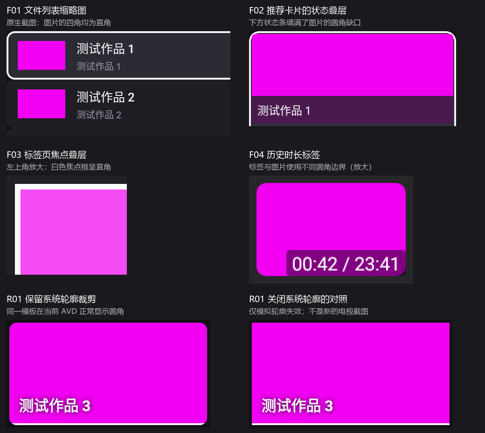
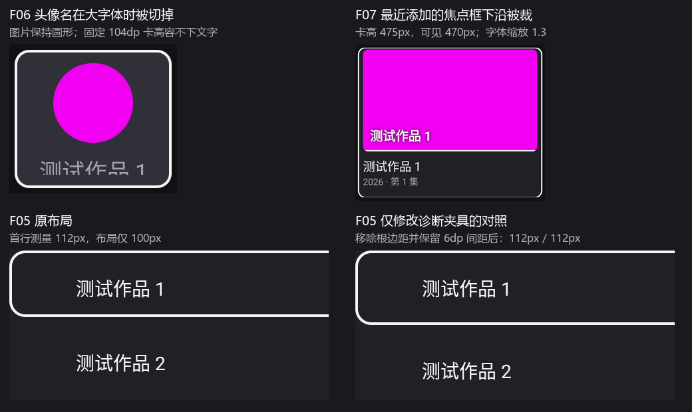
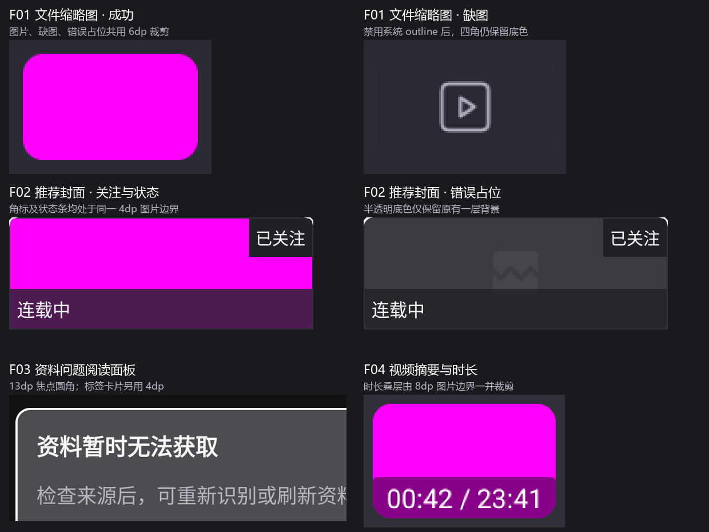
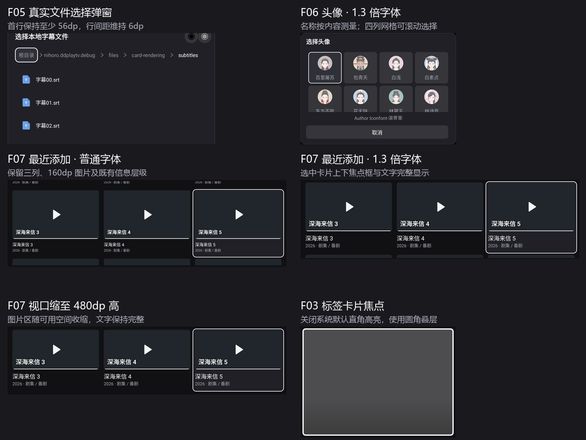

# 全项目圆角与卡片裁切排查

日期：2026-11-01。源码基线：`aa7bfade8`，即已安装的详情页圆角修复之后。本轮为排查，没有修改生产代码、安装电视或执行电视导航。

后续用户已授权修复全部确认问题。下方原始审查证据保留，当前实施状态见“修复跟进”，两阶段结果分别记录。

## 结论

确认 **7 项问题**，另有 **2 类与电视反馈同源的兼容风险**。问题分布在共享图片与叠层、焦点资源和列表尺寸计算，需按公共模板修复，不能只处理某一张封面。

| 编号 | 等级 | 确认的问题 | 影响入口 | 证据 |
| --- | --- | --- | --- | --- |
| F01 | P2 | 视频缩略图完全没有圆角裁剪 | 文件浏览列表，各保留存储来源共用 | 源码 + AVD 正常/缺图/失败截图 |
| F02 | P2 | 状态与关注标签填平封面圆角 | 番剧详情“更多推荐”；追番、云端历史、相关推荐的已关注角标 | 公共模板 + 位图加载路径 + AVD 叠层组合 |
| F03 | P2 | 直角焦点叠层覆盖圆角内容 | 番剧标签列表；资料与识别问题的阅读面板 | 标签列表 AVD；阅读面板为同资源的静态确认 |
| F04 | P2 | 时长标签画到图片圆角缺口中 | 播放历史、弹幕/字幕绑定页的视频摘要 | 共用布局 + AVD 有/无时长标签对照 |
| F05 | P2 | 文件选择弹窗首行被压矮 6dp | 选择弹幕/字幕、常用目录及扫描扩展目录等公共弹窗 | 两种字体下的边距因果对照 |
| F06 | P2 | 头像名称被固定卡高裁掉 | 选择头像弹窗 | 1.3 字体原生截图 |
| F07 | P2 | 最近添加卡片的焦点框下沿被裁 | 媒体库“最近添加” | 1.3 字体：475px 高，仅可见 470px |

| 编号 | 已确认的兼容弱点 | 影响入口 | 当前验证边界 |
| --- | --- | --- | --- |
| R01 | 图片及叠层仍完全依赖 `clipToOutline` | 首页观看足迹、最近添加、全部作品、媒体搜索 | AVD 正常时圆角有效，禁用系统轮廓后四种模板均失去保护；没有新的电视逐页截图 |
| R02 | 文件预览的顶部圆角完全依赖父面板轮廓 | 文件浏览右侧预览，包括视频、缺图/失败及目录背景 | AVD 控制实验复现顶部变直角；实际电视表现待验 |

“已确认弱点”和“电视上已发生同样症状”分别记录。关闭系统轮廓是诊断对照，不能证明电视驱动具体发生了什么。

## 排查覆盖

对当前构建中持有 UI 布局的全部 7 个模块做了 XML 结构扫描：154 份布局、116 个图像/裁剪节点、46 个 RecyclerView 节点。另追踪图片加载、位图圆角、焦点叠层、列表根边距和调用入口。共找到 8 份 XML 中的 9 处 `clipToOutline` 属性，逐项区分了可达页面、已有位图保护和未使用分支。

| 模块 | 布局数 | 本次覆盖 |
| --- | --- | --- |
| `app` | 3 | TV 壳、顶栏、导航及容器；图标与全屏背景的边界 |
| `local_component` | 34 | 首页、最近添加、作品网格、搜索、详情 B、识别问题、历史、资源绑定及弹窗 |
| `anime_component` | 12 | 保留的详情/介绍/推荐/分集、追番、云端历史、标签页及两类共享封面模板 |
| `storage_component` | 22 | 文件列表/预览/路径、存储表单与二维码、投屏入口及横屏资源 |
| `user_component` | 30 | 头像/个人页、设置、扫描/缓存/任务/目录管理及横屏资源 |
| `player_component` | 32 | 控制条、轨道/字幕/弹幕/文件选择面板、截图控件及列表容器 |
| `core_ui_component` | 21 | 通用文件选择、视频摘要、弹窗、偏好设置、焦点资源、圆形头像及新增裁剪容器 |

现有模块关系仍是入口/功能页使用 `core_ui_component` 的公共布局、加载扩展和焦点工具。本次没有引入模块依赖或新的 UI 抽象。

本轮在任务独占 API 34 AVD 上实测 13 个布局场景，分正常字体和 1.3 字体各运行一次。视口为 1920×1080、320dpi，即 960×540dp。复用生产布局和图片加载方法，以本地纯色图隔离海报内容的干扰。

| 实测场景 | 对应设计/实现 | 覆盖状态 |
| --- | --- | --- |
| 首页观看足迹 | Cinema；`item_metadata_continue` | 成功、100% 进度、缺图、失败、DPAD 横移、轮廓失效对照 |
| 最近添加 | Cinema；`item_metadata_landscape` | 成功、进度、缺图、失败、网格 DPAD、字体与视口 |
| 全部作品 | 当前作品网格；`item_metadata_poster` | 成功、缺图、失败、边列/换行、根边距与轮廓对照 |
| 媒体搜索 | 当前搜索弹层；`item_metadata_search` | 成功、缺图、失败、上下移动、轮廓对照 |
| 追番/云端历史/相关推荐（3 场景） | 当前深层页；`item_anime_cinema` | 成功、关注/状态叠层、缺图、失败、DPAD、轮廓对照 |
| 番剧标签 | 当前保留标签页；`item_anime` | 成功、关注、缺图、失败及焦点覆盖 |
| 选择头像 | 当前头像弹窗 | 圆形图片、名称、DPAD、正常/放大字体 |
| 通用文件选择 | 当前公共弹窗；`item_file_manager` | 首行/普通行、DPAD、边距/间距装饰对照 |
| 文件浏览列表与预览 | 已选 C；`item_file_browser`、`fragment_storage_file` | 成功、缺图/失败、目录预览、DPAD、顶部轮廓对照 |
| 历史视频摘要 | 当前共用 `item_storage_video` | 成功、有/无时长、封面失败 |
| 番剧详情海报 | 当前保留的番剧详情 | 成功、缺图、既有位图圆角 |

夹具检验公共模板的叠层组合，不等同账号和业务流程验收。实际代码中，追番和云端历史默认 `showStatus=false`；“更多推荐”才启用状态条。关注角标的真实条件是已登录且作品已关注。云端历史夹具还显示了共享模板支持的状态条，该组合不作为真实云端历史入口的缺陷证据。推荐内容装入保持相同尺寸和 padding 的 FrameLayout，以承载生产布局，未执行真实 Fragment/账号请求。

加载中占位资源也做了源码追踪；本轮缺图/失败状态使用生产 fallback/error 资源。没有穷举所有网络加载时序、真实账号及全应用空/错误业务流程。154 份布局的扫描覆盖与 13 个布局场景的运行覆盖不能互相替代。

## 问题证据与最小修复方向

### F01：文件视频缩略图没有圆角

- 证据：`storage_component/src/main/res/layout/item_file_browser.xml:3` 的 `cover_iv` 是普通 ImageView；`StorageFileAdapter.kt:87–93` 改为 `CENTER_CROP` 后直接 `load`，既无父容器裁剪，也无圆角转换。成功图及 `file_browser_placeholder.xml` 均可填满矩形。
- AVD：102×62px 缩略图中心和四角都是输入纯色 `#F100F1`，移动焦点后相同；缺图/失败占位也呈直角。
- 设计依据：已选 [文件浏览 C](../prototypes/tv-ui/files-prototype.html?variant=preview) 的 `.thumb` 明确有圆角和 `overflow:hidden`。
- 修复方向：给缩略图区建立实际裁剪边界，覆盖成功图和占位图。只影响图片区，不改变目录图标/文件行焦点层。
- 复杂度：复用已有裁剪能力即可，无需新增加载器或按来源分别修复。

### F02：位图圆角不能保护同级标签

- 证据：`anime_component/src/main/res/layout/item_anime_cinema.xml:15–45` 的内部 FrameLayout 不裁圆角；状态 TextView 使用矩形色块，关注 TextView 贴到右上角。`ImageViewExtension.kt:23` 的 `RoundedCornersTransformation` 只处理图片。
- AVD：推荐场景的底部角点被状态色块填入；启用关注角标后，右上角也被覆盖。外层卡片的 `clipToOutline` 保护的是整张卡片，无法保护位于卡片中段的图片区下角。
- 入口映射：`AnimeCinemaAdapter.bind` 统一服务追番、云端历史和推荐；状态条影响“更多推荐”，关注角标按前述登录/关注条件触发。
- 修复方向：图片区、状态条和角标使用同一个裁剪边界，外层焦点框独立保留。
- 复杂度：修一份共享模板，保留现有状态条件及数据流，不需要重写 adapter。

### F03：共享焦点资源没有圆角

- 证据：`core_ui_component/src/main/res/drawable/background_focus_overlay.xml:3` 的 focused/pressed shape 没有 `<corners>`。当前消费者是 `item_anime.xml:60` 的整卡叠层，以及 `activity_metadata_match.xml:36` 的阅读面板 foreground。
- AVD：番剧标签首张卡片获取焦点后，四个极角均为白色描边像素，形成直角框；失焦图片仍有 4dp 位图圆角。
- 阅读面板静态证据：背景 `cinema_surface` 为 13dp 圆角，同一个矩形 foreground 覆盖其全边界。本轮没有单独运行该阅读页。
- 修复方向：为两个消费者配置与各自背景半径一致的焦点边界；不要把 4dp 和 13dp 的两种容器强制使用同一个固定半径。
- 复杂度：局部 drawable/布局调整，不新增焦点体系。

### F04：时长标签越过图片圆角

- 证据：`core_ui_component/src/main/res/layout/item_storage_video.xml:43–69` 的时长标签是 ImageView 的同级控件；图片加载器转换半径为 5dp，`background_duration.xml` 标签半径为 2dp，周围 `cinema_image` 背景又是 8dp。两者没有共同裁剪层。
- AVD：同一位置有/无时长标签对照，在图片 5dp 圆角的右下缺口中检测到 20 个改变像素，说明标签画到了图片轮廓之外。截图可见右下角边界不一致。
- 入口映射：`PlayHistoryAdapter.kt:83` 使用这份布局；`activity_bind_extra_source.xml:105–106` 也 include 同一布局，由 `VideoItemLayout` 填充封面和时长。
- 修复方向：把图片及其时长叠层放到同一图片裁剪区域；保持根卡片与更多操作按钮的焦点结构。
- 复杂度：一次公共布局修正覆盖两个真实入口，无需给两种调用分别加位图转换。

### F05：通用文件选择首行高度不一致

- 证据：`core_ui_component/src/main/res/layout/item_file_manager.xml:15` 使用根 `layout_marginBottom="6dp"`，由 `FileManagerDialog.kt:172–181` 放入垂直 DpadRecyclerView。
- 两种字体均复现：首行 measuredHeight 为 112px，实际 height 为 100px；后续行是 112/112px。首行低于声明的 56dp 最小高度。
- 因果对照：仅在诊断夹具中移除根底边距，改用 6dp `ItemDecorationSpace` 保留间距，首行和普通行全部变为 112/112px。生产布局未修改。
- 影响：弹幕/字幕文件选择、常用目录和扩展扫描目录共用此弹窗，首行密度与焦点框高度会不同。
- 修复方向：对这份已确认异常的列表改用间距装饰。其他根边距没有出现相同测量差异的模板不应批量替换。

### F06：头像卡片固定高度裁掉名称

- 证据：`user_component/src/main/res/layout/item_user_cover.xml:5` 固定 104dp，包含上下共 20dp padding、60dp 头像及 8dp 间隔，名称只剩 16dp 空间；名称使用 `Cinema.Body` 的 13sp 字体和行间距。
- AVD：1.3 字体下，头像仍为完整圆形，名称下半部分被卡片的 padding/内容边界裁掉。DPAD 仍能到达卡片，问题是内部文字布局。
- 修复方向：卡片按内容测量高度，以原尺寸作为最小值，确保名称完整可读，保留现有可滚动头像网格。
- 复杂度：一处尺寸约束修正，无需更换圆形头像控件。

### F07：放大字体后最近添加的整卡高于视口

- 证据：`local_component/src/main/res/layout/item_metadata_landscape.xml:2` 的图高固定 160dp，标题/副标题随字体增大；`fragment_media.xml:18` 的列表占据页内剩余高度。
- AVD：字体 1.3 时选中卡片高 475px，可见高 470px，焦点框下沿被裁掉 5px。初始、DPAD、缺图和失败状态均相同。正常字体下该场景完整可见。
- 影响：此时不是图片自身圆角失效，而是选中卡片超过可用垂直视口；此前左右边沿的修复不能解决这个高度问题。
- 修复方向：确保整卡高度不超过可用视口，大字体时按可用高度调整图片区，保持既有三列和内容层级。
- 复杂度：针对当前网格尺寸处理，无需重建整个媒体库页面。

## 两类兼容风险

### R01：四个维护中的元数据模板缺少独立裁剪保护

`MetadataCardAdapter.kt:58–62` 的四个实际调用分支分别为 continue、landscape、poster、search。图片在 `99–103` 行直接 Coil 加载；圆角全靠布局轮廓。正常 AVD 四种模板有圆角，关闭系统轮廓后，完整可见且中心为输入纯色的卡片出现直角，进度条也能越过下角。

这与详情 B 修复前的实现方式相同，说明兼容保护尚未推广。**不据此宣称这四个页面已在用户电视上逐页复现。** 建议后续修复复用已存在的 `RoundedArtworkLayout`，只包裹图片区及叠层，保留卡片焦点边界。没有必要引入第二套图像管线。

`item_metadata_row.xml` 也有该模式，但四个构造调用均使用其他 flags，当前没有可达消费者，因此作为未使用分支记录，不增加当前受影响页面数。

### R02：文件预览的外层轮廓是唯一保护

`storage_component/src/main/res/layout/fragment_storage_file.xml:7` 的预览面板只有 `clipToOutline=true`。其内部 `preview_art` 的背景和整幅图片、失败占位均为矩形。AVD 正常时顶部圆角存在；关闭轮廓后顶部两角变直，目录渐变背景也依赖同一层保护。

建议为面板/图片区提供实际内容裁剪，遵循 C 稿“面板顶角圆、内部图文分界平直”的结构。不能把预览图四角都简单变圆，造成与面板分段不符的新差异。

## 已排除与验证边界

- 详情 B 的剧照/海报已经用 `RoundedArtworkLayout`，集卡间距也已修正。本轮确认源码处于 `aa7bfade8`，继承[此前四项 AVD 回归](../../docs/superpowers/plans/2026-11-01-home-watch-history.md#真机截图反馈圆角兼容修正2026-11-01)，未重复运行这些未改变的检查；电视视觉验收仍独立待验。
- `CircleImageView.java:103–110` 使用 BitmapShader/`drawCircle`。本轮两种字体下圆形图片均正常，F06 是名称裁切，不能归因于圆形绘制。
- 番剧海报和普通番剧封面已有 4dp 位图圆角；未带叠层的成功图正常。不能把所有 `clipToOutline` 搜索结果都当作直角缺陷。
- 海报网格、番剧网格和头像卡片虽有根边距，两种字体下测量/布局尺寸一致，没有复现详情集卡式的宽度损失。只针对 F05 的实证问题建议替换间距方式。
- 屏外的相邻滚动项被裁掉是列表的正常表现。本轮按完整可见图、选中焦点边界分别统计；F07 只统计选中卡片的裁切。
- 文件夹内缩图标、二维码、全屏背景及视频画面不要求与海报使用同一种圆角。播放器面板的图片/图标多有内距；本轮没有发现需要按封面模式处理的新增图片越界。
- 退役的旧首页/季度/番剧搜索不计当前问题；仅静态扫描、未单独运行的设置/表单/真实账号/协议/播放流程，没有标成视觉通过。

## 工具与结果

- XML：Python 标准 XML 解析器扫描 154 份布局，0 解析失败；检查了资源限定目录和全部现存根边距。
- ast-grep `0.40.5`，Kotlin，范围为上述 7 模块 `src/main/java`。`MetadataCardAdapter($$$)` 命中 4 处；`$V.loadAnimeCover($$$)` 3 处；`$V.loadVideoCover($$$)`、`$V.loadStorageFileCover($$$)` 各 1 处；圆角转换 4 处；`setImageBitmap` 5 处。直接 `.load` 模式命中 7 处，其中一个是弹幕加载，已排除。`MetadataCardAdapter.kt` 有 6 个 AST 解析错误节点，遗漏的图片调用使用 `rg` 和原文件补核，AST 命中数没有作为穷尽证明。
- Claude Context 当前不可用，按项目规则使用 `rg` 与定向文件读取，没有安装工具或重建索引。重复率/安全审查不属于本次视觉范围，未运行 jscpd/semgrep。
- Debug 与诊断 APK 构建均检查了 Gradle 尾部：应用/初次诊断构建 `BUILD SUCCESSFUL in 1m 7s`；完整状态诊断构建 7s；最终边距对照诊断构建 `BUILD SUCCESSFUL in 8s`。本轮没有运行全量 JVM/lint，也没有据此宣称它们通过。
- 两个诊断方法分别在字体 1.0/1.3 下运行，共 4 次 `OK (1 test)`：状态/几何采集 79.327s、79.676s；边距对照 8.076s、8.069s。**通过表示采集完整，不表示所采集的 UI 没有缺陷。**
- 两种字体各 64 个状态截图，边距对照各 4 个，共 136 份截图/几何采样。关键差异截图已实际查看；没有把全部截图采集等同全应用视觉验收。早期诊断遇到“硬件位图不能绘制到软件 Canvas”和主线程重复调度两项夹具错误，修正后重跑；还增加了滚动位置稳定检查，使用上述最终采样作结论。
- 任务 AVD `emulator-5574`、私有 ADB 5061 已关闭，字体恢复 1.0。电视仍是之前安装的 4.2.4 / 71；本次未部署变更。

可保存的[测量摘要、源码哈希与角点样本](ui-rounding-audit-2026-11-01/measurements.json)与上方两张证据图随本报告保存。完整夹具、原始 JSON、原生截图和构建/运行日志在项目 `.tmp/rounding-audit/`；这是临时诊断目录，不是长期测试套件。

复现入口：临时 init script 将 `.tmp/rounding-audit/androidTest` 加入 app 的 AndroidTest 源集，不修改生产/测试源码目录。构建命令为 `.tmp/watch-history/gradle.ps1 --offline -I .tmp/ui-repairs-local.gradle -I .tmp/tmdb-validation.gradle -I .tmp/play-history-short-temp.gradle -I .tmp/rounding-audit/sources.gradle :app:assembleDebug :app:assembleDebugAndroidTest`。在独占 AVD 运行 `RoundedArtworkAuditInstrumentedTest`，输出目录通过 instrumentation 参数 `output` 指定。生产包与已安装电视不参与诊断夹具操作。

原始审查建议先统一公共图片区与叠层的裁剪，再处理焦点资源与已确认的尺寸约束。现有 `RoundedArtworkLayout` 要求背景为带统一半径的 GradientDrawable，不能直接套在使用 selector 背景的整卡焦点容器上。以上保留修复前证据；当前实施与验证状态以下方跟进为准。

## 修复跟进（2026-11-01）

范围为用户确认的 F01–F07，维持 Cinema、文件浏览 C、详情 B 及真实数据/导航。本地实施阶段没有版本递增、提交或电视操作；用户随后授权的电视安装见文末。R01/R02 仍按兼容风险单列；本次修改最近添加时，同时为其图片区提供了实际裁剪，其余风险模板未扩项。

| 问题 / 页面状态 | 设计与实施 | 回归检查 | 当前状态 |
| --- | --- | --- | --- |
| F01 文件列表：成功、加载占位、缺图、失败、目录切换 | C 的缩略图圆角；新增 6dp 图片裁剪容器，目录/视频动态宽度移到容器 | 软件透明角点、硬件有/无图片对照，文件浏览实际 DPAD 回归 | 两种字体本地通过；TV 待验 |
| F02 关注/历史与推荐：关注角标、推荐状态条、正常/缺图/失败 | 保留 4dp 半径，图片与标签共用 RoundedArtworkLayout；半透明占位背景仅保留父容器一层 | 有/无状态条两种组合的软/硬件角点断言 | 两种字体本地通过；TV 待验 |
| F03 标签卡片与资料问题阅读面板：焦点、阅读/按钮切换 | 分别使用 4dp、13dp 焦点资源，并关闭这两个控件的系统默认直角焦点高亮 | 透明角点、13dp 内侧样点、焦点可见/上下切换；真实问题页返回恢复 | 两种字体本地通过；TV 待验 |
| F04 历史与绑定视频摘要：时长、封面失败、更多操作 | 图片与时长共用 8dp 裁剪层，保留 binding ID 与根卡片/更多按钮 | 软/硬件角点，左右焦点切换 | 两种字体本地通过；TV 待验 |
| F05 文件选择：首行、普通行、滚动/选择 | 去根底边距，公共 FileManagerDialog 用 ItemDecorationSpace 保留 6dp 间距 | 真实弹窗首行测量/实际高度一致且至少 56dp，第二行同高、间距 6dp；DPAD 选择第 7 项 | 两种字体本地通过；TV 待验 |
| F06 头像：名称、第二行、选择 | 保留 104dp 最小高，按内容测量，保留四列与 224dp 滚动视口 | 真实 UserCoverDialog 前两行文字与焦点、滚动及第 8 项选择；未穷举全部头像行 | 两种字体本地通过；TV 待验 |
| F07 最近添加：普通/1.3 字体、窗口高度变化、边列/换行 | MetadataLandscapeLayout 扣除列表 padding/边距/间距后限制整卡高度；加权图片区优先收缩；视口高度变化时触发重新测量 | 焦点完整边界、文字高度、视口缩至 480dp 后恢复与 DPAD 操作；保留三列、原边沿留白与信息层级 | 两种字体本地通过；TV 待验 |

维护回归位于 `app/src/androidTest/java/com/okamihoro/ddplaytv/ui/tv/SharedCardRenderingInstrumentedTest.kt`，7 项测试含产品行为断言，区别于之前只采集数据的临时诊断。本次共修改 15 个生产文件（含 3 个新增文件），新增这份维护测试；没有改变模块依赖、扫描、历史、播放队列或版本号。并行整剧播放任务的改动保留，各自验证范围分别记录。

### 构建、测试和 DPAD 结果

全部日志位于 `.tmp/rounding-fixes/`，以下结果均读取了终态。构建复用 `.tmp/watch-history/gradle.ps1 --offline` 和本机 init 配置；格式检查另用本任务 `scoped-format.gradle`，只检查本任务 Kotlin 文件，不代表全项目格式清理。

| 检查 | 日志 | 结果 |
| --- | --- | --- |
| 共享 UI Debug 构建、JVM、Debug lint | `core-verification.log` | `BUILD SUCCESSFUL in 3m 6s` |
| app/anime/local/storage/user/core UI 的 Debug lint、相关 JVM、定向 ktlint | `validation-2.log` | `BUILD SUCCESSFUL in 53s` |
| Debug/AndroidTest APK、app/local lint、相关五模块 JVM、定向 ktlint | `final-verification.log` | `BUILD SUCCESSFUL in 25s` |
| 最后去掉 F02 重复半透明背景后的 APK 与 anime/app lint | `placeholder-final-verification.log` | `BUILD SUCCESSFUL in 19s` |
| 最终定向格式整理 | `format-final.log` | `BUILD SUCCESSFUL in 8s` |
| 7 项维护回归，字体 1.0 / 1.3 | `test-normal-final.log` / `test-font130-final.log` | `OK (7 tests)`，43.929s / 43.254s |
| 原有焦点、文件浏览与资料问题回归，字体 1.3 | `regressions-font130.log` | `OK (7 tests)`，28.6s |
| 头像首行补拍与选择 | `avatar-first-font130.log` | `OK (1 test)`，4.593s |
| Cinema 首页→媒体库→搜索→设置、设置持久化/还原及 BACK | `shell-settings-final.log` | `OK (1 test)`，7.036s |
| F02 最后背景修正后，字体 1.0 / 1.3 | `anime-background-normal.log` / `anime-background-font130.log` | `OK (1 test)`，8.428s / 8.147s |

五个相关模块 JVM XML 合计 **77 项，0 失败、0 错误、0 跳过**：core UI 17、local 22、storage 23、anime 12、user 3。上述本地门禁没有重新运行全项目 JVM 或 Release 构建；后续交付的 Release 构建另记于文末，并行队列任务的全项目计数不归入本次验证。

原生检查合计 **15 个不同场景**：新增 7 项、原有回归 7 项、Cinema 1 项；双字体重复、头像补拍和 F02 最后复测不重复计数。原有回归覆盖 `FocusClippingInstrumentedTest` 当前 3 项，文件浏览的目录返回/重建与延迟封面/分页失败恢复 2 项，以及资料问题页的缺失文件返回、异步识别后焦点恢复 2 项。所有相关交互由 DPAD/BACK 驱动。

### 中间失败与修正

- `build-1.log`、`build-2.log` 明确为 `BUILD FAILED`：并行任务的 `SeriesPlaybackDescriptor` 分支未补全、`MetadataPlaybackRequests` 空值类型未对齐；本任务未代改这些播放代码，最终构建成功。
- `validation-1.log` 因格式任务过早筛选源文件，仍扫描到并行任务未整理的代码而失败。随后在任务图就绪时再次定向筛选，并在最终日志输出 `ROUNDING_FORMAT_SOURCES`；最终门禁通过。
- 首轮原生检查包含夹具错误和真实缺陷。半透明占位不能断言内部 alpha 必为 255；弹窗可见矩形需要加窗口屏幕偏移；阅读面板应模拟真实 Activity 的首个可用动作焦点。修正这些夹具后重跑。
- F03 仅给 selector 加圆角仍会被系统默认直角焦点高亮覆盖，现关闭两个消费者的默认高亮。F07 仅限制测量高度仍会复用旧尺寸，在缩小视口时残留 16px 裁切；现监听列表高度变化并触发重新测量，缩小/恢复均通过，没有关闭 RecyclerView 测量缓存。
- `shell-settings-normal.log` 初次在 `@Before` 因缺少参考图片失败；从现有原型夹具补齐到本任务模拟器后，不改生产代码，最终 Cinema 检查通过。最后 F02 将原 ImageView 的半透明背景移到父容器，去掉重复一层，重新构建、lint 并在两种字体下定向通过。

### 截图对比与剩余边界

修复前复用上文两种字体的测量/截图，并重新渲染、实际查看 C、Cinema 媒体库和头像网页原型。修复后实际查看原生圆角/时长/焦点图、两种字体的布局图、1.3 字体头像首行/第二行和最近添加全高/缩小视口；另查看了使用同组 4 幅参考图片的真实 Cinema 媒体库页面。三列、信息位置及原有导航保持选定设计；本次没有重设计其他页面。

下图裁自最终原生截图。纯色输入用于检验四角，不是生产图片。F02 图已换成最后去重背景后的两种字体截图；拼图与完整图均实际查看。头像首行截图下方的相邻项处于滚动区边缘，第二行取得焦点并滚动后完整可见，不属于内部名称裁切。

[1.3 字体头像首行完整截图](ui-rounding-audit-2026-11-01/repair-avatar-font130.png)、[最近添加完整截图](ui-rounding-audit-2026-11-01/repair-library-font130.png)和[源码/依赖、APK 哈希及验证摘要](ui-rounding-audit-2026-11-01/repair-results.json)随报告保存。完整日志与原生图片在 `.tmp/rounding-fixes/`；目录里保留早期失败图，不能把所有文件都视为最终通过截图。

任务环境为 API 34、1920×1080、320dpi 的只读 `emulator-5574`，私有 ADB 5063。测试结束已读回字体 1.0，关闭本任务模拟器与私有 ADB 并确认进程退出；没有操作默认 ADB 或其他任务设备。

**F01–F07 的实施、构建/测试、DPAD 与本地截图检查已完成，并于 20:23:29 安装到电视；物理 TV 与用户视觉验收仍待进行。** R01 中最近添加分支已因 F07 获得实际图片/叠层裁剪；观看足迹、全部作品、媒体搜索其余三个模板及 R02 文件预览仍为独立兼容风险，不作已修复声明。真实账号、所有协议、网络加载时序、全部业务空/错误页与其他设备组合未穷举。

## 修复后的电视 Release 安装（2026-11-01 20:23）

用户要求“安装到 tv”。从 `aa7bfade8` 加当前工作区构建，包含 F01–F07 修复和另行完成验证的整剧播放队列。安装前后核对圆角任务的 17 个源码/依赖文件、队列任务的 20 个 Kotlin 文件，均与已验证 SHA-256 一致；本次没有修改生产代码、再次递增版本或重复未变的行为测试。

- 构建：`.tmp/watch-history/gradle.ps1 :app:assembleRelease --offline`，读取尾部确认 **BUILD SUCCESSFUL in 1m 30s**，689 个任务。
- 产物：`app/build/outputs/apk/release/ddplaytv_v4.2.4_arm64-v8a-release.apk`，68,319,361 字节；包名 `com.okamihoro.ddplaytv`、版本 `4.2.4` / `71`、ARM64，未启用 debuggable。`apksigner verify` 通过，v2 签名有效，证书与电视现有包一致。
- 安装：私有 ADB 5065 对 VIDAA TV `192.168.31.70:5555` 执行 `install -r`，返回 **Success**；设备读回 `lastUpdateTime=2026-11-01 20:23:29`、版本 `4.2.4` / `71`。
- 数据保留：没有卸载或清空数据；安装前后 UID 10111、首次安装时间 `2026-02-12 10:47:55` 一致。
- 从电视拉取安装后的 APK，与交付文件 SHA-256 一致：`27a1b4088b5ee1d35cc6f08a4b71c5ab8fdb84a3dffad23e78b998d9b262b427`。这次更新替代 18:07:29 的包。

[交付身份、安装前后信息与源码哈希](ui-rounding-audit-2026-11-01/tv-delivery.json)随报告保存；完整构建、签名、包信息、安装日志与 APK 快照在 `.tmp/rounding-fixes/release-delivery/`。已断开电视并关闭私有 ADB 5065，确认监听端口关闭，未操作默认 ADB。没有启动、导航、播放或截取电视画面，不将安装成功记作实际圆角效果或运行验收；未提交代码。
